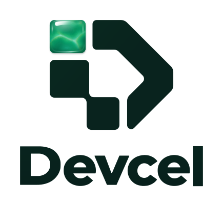
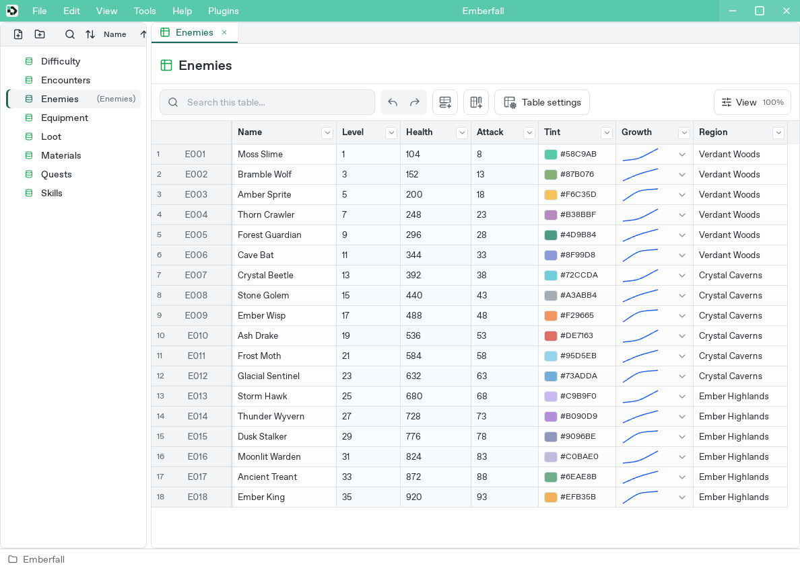
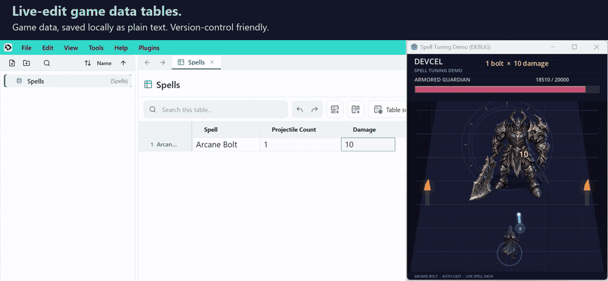

<p align="center">
  <picture>
    <source media="(prefers-color-scheme: dark)" srcset="assets/brand/svg/devcel-lockup-stacked-inverse.svg">
    <source media="(prefers-color-scheme: light)" srcset="assets/brand/svg/devcel-lockup-stacked-transparent.svg">
    
  </picture>
</p>

# Devcel

Devcel is a table editor for game master data. Define tables and edit their contents in Studio, with projects, tables, and shared interfaces saved locally as TOML text files. Keep them in version control to review diffs and track changes alongside your game code.



**[Get Studio](https://github.com/devcel-dev/devcel/releases)** · **[Get started](docs/manual/getting-started.md)** · **[Read the manual](docs/manual/README.md)**

## Define, calculate, and version game data

- **Types.** Use integers for HP, curves for growth, and colors for presentation. [Column types](docs/manual/data-types.md) define valid inputs and how the game reads each value.
- **References.** [Select rows in other tables](docs/manual/data-types.md#reference-select-another-row) to connect items, materials, and recipes. Follow a reference to inspect the related data.
- **Formulas.** Derive stats and prices from other fields instead of updating dependent values by hand. [Formulas](docs/manual/formulas.md) recalculate when inputs change; runtime exports contain their evaluated results.
- **Content Versions.** Assign versions to rows and columns to [control what ships](docs/manual/versions.md). Keep upcoming content in the project while exporting only the data and generated code for the target version.
- **Interfaces.** Define shared fields such as `hp` and `attack` once, then apply the [Interface](docs/manual/interfaces.md) to player and enemy tables. Review and synchronize definition changes while each table keeps its own row values.

Connect these tables to your game to shorten the edit-and-test cycle. With automatic import and runtime reloading configured, saved edits can reach the running game without a restart. Follow the [Unity](docs/manual/unity.md) or [Godot](docs/manual/godot.md#3-edit-in-studio-and-check-automatic-import) setup guide; the [importer overview](importers/README.md) covers other integrations.



For a playable sample with mining, trading, crafting, and combat, see [Forge & Field](examples/sample-rpg/README.md).

## User manual

**[Open the manual](docs/manual/README.md)**

- [Install Studio](docs/manual/installation.md) / [Create a project](docs/manual/getting-started.md)
- [Edit tables](docs/manual/studio.md) / [Types and references](docs/manual/data-types.md) / [Interfaces](docs/manual/interfaces.md)
- [Formulas](docs/manual/formulas.md) / [Function reference](docs/manual/formula-reference.md)
- [Versioned exports](docs/manual/versions.md)
- [Godot](docs/manual/godot.md) / [Unity](docs/manual/unity.md)
- [CLI](docs/manual/cli.md) / [Synchronization and files](docs/manual/collaboration.md)
- [Settings and plugins](docs/manual/settings-and-plugins.md) / [Troubleshooting](docs/manual/troubleshooting.md)

## Development

See [Building Studio](docs/development/build-studio.md) and [Contributing](CONTRIBUTING.md) for setup and development guidance. [Installation](docs/manual/installation.md) lists system requirements; [Known limitations](docs/manual/known-limitations.md) records design limits and validation gaps.

## Repository layout

```text
devcel-core/       Data, formulas, persistence, P2P, and code generation
devcel-studio/     Tauri / React desktop application
devcel-cli/        devcel command-line application
devcel-runtime/    Native reader for exported data
importers/        Unity / Godot / MV–MZ / WOLF / UE5 / GameMaker / Cocos / Defold / JS–TS
examples/         Integration samples
devcel-studio/app-settings/  Studio settings, themes, plugins, and translations
docs/manual/      User manual
docs/development/ Build, localization, and extension guides
docs/reference/   Authoring and runtime API reference
```

See the [documentation index](docs/README.md) and [importer overview](importers/README.md).

## Licensing

Licenses apply per component. Core, CLI, runtime, and engine SDK first-party code are MIT licensed; Studio is GPL-3.0. See [LICENSE-NOTICE](LICENSE-NOTICE) for component boundaries. Consult each component's LICENSE and retain applicable third-party notices.
