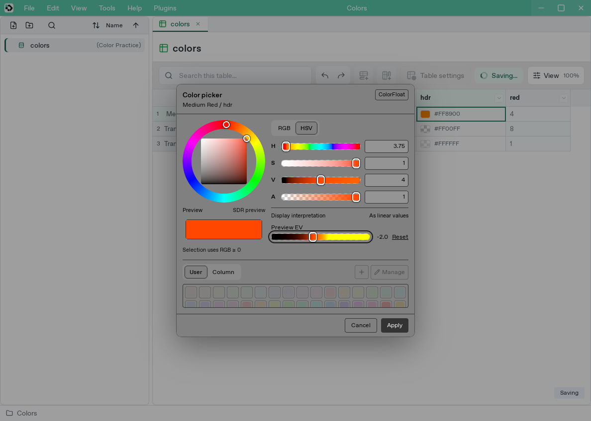
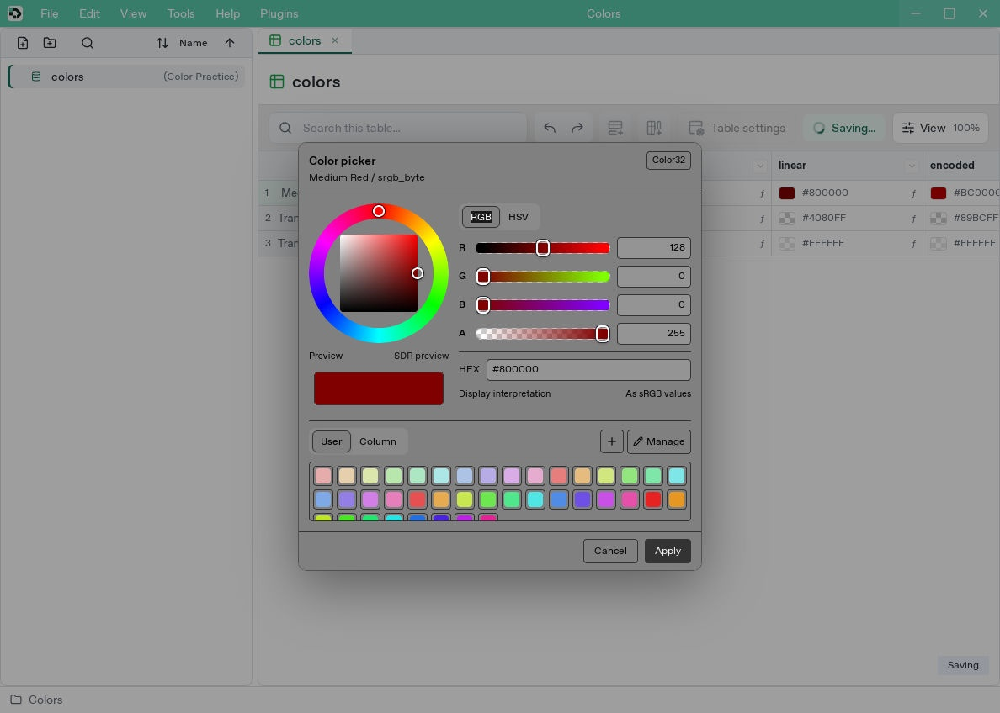
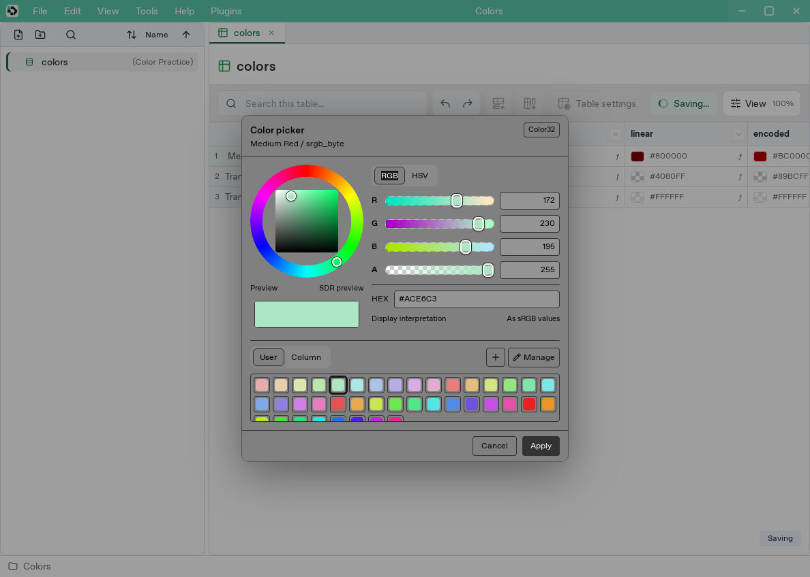
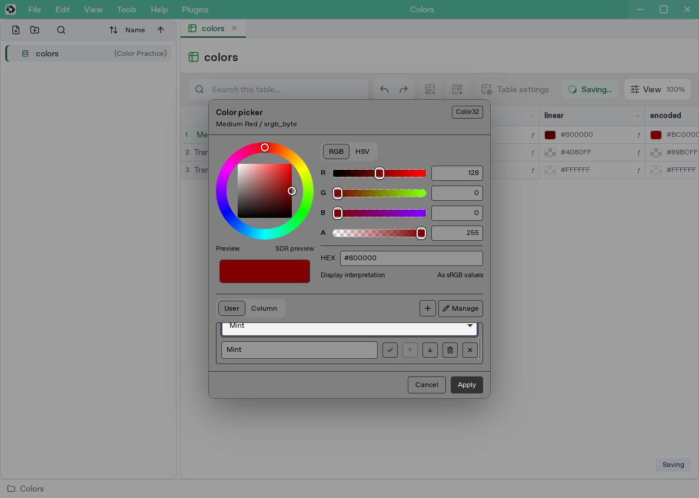

# Edit colors, opacity, and HDR

[Manual](README.md) / [Types and references](data-types.md) / [Functions](formula-reference.md)

Colors have four components: red, green, blue, and alpha (opacity).

| Type | RGB | Alpha | Default |
| --- | --- | --- | --- |
| Color32 | Integers 0–255 | 0 transparent, 255 opaque | `[255,255,255,255]` |
| ColorFloat | 32-bit floating point; negative and above-one values allowed | 0 transparent, 1 opaque | `[1.0,1.0,1.0,1.0]` |

Interpreted as linear, ColorFloat RGB `4` has four times the intensity of reference white `1`. Values must be finite and within float32 range; saving rounds them to float32 precision. RGB survives even at zero alpha (straight alpha).

Both cell types show a swatch and `#RRGGBB`. Color32 shows stored RGB as hex. ColorFloat shows an approximate SDR preview under the current display interpretation. The checkerboard reveals transparency. Read full canonical RGBA values, including negative/HDR channels, in the tooltip or picker. Preview formatting leaves saved, copied, and exported values intact.

## Open the color picker

1. Open a color cell's picker.
2. Click or drag the outer hue ring, then choose saturation horizontally and brightness vertically on the center plane. The selected hue survives white or black so moving the plane can restore its color.
3. Use RGB/HSV tabs beside the ring, then sliders or numeric fields. Alpha is shared. The preview below the ring sits beside hex, interpretation, and exposure controls. Each slider's background previews the result at that position.
4. Color32 hex accepts six-digit `#RRGGBB` and preserves current alpha. Edit alpha in the A field. ColorFloat numeric fields accept negative and above-one RGB.
5. Check opacity against the checkerboard and choose **Apply**.

Arrow keys adjust the ring and plane; Shift makes larger changes. Opening a negative-RGB color preserves it. Manipulating the hue ring or HSV chooses a nonnegative color, while changing hue preserves HDR brightness rather than clipping it to one.

Dragging edits a draft. Cancel, Esc, or closing preserves the original input. An applied edit is one grid undo step. Formula cells can be inspected in the picker; edit the formula itself to change their value.

Project header colors use the same picker with opaque SDR UI colors, including existing custom colors.

## Separate stored values from their appearance

Color32 and ColorFloat describe precision. Choose the picker's display interpretation as **sRGB values** or **linear values**. Defaults are sRGB for Color32 and linear for ColorFloat. Per-type interpretation settings are shared by grid and picker and retained for the next opening. Preview exposure resets to EV=0 each time.

Interpretation and preview EV change appearance only. Edit ColorFloat's numeric RGBA fields to change saved HDR values.

### HDR and SDR preview

- Linear RGB `1` is reference white. EV +1 doubles preview RGB intensity; EV −1 halves it. Alpha stays unchanged.
- SDR display clips below-zero values to zero and above-one values to one. Lower EV to inspect differences between bright HDR values.
- On eligible environments, extended WebGPU output is used. Unsupported output, rejected configuration, or device loss falls back to SDR.
- HDR depends on the display, OS settings, WebView, and GPU path. The status indicator describes that path; verify actual brightness on a supported HDR display.

## Precision conversion and color-space conversion

Compare these formulas in a ColorFloat column:

| Formula | Red result | Interpretation for comparison |
| --- | --- | --- |
| `=COLOR_TO_FLOAT(COLOR32(128,0,0,255))` | About 0.50196 | sRGB |
| `=SRGB_TO_LINEAR(COLOR_TO_FLOAT(COLOR32(128,0,0,255)))` | About 0.21586 | linear |
| `=LINEAR_TO_SRGB(COLORFLOAT(0.2158605,0,0,1))` | About 0.50196 | sRGB |

`COLOR_TO_FLOAT` divides by 255. Apply `SRGB_TO_LINEAR` or `LINEAR_TO_SRGB` explicitly wherever your data needs that conversion. Alpha remains unchanged by transfer functions.

`COLOR_TO_BYTE` multiplies normalized channels by 255 and rounds. Negative or HDR inputs are range errors. To deliberately fit SDR, write `COLOR_TO_BYTE(CLAMP_COLOR(...))`.

Other useful expressions include `COLORFLOAT(4,0.5,-0.2,1)`, `hdr.r`, and `EXPOSURE(hdr,1)`. Use `GAMMA_DECODE`/`GAMMA_ENCODE` for arbitrary gamma and `LERP_COLOR` for interpolation. See the [function reference](formula-reference.md#color) for argument and return types.

## Try the sample and read colors in a game

The [color sample](../../examples/color-types/README.md) combines HDR, transparent RGB, normalization, and sRGB conversion.

Saved table inputs use canonical RGBA-array strings. JSON output preserves type information and canonical RGBA representation. Runtime readers use dedicated four-component types; generated C#/C++ exposes `DevcelColor32` and `DevcelColorFloat`. Column background colors and project header colors are separate UI decorations stored as hex.

The picker uses an achromatic middle-grey surround for color previews and palette tiles, with higher-contrast controls for editing. This is a consistent viewing aid, not a guarantee of perceptual neutrality on every screen or under every viewing condition. Selection indicators remain achromatic.

## Choose a swatch

The picker has a **User** tab and, when a column is available, a **Column** tab. Select a compact 24px swatch; hover or focus it to see its name. Scroll the list when there are many entries. **Manage** adds, renames, reorders, or removes user swatches.

- User swatches are personal app settings shared across projects.
- Column swatches are saved in that column definition and are independent of same-named columns elsewhere. Interface-owned columns inherit their source definition's swatches.
- A swatch preserves its type and all RGBA channels, including alpha. Selecting it restores that alpha, unlike editing hex, which preserves the current alpha.
- Different precision types are not implicitly converted. Project colors accept opaque Color32 swatches.
- Swatch previews follow the current interpretation and EV, without baking either into stored values.

Choosing a swatch changes the draft; **Apply** confirms the cell and Cancel leaves it unchanged. Editing the user swatch collection saves personal settings; editing column swatches is confirmed with column settings.
