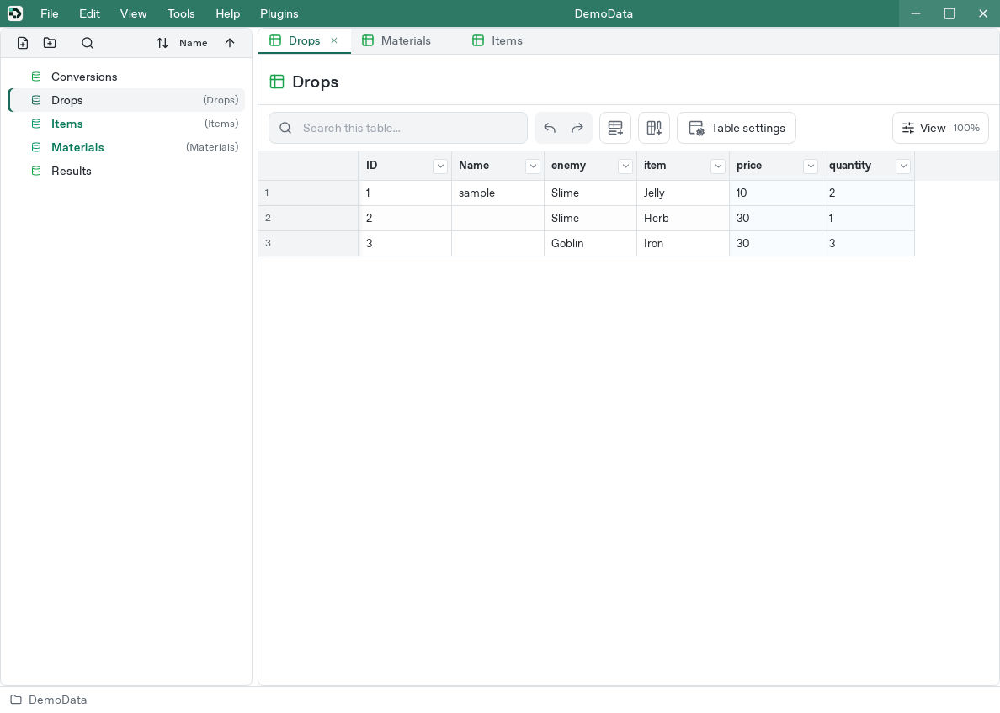
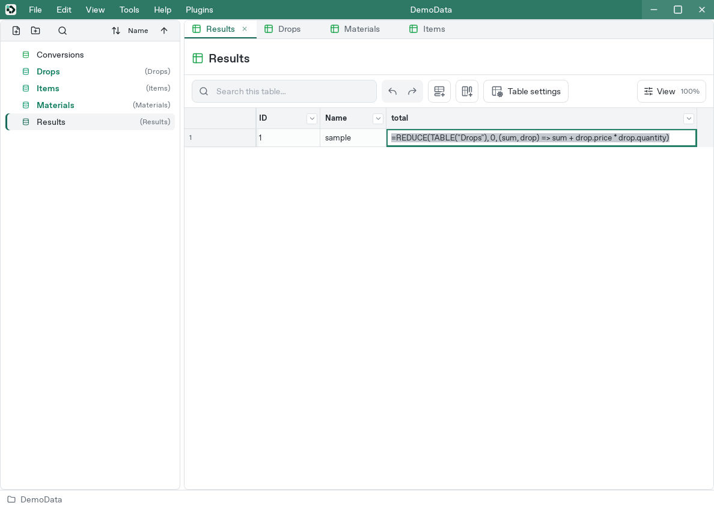
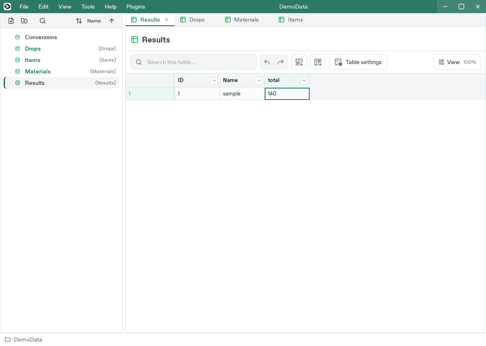
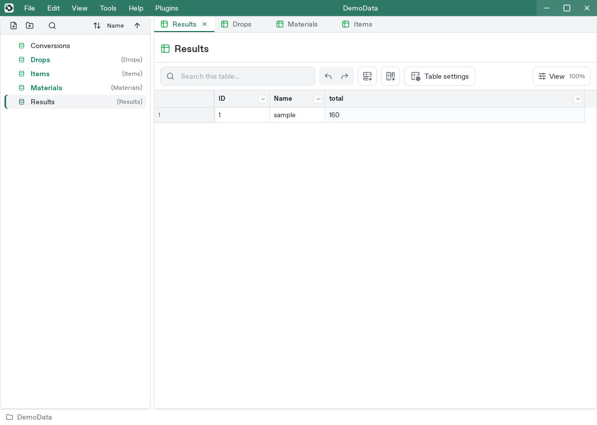

# Calculate rewards across rows and tables

[Manual](README.md) / [Formula basics](formulas.md) / [Collection reference](formula-collections-reference.md)

When you balance enemy drops, formulas can answer questions such as “How much are these rewards worth?” and “How many high-value drops are there?” Changing a price or quantity then updates the calculation from the original data.

This tutorial walks through four examples:

1. Calculate the total value of all drops
2. Count rewards that meet a condition
3. Calculate rewards for each enemy
4. Combine a drop table with an item price table

## 1. Calculate the total value of drops

### Create the source tables

Create two tables, `Drops` and `Results`, in the same project. See [Create a table](studio.md#create-a-table) for the table and column controls.

Add these four columns to `Drops`. Use the exact data names below so the formulas can find them.

| Data name | What it contains | Type |
| --- | --- | --- |
| `enemy` | Enemy name | String |
| `item` | Item name | String |
| `price` | Price of one item | I32 |
| `quantity` | Number of items dropped | I32 |

Use the initial sample row as the first row, add two more rows, and enter these values. The initial `ID` and `Name` columns are not used in this calculation.

| enemy | item | price | quantity |
| --- | --- | ---: | ---: |
| Slime | Jelly | 10 | 2 |
| Slime | Herb | 30 | 1 |
| Goblin | Iron | 30 | 3 |



The total is `10 × 2 + 30 × 1 + 30 × 3`, or **140**. We will ask a formula to do this calculation.

Add an integer `I32` column named `total` to `Results`. Use its initial sample row for the result.

### Enter the total formula

Double-click the first `total` cell in `Results`, enter the following formula, and press Enter:

```text
=REDUCE(TABLE("Drops"), 0, (sum, drop) => sum + drop.price * drop.quantity)
```



The cell displays **140**.



The formula has three parts:

- `TABLE("Drops")` supplies the rows from `Drops`.
- `0` starts the running total at zero.
- `(sum, drop) => sum + drop.price * drop.quantity` adds price times quantity for each row.

`REDUCE` combines several rows into one result. `sum` names the result so far; `drop` names the row currently being processed. `drop.price` reads that row's price. The expression after `=>` describes the calculation to repeat for every row.

| Row | Amount added | Running total |
| --- | ---: | ---: |
| Jelly | 10 × 2 = 20 | 20 |
| Herb | 30 × 1 = 30 | 50 |
| Iron | 30 × 3 = 90 | 140 |

### Change a price

In `Drops`, change Jelly's `price` from `10` to `20`, then return to `Results`. The total becomes **160**.



Restore Jelly's price to `10` before continuing so the following examples have the same inputs.

## 2. Count rewards that meet a condition

Now count drop rows whose price is at least 30. Herb and Iron qualify, giving **2 rows**.

The part of the formula that selects these rows is:

```text
FILTER(TABLE("Drops"), drop => drop.price >= 30)
```

`FILTER` keeps rows that satisfy a condition. Here, `drop => drop.price >= 30` asks whether each row's price is at least 30. The intermediate table contains:

| enemy | item | price | quantity |
| --- | --- | ---: | ---: |
| Slime | Herb | 30 | 1 |
| Goblin | Iron | 30 | 3 |

Pass that `FILTER(...)` result into `REDUCE` to count only the selected rows. Add an `I32` column named `expensive_count` to `Results` and enter this formula in its first row:

```text
=REDUCE(FILTER(TABLE("Drops"), drop => drop.price >= 30), 0, (count, drop) => count + 1)
```

The result is **2**, because the formula adds one for each selected row. Change the condition to `drop.price >= 50` and the result becomes **0**.

Filtering inside a formula lets you calculate from a selection while preserving the original table.

## 3. Calculate rewards for each enemy

Instead of writing an enemy name directly in the formula, read it from the row containing the result. The same formula can then calculate **50** for Slime and **90** for Goblin.

Create an `EnemySummary` table with `enemy` (String) and `total` (I32) columns. Enter these two rows:

| enemy | total |
| --- | --- |
| Slime | Leave empty |
| Goblin | Leave empty |

Enter the same formula in both `total` cells:

```text
=REDUCE(FILTER(TABLE("Drops"), drop => SAME(drop.enemy, enemy)), 0, (sum, drop) => sum + drop.price * drop.quantity)
```

The new condition is `SAME(drop.enemy, enemy)`. `SAME` checks whether two values match:

- `drop.enemy` is the enemy name in `Drops`.
- `enemy` is the enemy name in the current `EnemySummary` row.

The Slime row selects Slime's rewards; the Goblin row selects Goblin's rewards. Add another enemy to the summary and reuse the formula. To apply the formula to every row, see [Set a column's default formula](formulas.md#2-set-a-columns-default-formula).

## 4. Combine prices with drops

If several enemies drop the same item, storing its price in every drop row makes price changes repetitive. Store each price once in an item table and combine it with drops during the calculation.

### Separate prices and quantities

For this example, keep `Drops` and create two more tables in the same project: `Items` and `RewardDrops`.

**Items: one price per item**

| item (String) | price (I32) |
| --- | ---: |
| Jelly | 10 |
| Herb | 30 |
| Iron | 30 |

**RewardDrops: items and quantities dropped by enemies**

| enemy (String) | item (String) | quantity (I32) |
| --- | --- | ---: |
| Slime | Jelly | 2 |
| Slime | Herb | 1 |
| Goblin | Iron | 3 |
| Goblin | Jelly | 1 |

Goblin now also drops one Jelly, so the total is **150**.

### Match rows for the same item

`JOIN` combines two tables. The matching part of the formula is:

```text
JOIN(TABLE("RewardDrops"), TABLE("Items"),
     (drop, product) => SAME(drop.item, product.item), "INNER")
```

The drop table comes first and the price table second. The condition matches rows with the same item name. `"INNER"` keeps pairs that match on both sides.

The intermediate result has four pairs:

| Drop's enemy | Item | Drop quantity | Item price | Amount |
| --- | --- | ---: | ---: | ---: |
| Slime | Jelly | 2 | 10 | 20 |
| Slime | Herb | 1 | 30 | 30 |
| Goblin | Iron | 3 | 30 | 90 |
| Goblin | Jelly | 1 | 10 | 10 |

Within each pair, `left` refers to the first input's drop row and `right` to the second input's price row. For example, `pair.left.quantity` reads the quantity and `pair.right.price` reads the price.

### Total the matched amounts

Add an `I32` column named `joined_total` to `Results`. Enter this formula in the first row. The line breaks are for readability; you can enter it on one line.

```text
=LET(rewards,
  JOIN(TABLE("RewardDrops"), TABLE("Items"),
       (drop, product) => SAME(drop.item, product.item), "INNER"),
  REDUCE(rewards, 0, (total, pair) => total + pair.left.quantity * pair.right.price))
```

`LET(name, value, calculation)` names an intermediate result for use in the following calculation. Here, `rewards` names the `JOIN` result and `REDUCE` totals the amounts. The cell displays **150**.

Change Jelly's price in `Items` from `10` to `20`. The total becomes **180**. One price change affects both Slime's two Jellies and Goblin's one Jelly.

Duplicate item names in `Items` produce multiple matching pairs and increase the total. Items absent from the price table are omitted by this inner join. Keep one price row per item and use matching names in the two tables.

## Collections and temporary tables

A collection is a group of values or rows used together in a calculation. Rows selected by `FILTER` or paired by `JOIN` form a temporary table inside the formula. You can select, combine, and summarize them while keeping the original table unchanged.

Finish with one value, such as a total or count, to display the result in a cell.

Other functions include `MAP`, which transforms each element, and `GROUPBY`, which groups rows by a key. The [collection reference](formula-collections-reference.md) walks through lists of amounts, enemy groups, and missing prices, showing intermediate results as well as argument rules, ordering, empty collections, and limits.

## When the result looks wrong

- Check table and column names and remove any unintended extra sample rows.
- Hiding rows with Studio search does not change `TABLE`'s input. Put a `FILTER` condition in the formula to select rows.
- A result column can share a table with its inputs, but reading the result cell itself during evaluation creates a circular reference. This tutorial uses separate input and result tables.
- Versioned game exports calculate using the rows included in that content version. See [Versions](versions.md).
- Open the cell's error details to identify the failed expression or reference. See [Formula troubleshooting](formulas.md#7-troubleshoot-a-formula).
