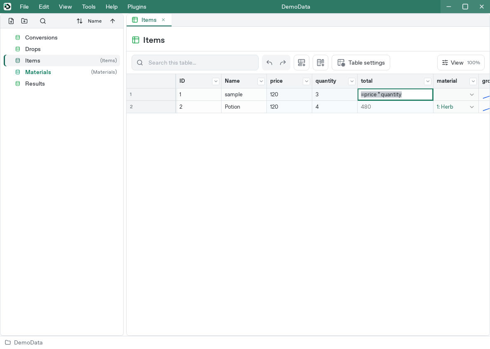
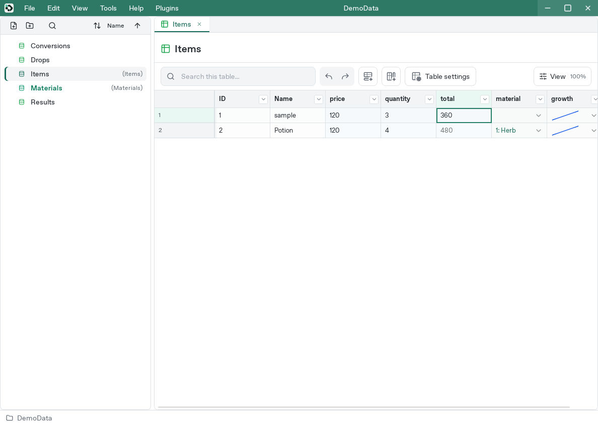
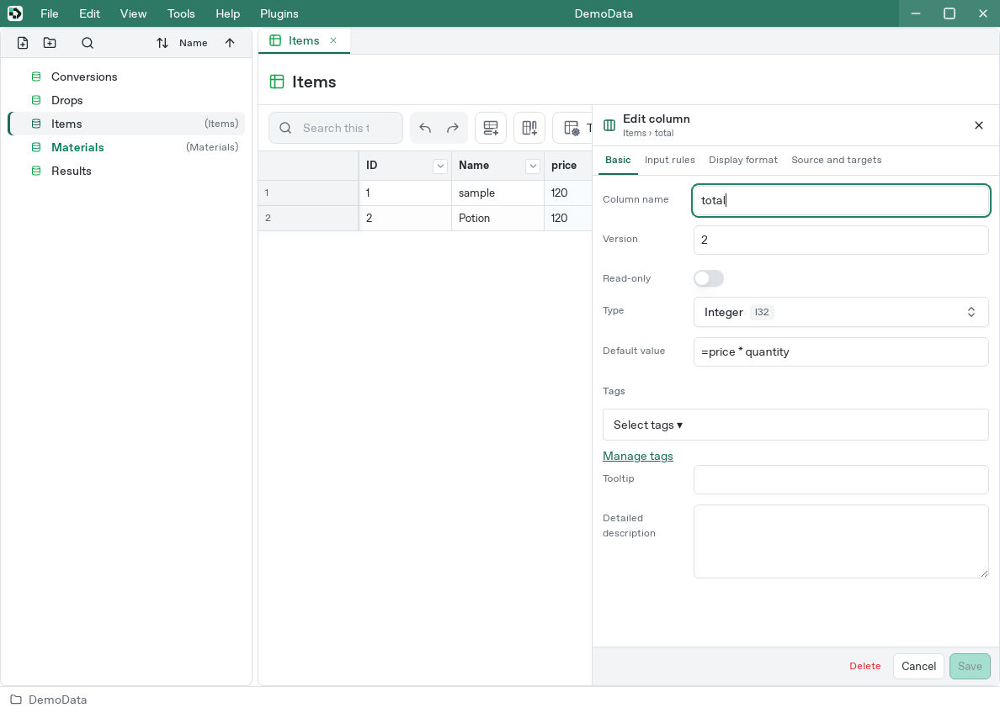
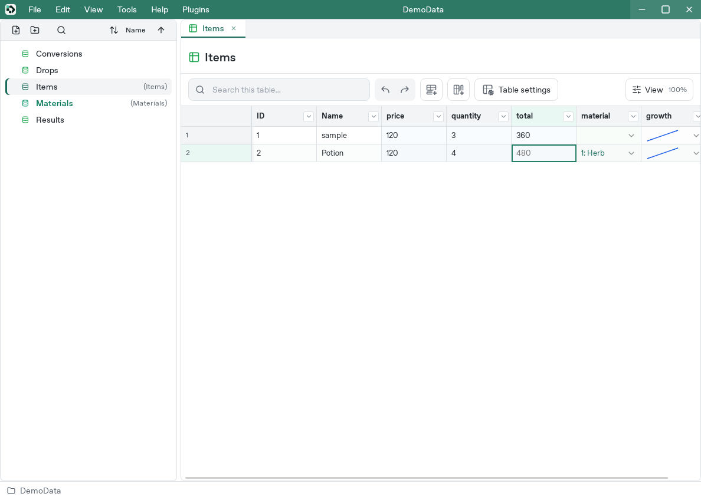

# Use formulas

[Manual](README.md) / [Studio controls](studio.md) / [Function reference](formula-reference.md)

Formulas calculate prices or statistics from columns in the same row, or read values from another table in the same project. Begin a formula with `=`:

```text
=price * quantity
```

This multiplies the current row's `price` by its `quantity`. Refer to columns by name.

## 1. Calculate in one cell

Create a table with these three columns. See [Studio controls](studio.md) for adding columns and [Data types](data-types.md) for choosing types.

| Data name | Type | First-row input |
| --- | --- | --- |
| `price` | I32 | `120` |
| `quantity` | I32 | `3` |
| `total` | I32 | Formula entered below |

1. Double-click the first `total` cell, or select it and press F2.
2. Enter `=price * quantity`.



3. Press Enter. The cell displays `360`.



4. Change `quantity` to `4`: the total becomes `480`. Restore it to `3` for the following examples.
5. Edit `total` again to see its saved formula. Esc cancels an edit.

This is a **cell formula**, saved in that cell alone. The same formula in another row uses that row's price and quantity.

## 2. Set a column's default formula

To use a calculation throughout a column, put it in the column's **Default value**.

1. Double-click the `total` column header to open its settings.
2. Under **Basic**, check that its type is I32.
3. Set **Default value** to `=price * quantity`.
4. Choose **Save**.



You can also set the default formula while adding the column.

5. Add a row with the table's **Add row** control. Enter `Potion` in `Name`, `120` in `price`, and `4` in `quantity`. With no individual `total` input, the result is `480`.



A cell can use its own input, inherit from a parent record, or use the column default. For a row without a parent, clearing an input restores the column default:

| Saved input in total | Value used |
| --- | --- |
| Empty input in a row without a parent | Evaluate the column default for this row |
| Empty input in a row with a parent | Use the parent's input and evaluate any formula in this row |
| `500` | Fixed value `500` |
| `=price * quantity * 2` | This cell's formula |
| `=""` | Empty-string formula; a type error in a numeric column |

Clearing a cell restores inheritance: it uses its parent when present, otherwise the column default. Entering `0` saves an explicit zero. See [Parent records and cell inputs](metadata-and-inheritance.md#choose-where-a-cell-gets-its-value).

A Boolean column can use a default comparison such as `=quantity > 0`. For an interface-owned column whose default is locked, check the defining interface shown in column settings.

## 3. Basic syntax

### Values and column names

| Syntax | Meaning |
| --- | --- |
| `120`, `-5`, `0.5`, `1e-3` | Numbers |
| `"Potion"` | String enclosed in double quotes |
| `""` | Empty string |
| `price` | Column in the current row |
| `"price"` | Literal text `price` |
| `SUM(price, tax)` | Function call with comma-separated arguments |

Columns can be addressed by data name or display name, case-insensitively: `price` and `PRICE` refer to the same column. Unicode display names are supported. Ambiguous matches are errors, so unique data names make formulas easier to maintain.

Double a quote inside a quoted string:

```text
="He said ""Hi"""
```

The result is `He said "Hi"`.

### Arithmetic and comparison

| Operator | Meaning | Example |
| --- | --- | --- |
| `+` | Numeric addition, or concatenation if a value cannot be read as a number | `=10 + 20` → `30` |
| `-` | Subtraction | `=10 - 3` → `7` |
| `*` | Multiplication | `=10 * 3` → `30` |
| `/` | Division | `=3 / 2` → `1.5` in F64 |
| `=`, `==` | Equal | `=price = 120` → true or false |
| `!=`, `<>` | Not equal | `=price <> 120` |
| `<`, `>`, `<=`, `>=` | Ordering comparisons | `=quantity >= 3` |

Precedence from highest to lowest is unary `!`, `-`, `+`; multiplication/division; addition/subtraction; comparisons; `&&`; `||`; and `condition ? A : B`. The conditional operator associates to the right; other operators associate to the left. Parentheses change the order.

`=1 + 2 * 3` returns `7`, while `=(1 + 2) * 3` returns `9`.

When both operands can be read as numbers, `+` adds them: `="12" + "3"` returns `15`. Use `CONCAT` for predictable text concatenation.

Comparisons are numeric when both operands can be read as numbers; otherwise they compare strings, including case and spaces. Store comparison results in a Boolean column, or a String column when text is desired.

### Reference paths and short expressions

```text
=equipment.attack
=equipment.category.multiplier
="Attack: ${attack}"
=quantity > 0 ? price / quantity : 0
=quantity > 0 && price > 0
=!(quantity > 0) || price = 0
```

- `equipment` is a Reference column. Its row UUID leads to the configured target table. Continue through further Reference columns to follow a chain. The final value can be a Curve, as in `=CURVE(level, 1, 100, equipment.growth)`.
- A column name matching the whole dotted expression takes precedence. Write `` `equipment`.`attack` `` to separate path segments, or `` `equipment.attack` `` to name one column. Double a backtick inside a quoted name.
- `${expression}` inside a quoted formula string inserts the calculated result. Escape a literal `${` as `$${`: `="$${attack}"` returns `${attack}`. Ordinary saved text cells are not interpolated.
- Double quotes inside interpolation are doubled too: `="${quantity > 0 ? ""In stock"" : ""Out of stock""}"`.
- `condition ? A : B` uses the same truth test as `IF` and evaluates only the chosen branch. `&&` skips its right side when the left is false; `||` skips it when the left is true. `!` reverses truth. Logical results are `true` or `false`.
- Empty text, `0`, and case-insensitive `false` are false; other values are true.
- References read the value selected by the cell's effective input: its own input, its parent, or its column default. Missing reference targets, invalid UUIDs, a non-Reference intermediate column, and circular calculations are errors. Use `LOOKUP` to search an arbitrary table by a key.

### Choose the result type

The result is converted and validated against its destination column:

| Formula | Column type | Result |
| --- | --- | --- |
| `=3 / 2` | F64 | `1.5` |
| `=3 / 2` | I32 | `2` |
| `=-3 / 2` | I32 | `-2` |
| `=256` | U8 | Error: outside the type's range |
| `="Potion"` | I32 | Error: not numeric |
| `=2 > 1` | Boolean | `true` |
| `=1` | Boolean | Error: numeric 1 is not implicitly true |

Integer columns round formula results to the nearest integer, with ties away from zero: `19.8` becomes `20`, `2.5` becomes `3`, and `-2.5` becomes `-3`. The rounded value must fit the column type.

Use `TRUNC` to round toward zero, `FLOOR` downward, or `CEIL` upward. Decimal literals entered directly into integer cells are rejected.

Choose F32 or F64 to preserve decimals. A column containing saved formulas cannot change type; create it with the required type before entering formulas. See [Change an existing column's type](data-types.md#change-an-existing-columns-type).

Integer arithmetic retains integer precision. Mixed decimal calculations use floating point; overflow or a combination requiring an inexact large-integer conversion is an error.

### Empty inputs

A formula reads the input selected for each referenced cell: a local value or formula, an inherited parent input, or the column default. Inherited formulas calculate using the current row's values. If inheritance reaches a row without a parent, it uses the column default. An empty column default supplies `0` for numbers, `false` for Boolean, and empty text for string-like columns.

A saved `=""` produces intentional empty text in a String column even when a parent or default supplies text; in a numeric column, that formula is a type error. Empty raw input instead restores inheritance. See [Cell inputs](metadata-and-inheritance.md#choose-where-a-cell-gets-its-value).

## 4. Useful formulas

These examples assume `price = 120` and `quantity = 3`:

| Purpose | Formula | Type | Result |
| --- | --- | --- | --- |
| Total price | `=price * quantity` | I32 | `360` |
| Add a fixed fee | `=SUM(price * quantity, 30)` | I32 | `390` |
| Quantity discount | `=IF(quantity >= 3, price * 0.9, price)` | F64 | `108` |
| Average | `=AVG(10, 20, 30)` | F64 | `20` |
| Round to two decimal places | `=ROUND(3.14159, 2)` | F64 | `3.14` |
| Create a label | `=CONCAT("Total: ", price * quantity, " coins")` | String | `Total: 360 coins` |
| Avoid division by zero | `=IF(quantity = 0, 0, price / quantity)` | F64 | `40` |
| Display text beginning with = | `="=price"` | String | `=price` |

`IF` evaluates only the selected branch. `=IF(1, 42, 1 / 0)` returns `42`. Syntax, including matching parentheses/quotes and nonempty arguments, must still be valid throughout the expression.

Use comparisons, Boolean columns, `1`/`0`, or strings `"true"`/`"false"` for conditions. See the [IF reference](formula-reference.md#if) for exact truth rules.

### Follow a curve

A Curve column stores how a value changes as a line or curve. `CURVE` turns a value within a range into a position on that curve and returns its height.

Set a `growth` Curve column to a straight line from Y=10 to Y=110, then enter this in an F64 column:

```text
=CURVE(50, 0, 100, growth)
```

Fifty is halfway between zero and 100, so the result is approximately 60. Replace `50` with a column such as `level` to calculate from each row. Changing the curve's shape changes the result.

Arguments are current value, minimum, maximum, and curve. Inputs outside the range use the corresponding endpoint. See [CURVE](formula-reference.md#curve).

## 5. Read and summarize another table

Create an `Items` table in the same project:

| id (String) | category (String) | price (I32) |
| --- | --- | --- |
| potion | common | 120 |
| ether | common | 300 |
| sword | rare | 500 |

In the current table, create a String column named `item_id` and enter `potion`:

```text
=LOOKUP("Items", "id", item_id, "price")
```

This finds the Items row whose `id` is `potion` and returns its `price`, `120`.

| Purpose | Formula | Result |
| --- | --- | --- |
| Count common items | `=COUNTIF("Items", "category", "common")` | `2` |
| Total their prices | `=SUMIF("Items", "category", "common", "price")` | `420` |
| Count no matches | `=COUNTIF("Items", "category", "none")` | `0` |
| Read only a unique match | `=IF(COUNTIF("Items", "id", item_id) = 1, LOOKUP("Items", "id", item_id, "price"), 0)` | `120` |

- Quote fixed table and column names, such as `"Items"`. Leave `item_id` unquoted to read the current row's value.
- `LOOKUP` requires exactly one match. Zero and multiple matches are errors.
- Criteria are exact text matches. `">100"` and `"*"` search for those literal strings.
- Identifier matching is case-insensitive; searched values are case-sensitive. `potion` and `Potion` differ.
- Referenced formulas supply their calculated values.
- Loaded tables include unsaved edits in calculations.
- Searches stay within the same project.

See [Table queries](formula-reference.md#queries) for arguments and empty-value behavior. For arithmetic across rows, comparison-based filtering, or combining tables, continue to [Reward calculations](formula-collections.md).

### Versioned exports

Normal Studio calculations include rows from all content versions. Runtime export for version `N` searches and summarizes only rows with `min_version <= N`. Screen filtering and version previews differ from the export's calculation context.

Excluding future rows can lower a sum or remove a lookup target. Future-version columns excluded from the output remain available as inputs to retained formulas. See [Versions](versions.md).

Both Full and Minimal runtime exports contain evaluated values, including default formulas evaluated per row.

## 6. Copy formulas

- Ctrl/Cmd+C copies the input the cell is using, including a formula inherited from a parent or column default.
- To copy a calculated result as a fixed value, right-click the cell and choose **Copy values**.
- Ctrl/Cmd+X copies the same input and clears the source cell, restoring inheritance from its parent or, for a row without a parent, its column default. Inputs containing tabs or line breaks can be pasted back as one cell.
- Pasted formulas calculate using the destination row. For example, copying `=price/10` into a row with price `200` gives **20**. Copying its displayed result with **Copy values** keeps that number fixed.

## 7. Troubleshoot a formula

1. Start with `=`. Leading whitespace prevents formula recognition.
2. Check column references versus strings: `price` reads a column; `"price"` is text.
3. Use unique names. For table queries, check [Identifier resolution](formula-reference.md#query-identifiers).
4. Check destination type and range. Use F32/F64 for decimals.
5. Avoid a zero denominator, for example by branching with `IF`.
6. Check for cycles through columns, rows, or tables.
7. Ensure `LOOKUP` finds exactly one eligible row in the selected version.

Existing cells show an error indicator and details on hover. Editing, saving, or exporting may also report validation errors. Run project validation to check input rules after cross-table changes, and inspect exports using the intended version.

See [Error reference](formula-reference.md#errors).

## 8. Supported scope

The [function reference](formula-reference.md) lists supported functions. Formulas use named columns rather than spreadsheet coordinates: ranges such as `A1:A10`, absolute references such as `$A$1`, `Sheet!A1`, and array indexing are unsupported. An actual column named `A1` is interpreted as a column name. Define expression-local functions with [LETREC](formula-collections-reference.md#letrec).

Expression nesting and reference recursion have a depth limit of 128. Intermediate columns can simplify a formula, but still contribute to dependency depth and must remain acyclic.

`COUNTIF` and `SUMIF` scan rows. Large tables with many query formulas can take longer to display or export.

[All functions](formula-reference.md) / [Data types](data-types.md) / [Versions](versions.md)
