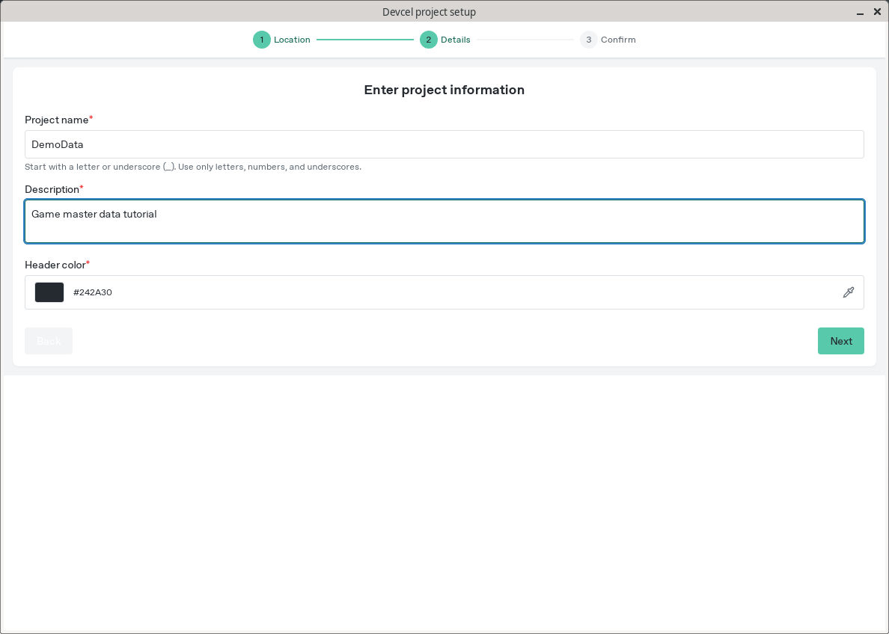
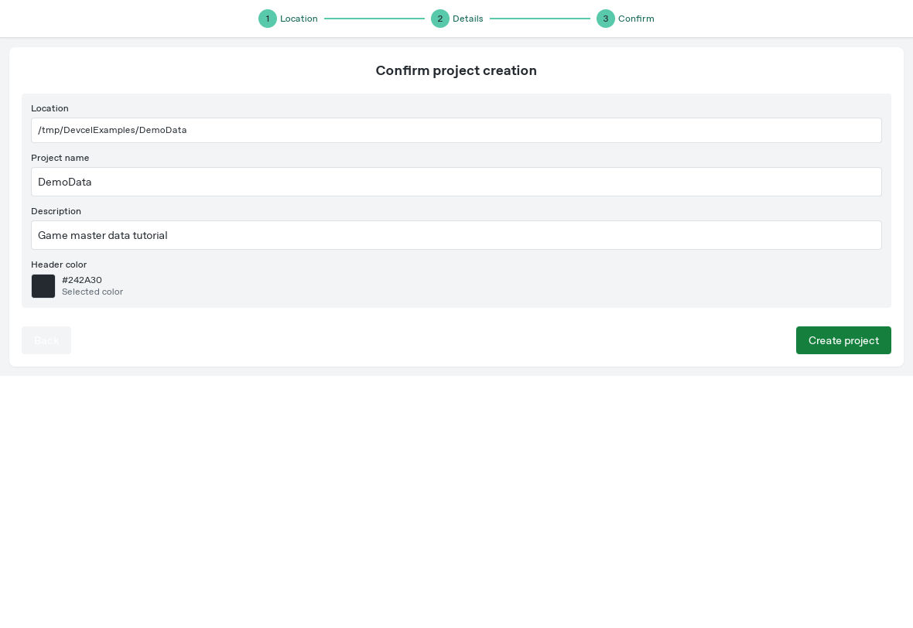
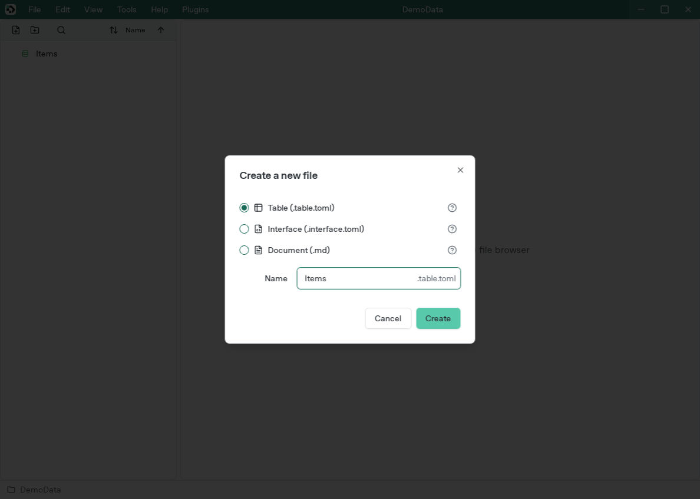
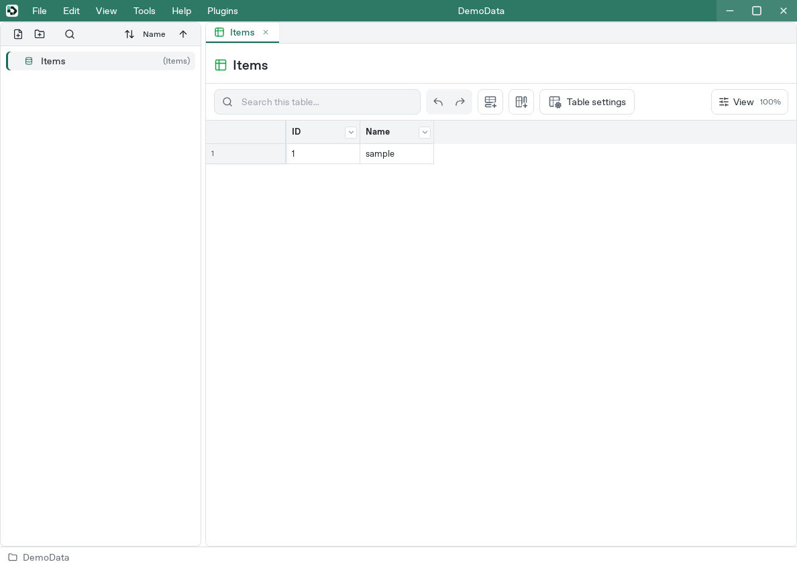
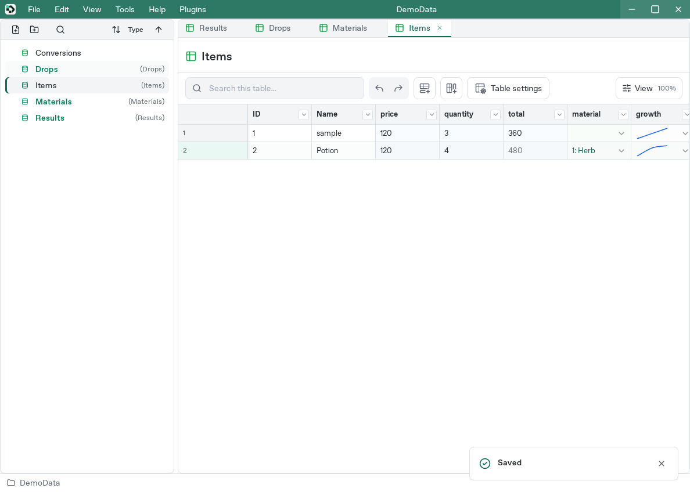
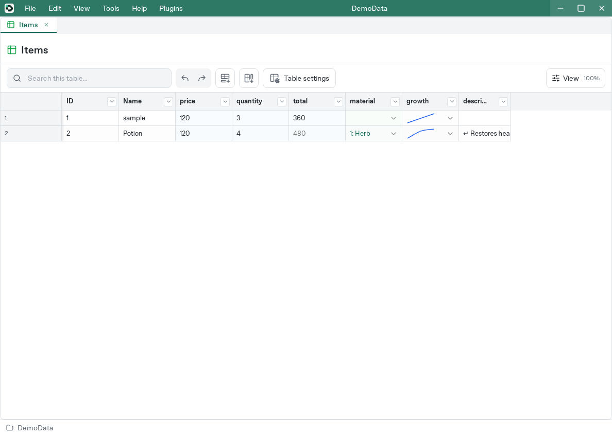

# Create your first project

[Manual](README.md) / Previous: [Open Studio](installation.md) / Next: [Edit tables](studio.md)

A **project** is a folder holding the tables for a game. Start with a practice project after [opening Studio](installation.md).

## Create a project

1. Choose **New project** on the welcome screen, or **File → Create new project**.
2. Use **Browse** to choose a parent folder and select **Next**.
3. Enter `DemoData` as the project name and `Game master data tutorial` as its description. A project name starts with an ASCII letter or `_` and uses letters, digits, and underscores. A description is required and can contain Unicode text. Choose **Next**.



4. Review the destination. If a project already exists there, go back and choose another name or location. Choose **Create project**.



Studio opens the new folder beneath your selected parent:

```text
DemoData/
├── DemoData.devcelproj.toml
└── Tables/
```

## Create your first table

Choose **Add file** in the left browser, select **Table**, enter `Items` without an extension, and choose **Create**.





A **column** is a field such as price; a **row** is one item or other entry. A **cell** is where a row and column meet.

The new table has String columns `ID` and `Name` and one sample row. `ID` is a user-facing identifier. Keep these columns and [add three more](studio.md#add-and-configure-columns):

| Column | Type | Example value |
| --- | --- | --- |
| Name | String | sample |
| price | I32 integer | 100 |
| quantity | I32 integer | 3 |
| total | I32 integer | Calculated by a formula |

Use these names exactly for the tutorial. To select I32 in the type picker, choose **Integer → 32 → Signed**.

Set the `total` column's default to `=price * quantity`. The result is `300`: `*` means multiplication, so this is price times quantity.

Change price to `120` and the total becomes `360`. Additional rows use the same default formula with their own price and quantity.

## Save and reopen

1. Confirm the active cell. Save any changes still pending in dialogs such as column settings.
2. Choose **File → Save project** and check the brief **Saved** notification at the bottom right.



3. Choose **File → Close project** to return to the welcome screen.
4. Choose **File → Open project** and select `DemoData/DemoData.devcelproj.toml`.
5. Open Items and check its columns, values, and formula settings.



This screenshot shows the project after completing the later [formula](formulas.md) and [reference/curve](data-types.md) exercises.

Table data lives under `Tables/`. Move or back up the whole project folder, including both the manifest and Tables. See [Synchronization and saved files](collaboration.md) for the distinction between saved data and connected editing state.

## Try a ready-made sample

[ManualBasics](../../examples/manual-basics/README.md) contains two rows and formulas. Copy its whole folder to a working location and open `ManualBasics.devcelproj.toml` to start with populated data.

## Use the data in a game

Try importing the ready-made ManualBasics project with either guide:

- [Godot](godot.md)
- [Unity](unity.md)

To select rows and columns for different releases, see [Versions](versions.md).
