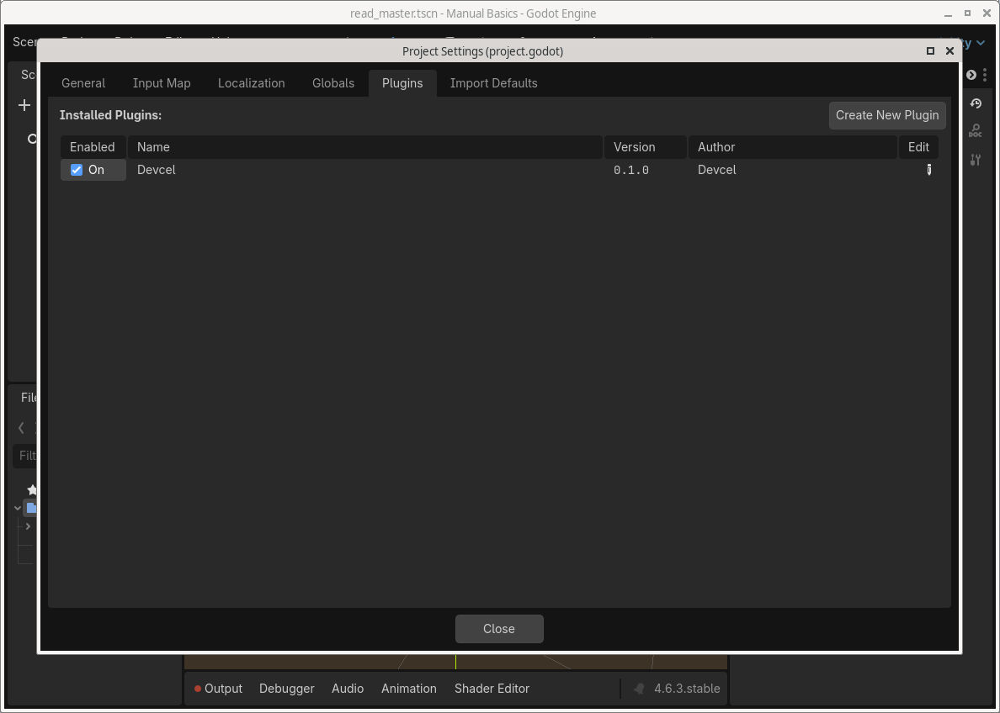
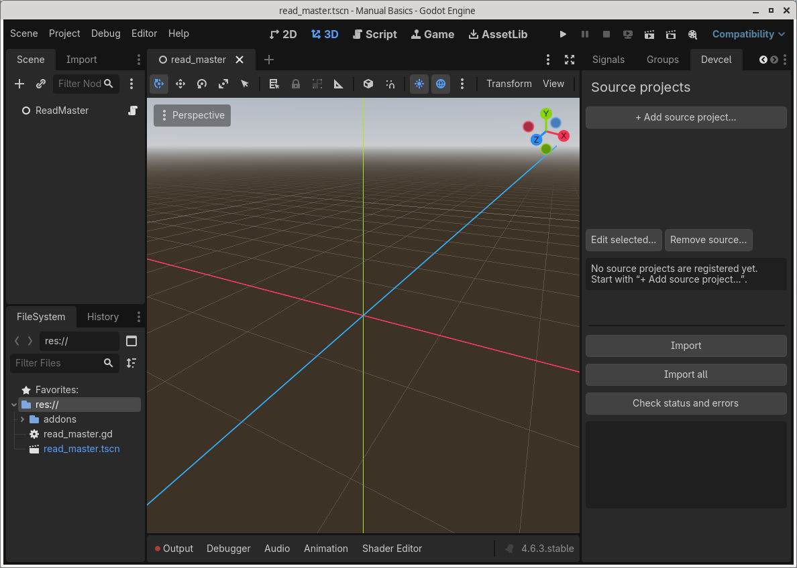
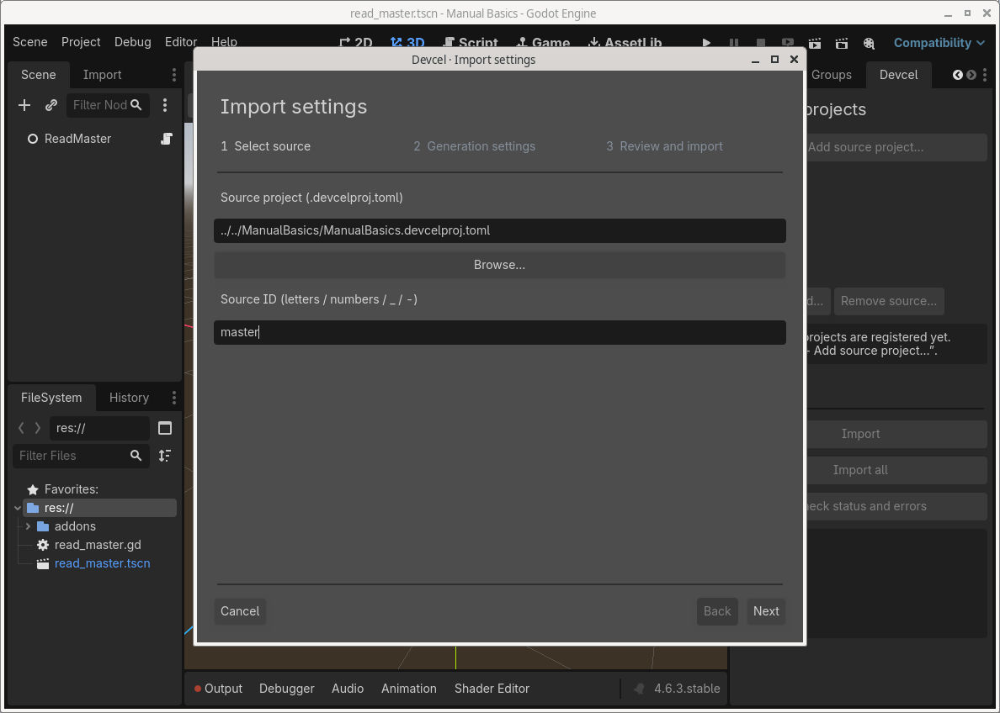
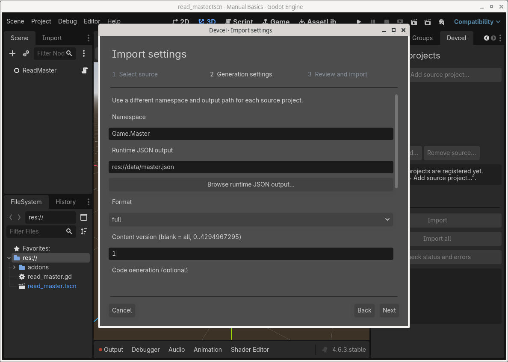
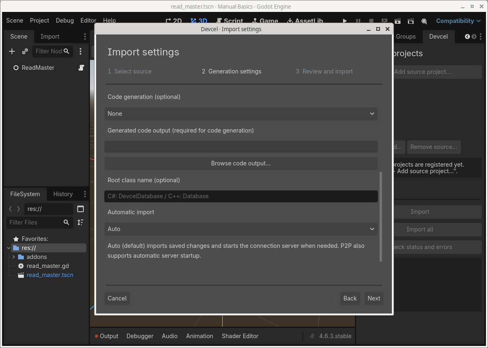
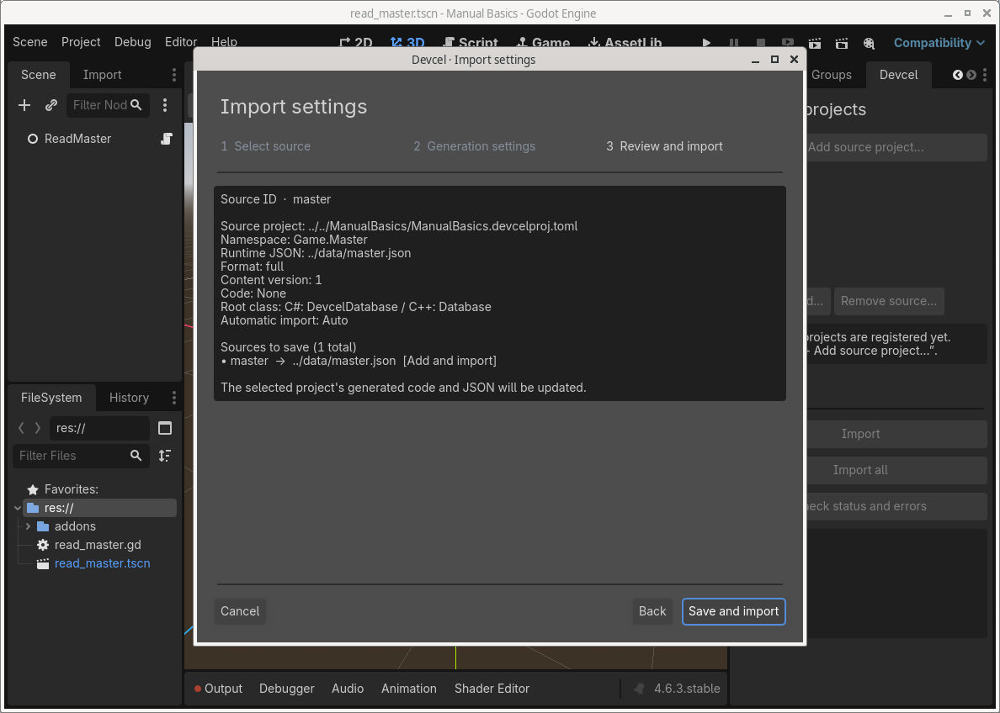
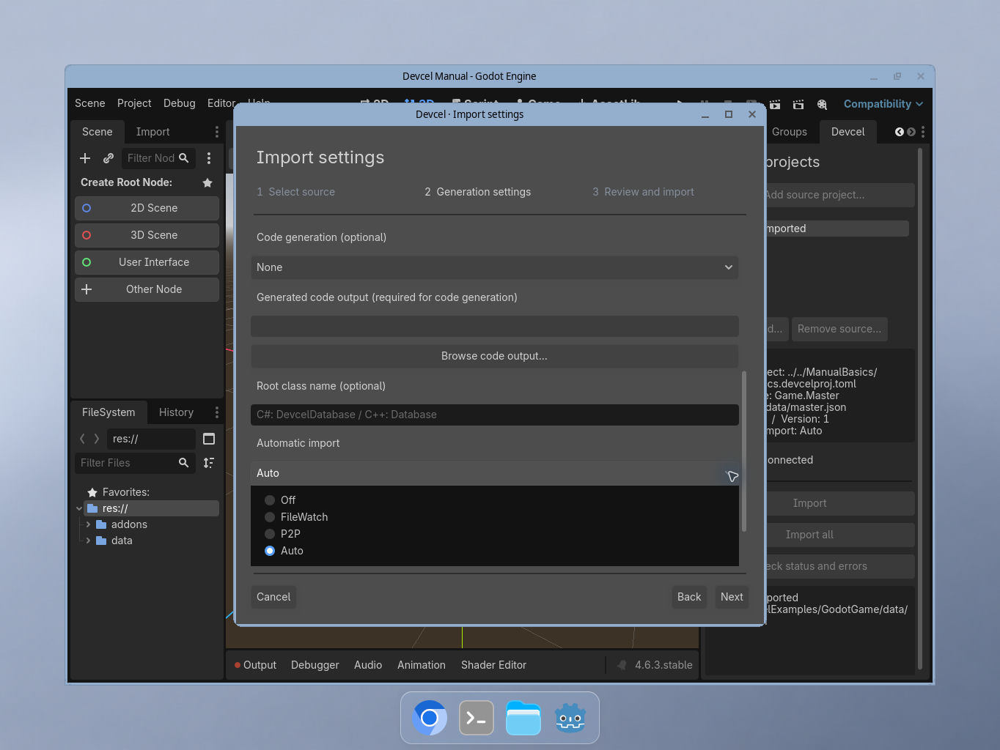
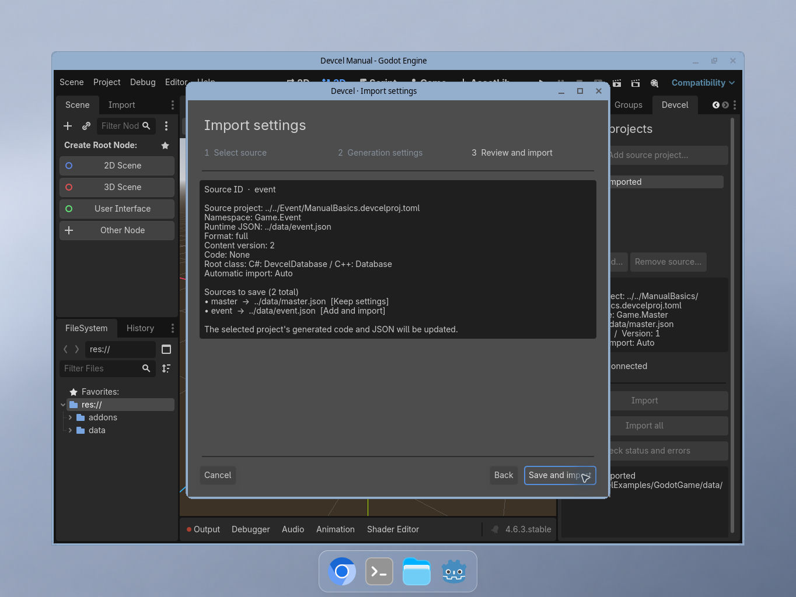
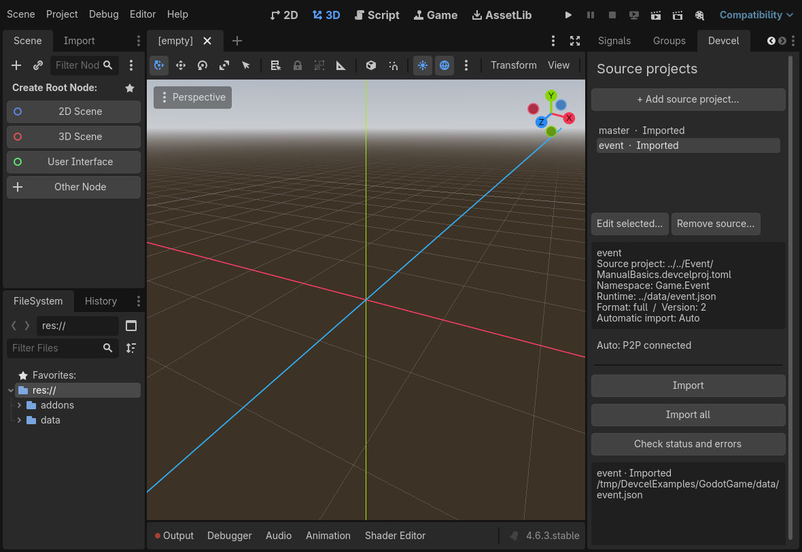

# Import data into Godot

[Manual](README.md) / [Getting started](getting-started.md) / [CLI](cli.md) / [Synchronization](collaboration.md)

Import saved Devcel tables into Godot, then watch Studio edits reach a running game. Start with a working copy of the [ManualBasics sample](../../examples/manual-basics/README.md).

## 1. Prepare the projects

You need the saved manifest and its Tables folder, plus the CLI-bundled importer ZIP for your editor's OS/CPU. A source-code archive does not include the required executable.

Use Godot 4.6 or later. This tutorial reads JSON with GDScript.

### Folder layout

```text
repo/
  ManualBasics/
    ManualBasics.devcelproj.toml
    Tables/
  GodotGame/
    project.godot
```

Place generated JSON/code outside the source project and use destinations reserved for generated files.

## 2. Import for the first time

### Enable the add-on

Extract `devcel-godot-<version>-<rid>.zip` into the game root so it contains `addons/devcel/`. Enable **Project Settings → Plugins → Devcel**.



Close settings, open the right-hand **Devcel** dock, and choose **+ Add source project…**.



### Step 1: select the source

Choose the saved manifest with **Browse…**, enter Source ID `master`, and choose **Next**. For this layout, the saved config-relative path is `../../ManualBasics/ManualBasics.devcelproj.toml`.



### Step 2: generation settings

Enter:

- Namespace: `Game.Master`
- Runtime JSON destination: `res://data/master.json`
- Format: `full`
- Content version: `1`



Scroll down, set **Code generation** to **None**, leave **Automatic import** at **Auto**, and choose **Next**.



### Step 3: review and import

Review the source, namespace, destination, version, and automatic-import mode. Choose **Save and import**.



The confirmation shows the JSON path relative to the configuration directory: `../data/master.json`.

Check for **master · Imported** and the generated `data/master.json` file.


### Tag filters for this source

In the source wizard’s **Generation settings**, configure the tag filters below Content version. Use **Refresh project tag presets** after changing the saved vocabulary, then review the filters and choose **Save and import**.

The four filters are **row include**, **row exclude**, **column include**, and **column exclude**. Each source keeps its own selections. An empty include list includes all rows or columns; multiple includes use OR (any matching tag), and exclusions take priority. Content Version also applies.

Choose names from the source project’s saved tag presets. A saved name missing from those presets remains visible and editable: correct it to a preset or explicitly remove it. If an exported reference needs an excluded row, import fails and preserves the previous output.

## 3. Edit in Studio and check automatic import

Keep both Godot Editor and Studio open:

1. Open the registered copy of ManualBasics in Studio.
2. Open the `enemies` table. The sample's saved display name is `Enemy Data`; its Slime row is labeled `Slime`. Change that row's hp from `100` to `150` and press Enter.
3. Choose **File → Save project** and wait for saving to finish.
4. Return to Godot and wait for automatic import. Check the dock's success state and updated `data/master.json`.




Inspect the generated JSON:

- manifest.content_version remains `1`.
- Slime's hp is `"150"` and double_hp is `"300"`, evaluated strings in runtime JSON.
- The Dragon row and reward column start at version 2 and are absent from version 1.

Make changes in Studio rather than editing generated JSON. See [Troubleshooting](#10-troubleshoot-import) if automatic import does not run.

## 4. Read imported data in the game

### Create a test scene

1. Create a scene with a Node root and save it as `res://read_master.tscn`.
2. Attach `res://read_master.gd` and replace its content with this script.
3. Save and press F6 to run the current scene. Output should show **Slime HP: 150**.

```gdscript
extends Node
const LiveDatabase = preload("res://addons/devcel/runtime/devcel_live_database.gd")
var live = LiveDatabase.new()

func _ready():
    live.bundle_path = "res://data/master.json"
    live.reloaded.connect(show_hp)
    live.reload_failed.connect(func(message): push_error(message))
    add_child(live)

func show_hp():
    var enemies = live.database.table("enemies")
    if enemies == null:
        push_error("The enemies table is missing")
        return
    var enemy = enemies.by_id("11111111-1111-4111-8111-111111111111")
    if enemy == null:
        push_error("The Slime row is missing; check the version and UUID")
        return
    var hp: int = enemy.get_int("hp")
    if not enemy.last_error.is_empty():
        push_error(enemy.last_error)
        return
    print("Slime HP: ", hp)
```

While playing in the editor, the live database reloads changed importer JSON and prints the new value. Edit and save the same row in Studio to see the next imported value.

LiveDatabase.database exposes the regular DevcelDatabase API. For a one-time load, preload devcel_database.gd, construct Database.new(), and call load_file. Later changes then require a reload or scene restart.

Main APIs:

- Database: load_file(path), load_json(text), table(name), table_by_uuid(uuid), manifest(), reload_if_changed()
- Table: by_id(uuid), at(index), count(), columns()
- Row: get_string, get_int, get_float, get_bool, get_color32, get_color_float, get_reference, get_table_reference, get_curve

Missing tables/rows return null. Missing columns and incompatible getters return a fallback and set the row's last_error; inspect it for required data. Read U64 values beyond Godot's int range with get_u64_decimal().

Reacquire rows after reloading, as the reloaded handler does above. Editor Play checks every 0.5 seconds by default. Exported games do not watch automatically; call reload_now() for explicit reloads.

For multiple sources, use devcel_project_set.gd:

```gdscript
const ProjectSet = preload("res://addons/devcel/runtime/devcel_project_set.gd")
var sources = ProjectSet.new()

func load_sources() -> bool:
    if not sources.add_source("master", "Game.Master", "res://data/master.json"):
        push_error(sources.last_error)
        return false
    if not sources.add_source("event", "Game.Event", "res://data/event.json"):
        push_error(sources.last_error)
        return false
    var master_db = sources.source("master")
    print(master_db.project_name())
    return true
```

Use the GDScript reader on the game's main thread. Check JSON loading memory with representative data sizes.

## 5. Settings and paths

Sources are saved in `.devcel/devcel.import.json`. Relative paths use its parent, `.devcel/`: the source above becomes `../../ManualBasics/ManualBasics.devcelproj.toml`, while res://data/master.json becomes `../data/master.json`.

Avoid concurrently editing the configuration while its wizard is open. Source/runtime/code paths save relatively; cross-drive Windows layouts that cannot be relativized are rejected. Preserve the relative source/game layout when moving or cloning, including external sibling folders.

### Optional code generation

For C# or C++, select:

- Code generation: csharp or cpp
- Code destination: `res://generated/Master.cs` or `res://generated/Master.h`
- Optional root class: `MasterDatabase`

Godot code destinations include the filename. Empty class names default to DevcelDatabase for C# or Database for C++. Only the root database type changes; table, row, interface, and GDScript reader names remain unchanged.

A blank content version includes all content; numeric versions range from 0 to 4,294,967,295.

```json
{
  "schema_version": 1,
  "sources": [
    {
      "id": "master",
      "project": "../../ManualBasics/ManualBasics.devcelproj.toml",
      "namespace": "Game.Master",
      "class_name": "MasterDatabase",
      "runtime_out": "../data/master.json",
      "code_target": "csharp",
      "code_out": "../generated/Master.cs",
      "mode": "full",
      "version": 1
    }
  ]
}
```

Schema_version describes configuration format, while version selects game content.

Keep the shared configuration, source manifest/Tables, any generated files needed by your workflow, and enough package information to reproduce the add-on version. Automatic-import modes are machine-local in `.devcel/pull-editor.cfg`.

Example ignore rules retaining the shared config:

```gitignore
.godot/
.devcel/*
!.devcel/devcel.import.json
*.devcel-state.json
*.devcel-owner.json
*.devcel-lock
```

## 6. Add multiple sources

Use the add-source wizard again:

| Setting | master | event |
| --- | --- | --- |
| Source ID | master | event |
| Source | ../../ManualBasics/ManualBasics.devcelproj.toml | ../../Event/ManualBasics.devcelproj.toml |
| Namespace | Game.Master | Game.Event |
| Content version | 1 | 2 |
| Runtime JSON | res://data/master.json | res://data/event.json |
| Optional C# output | res://generated/Master.cs | res://generated/Event.cs |
| Optional C# root class | MasterDatabase | EventDatabase |

### Add the second source

Copy ManualBasics into Event, then register its manifest with the event settings above.



The confirmation should show **Keep settings** for master and **Add and import** for event.



Master remains version 1. Event is version 2 and includes the Dragon row and reward column.

Keep IDs, namespaces, and destinations distinct. Case-only ID/namespace changes, parent/child namespaces, and paths resolving to the same output are collisions. Separate projects can share table/row UUIDs; give each source its own runtime database instance.

Automatic import updates only changed sources. Individual imports still validate collisions across the entire configuration, so an invalid second registration can block one source. Successful sources retain their outputs if an all-source import partly fails.

## 7. Automatic import

| Mode | Trigger | Server unavailable |
| --- | --- | --- |
| Off | Manual only | Manual import works |
| FileWatch | Saved project/table/interface changes | Continue from files |
| P2P | Notifications and file changes while connected | Acquire/reconnect, pausing automatic import on failure |
| Auto | P2P notifications plus file watching | Acquire/reconnect and continue from files |

Select a source in the dock, then **Edit selected… → Generation settings → Automatic import**. Confirm with Save and import. Sources can use different modes.

### P2P lifetime

Auto/P2P uses the bundled CLI to acquire a same-computer server per source. It shares an existing Studio, manual CLI, or importer server for that project. Connection failures retry with increasing delay up to 30 seconds; inspect the displayed cause.

Off, source removal, or editor exit closes that importer's connection. An automatically acquired server stops about five seconds after its last importer/editor leaves. A preexisting Studio/manual server stays running. Temporary automatic-import failures retry after about five seconds.

## 8. Manual import and retry

Choose **Import** for the selected source or **Import all** for every source.

For manual-only operation, edit Automatic import to Off and save. That settings save also performs an import. Thereafter, save in Studio and import when needed. Restore Auto through the same setting.

## 9. Build and runtime requirements

- Normal Godot Export validates and packages already imported JSON. Verify a successful import of the latest saved data first.
- The export plugin excludes CLI binaries, editor settings, state/owner/lock files, and source TOML. Audit extra JSON and final PCK contents too.
- Godot 4.6.3's standard export callback cannot cancel output merely by logging an error. Treat logs and content validation as part of success checks, beyond exit status.
- The add-on's single-bundle safe_export.gd workflow performs validation before publishing output; see the [Godot integration guide](../../importers/godot/README.md).
- PCK res:// paths are read-only. Put downloaded runtime updates under user:// and supply the game's update-download logic.

### Platforms and verification

Release v0.0.2 includes linux-x64, win-x64, osx-x64 and osx-arm64 importer ZIPs. The older v0.0.1 release includes Linux and Windows ZIPs only. Windows/Linux arm64 packages are not provided. The documented Linux build baseline requires glibc 2.39; verify the actual artifact against its target environment.

See [Bundled CLI packages](../development/importer-packaging.md) for packaging and platform checks.

## 10. Troubleshoot import

A wizard import failure can restore previous settings or stop automatic import. Inspect its error, source list, and outputs before retrying.

| Symptom | Check |
| --- | --- |
| Missing CLI or hash mismatch | Install the complete matching OS/CPU package |
| Source missing | Manifest selection and relative folder layout |
| No automatic import | Mode, connection state, then a manual import |
| Old JSON | Save completion, import success, eligible content version |
| Type/namespace error | ASCII identifiers, reserved words, generated-type collisions, other registrations |
| Not checked after restart | Refresh with Check status and errors |
| Output owned by another config | Duplicate destinations or copied local caches |

Wait for active operations before retrying. After a crash, check status, reimport, and compile optional generated code. Files replace individually, so interruption can leave a partial set.

**Check status and errors** distinguishes Imported (this import succeeded), Verified (saved inputs/configuration match outputs), and Import needed.

For owner/cache conflicts, verify the output is unused by other work, stop watchers/CLI, back up and remove only the affected configuration's stale cache/owner files, and reimport. Preserve active locks. See [Status and recovery](collaboration.md#6-status-and-recovery).
