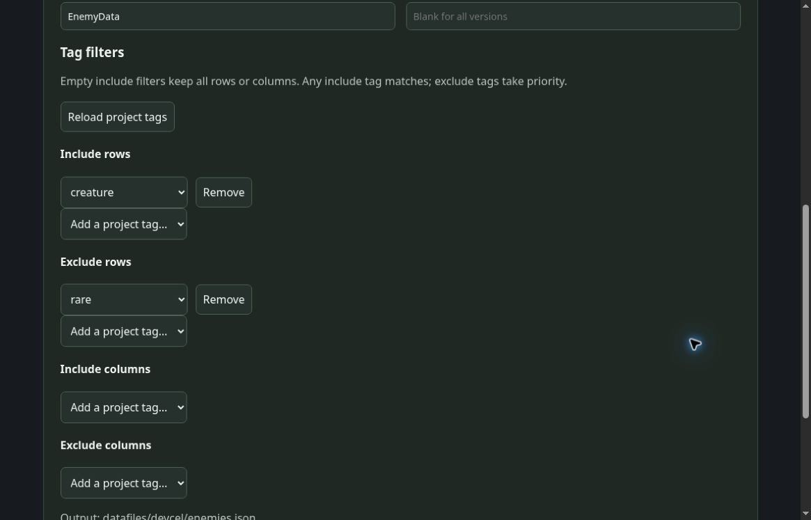

# GameMaker Importer Setup

The importer targets GML Code in GameMaker Monthly. Use the bundled CLI's browser UI to register `.devcelproj.toml` sources and generate JSON for Included Files. The GML runtime loads all tables using standard APIs. Settings support multiple sources, Content Version, namespace, class name, and per-source reimport.

Asset registration uses the IDE's **Add Existing** and **Included Files** tools; configuration uses the local browser UI.

## First setup

1. Extract `devcel-gamemaker-...zip` for your OS/CPU outside the game directory. Check for `tools/manifest.json` and `tools/<rid>/devcel[.exe]`. Source-only archives do not include the CLI.
2. Locate the folder containing your `.yyp`, for example `C:\Games\MyGame`.
3. On Windows, run `"C:\SDK\devcel-gamemaker\importer.cmd" "C:\Games\MyGame"` in Command Prompt. On macOS/Linux, run `sh /SDK/devcel-gamemaker/importer.sh /Games/MyGame`. The launcher verifies the manifest, OS/CPU, SHA-256, and CLI version.
4. Open the displayed local URL. Add a source and save its ID, project, namespace, class name, and Content Version. Select the `.devcelproj.toml` file itself. Blank Content Version includes all data; `0` is valid.
5. Click **Import**. The default output is `datafiles/devcel/<source-id>.json`. The CLI reads saved source data, evaluates formulas, and applies version filtering.
6. In Asset Browser, right-click → **Add Existing** and select the SDK's `scripts/DevcelRuntime/DevcelRuntime.yy`. If that script already exists, test in a separate project before replacing it. If your IDE cannot add it, create a GML Code Script named `DevcelRuntime` and paste in the bundled `.gml` contents.
7. Register `datafiles/devcel/<source-id>.json` under `devcel/` in Included Files. Check the actual destination. The importer leaves the existing Included Files and `.yyp` unchanged.
8. Load the database in your controller object's Create event:

```gml
master = new DevcelDatabase("base");
if (!master.load_file("devcel/base.json")) show_error(master.last_error, true);
var hero = master.by_id("Heroes", "hero-1");
show_debug_message(hero.get("hp"));
```

Replace table/record/column names with your data, or register `samples/master.full.json` as `devcel/base.json` to try the example unchanged.

## Save and reimport

Settings are stored in `devcel.import.json` beside `.yyp`. Relative `project` and `runtime_out` paths use that file as their base. Share settings in Git while preserving source/game directory layout.

- Use distinct source IDs, namespaces, JSON outputs, and `DevcelDatabase` instances, including for copies with identical UUIDs.
- After changing namespace, class name, or Content Version, save and pull that source. Inspect `manifest.content_version` in the output JSON.
- Namespace and `class_name` are shared settings metadata. GML has no built-in namespace, and this importer does not generate GML types. Use separate DB variables such as `master` and `events`.
- Pull constructs and validates all output before publication. A failed source retains its previous JSON. Check the UI/CLI result before relying on a new version.
- Runtime loading rejects unknown column keys. Failures retain the current snapshot and set `last_error`. Existing row/table handles retain their old snapshot; obtain new handles after reload.

## Live updates

Included Files are copied at build time. For desktop Debug runs, explicitly register the CLI's local runtime URL:

1. Leave the importer UI server running and pull the source.
2. Use the URL shown at startup with the actual source ID, for example `http://127.0.0.1:PORT/runtime/base?token=SESSION_TOKEN`. Tokens last for that session only; keep them out of Git and game builds.
3. In Create, call `if (debug_mode) master.watch_http("YOUR_RUNTIME_URL", 1);`.
4. In Step, call `master.update(delta_time / 1000000);`. In **Asynchronous → HTTP**, call `var result = master.handle_http(async_load);`. In Clean Up, call `master.stop_watch();`. Forward events to each source's DB. If `result.changed` is true, obtain new rows and apply them to game state.
5. Save in Studio, then pull the source. The next complete snapshot updates the running game, including schema changes.

This read-only HTTP polling uses saved output. CLI shutdown, HTTP failures, and malformed JSON preserve old data; polling retries after timeout. Request IDs discard delayed callbacks after Stop. Localhost polling on mobile/HTML5 is unsupported. `watch_http` is restricted to Debug; Release builds use Included Files offline.

For JSON the game writes in its writable area, use `load_file()` followed by `reload_if_changed()`. Keep the OS sandbox enabled.

## Value API

- `db.table(name)`, `table_by_uuid(uuid)`, `by_id(table,id)`: missing entries return `undefined`.
- `table.count()`, `ids()`, `columns()`, `column_info(name)`, `at(index)`: indices start at 0.
- `row.get_raw(column)` returns the normalized string; `row.get(column)` returns a typed value.
- I8 through U32 use numbers. I64/U64 use **exact decimal strings**. Unconditional `real()` conversion can round IDs or monetary values.
- F32/F64 are finite numbers; Boolean is boolean; String/Select/DateTime/None are strings.
- Color32/ColorFloat use `{r,g,b,a}`. Color32 is 0..255; ColorFloat preserves negative/above-one HDR RGB with alpha 0..1. There is no gamma conversion, premultiplication, or RGB clamping.
- Curve returns a struct containing points; empty cells retain configured start/end values. This runtime has no curve evaluation helper.
- `row.reference(column)` and `row.table_reference(column)` resolve within the same source. Version-filtered targets return `undefined`.

Full and minimal exports use the same runtime; omitted minimal cells are reconstructed from column defaults.

## Game builds and verification

Ship the GML script and generated JSON. Keep the CLI, source archive, settings JSON, `.devcel-state.json`, `.devcel-owner.json`, `.devcel-lock`, tokens, and authoring sources out of Included Files. Installation does not replace existing assets or hooks.

Fixture/static/launcher checks cover canonical fixture consistency, GML structure, shell syntax, paths containing spaces, working-directory independence, argument preservation, hash-tampering rejection, and restoring executable permission only after verification. Native GameMaker IDE/VM/YYC and target execution remain unverified by those checks.

From the repository root, run `python3 importers/gamemaker/tests/static_and_launcher.py --require-launcher`. Use `--static-only` where appropriate, including Windows. Missing POSIX tools produce an explicit SKIP/failure. See [tests/README.md](../../../importers/gamemaker/tests/README.md). Python is needed only for verification.

On the target engine:

1. Follow `samples/runtime-smoke.gml` to add full/minimal/invalid-column fixtures to Included Files, run the Create-event check, and confirm `DEVCEL RUNTIME SMOKE PASSED`.
2. Register two sources with identical UUIDs and verify that pulling one leaves the other's JSON and DB unchanged.
3. Test blank/zero/boundary versions, namespace/class-name changes, invalid sources, and output collisions. Failed import must preserve old JSON.
4. Check Debug live updates, equal-size value changes, schema changes, invalid HTTP responses, CLI restart, and game Stop/restart.
5. Stop the CLI and run a Release build using complete local data. Confirm existing Included Files remain present.

Official references: [Asset Browser](https://manual.gamemaker.io/lts/en/Introduction/The_Asset_Browser.htm), [Included Files](https://manual.gamemaker.io/monthly/en/Settings/Included_Files.htm), [json_parse](https://manual.gamemaker.io/monthly/en/GameMaker_Language/GML_Reference/File_Handling/Encoding_And_Hashing/json_parse.htm), [HTTP](https://manual.gamemaker.io/monthly/en/GameMaker_Language/GML_Reference/Asynchronous_Functions/HTTP/http_get.htm), [buffer_load](https://manual.gamemaker.io/monthly/en/GameMaker_Language/GML_Reference/Buffers/buffer_load.htm).

Compatibility with older GameMaker 2.3 IDE releases is not guaranteed.


## Per-source tag filters

Open the source in the bundled CLI’s browser settings and configure its tag filters. Save the source and import again.



The four filters are **row include**, **row exclude**, **column include**, and **column exclude**. Each source keeps its own selections. An empty include list includes all rows or columns; multiple includes use OR (any matching tag), and exclusions take priority. Content Version also applies.

Choose names from the source project’s saved tag presets. A saved name missing from those presets remains visible and editable: correct it to a preset or explicitly remove it. If an exported reference needs an excluded row, import fails and preserves the previous output.
