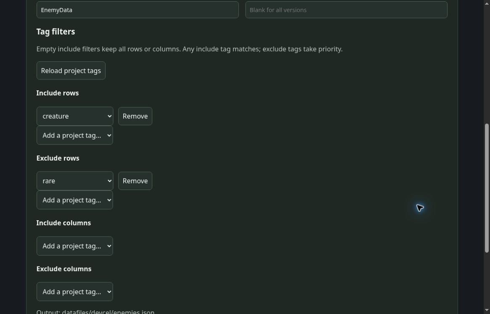

# WOLF RPG Editor importer

See the [installation, official CSV import, type limits, and distribution guide](../../../importers/wolf/README.md).

The bundled CLI's local browser settings interface imports complete saved projects and produces canonical JSON, UTF-8/BOM CSV, and a type/UUID mapping schema. Source ID, relative source path, namespace, class name, content version, Full/Minimal, and selective reimport settings are persisted.

Use WOLF's official database CSV import into a dedicated variable database. The importer does not synthesize undocumented WOLF binary formats, directly rewrite an existing database, or rely on a nonexistent editor plugin API. There is no automatic live reload; explicitly reimport CSV after regeneration.

Read CSV columns as strings to preserve U64, floating-point/HDR values, curves, and reference UUIDs. Game code must define conversion to WOLF variables, curve evaluation, and reference-to-numeric-ID mapping. More than 99 data columns plus UUID or 10,000 rows fails rather than truncating data.

CLI and standard CSV-reader fixtures do not establish WOLF/PowerShell UI or native multiline-cell compatibility. Use a new disposable database with the intended WOLF version and complete the README's acceptance checks before production import.

## Per-source tag filters

Open the source in the bundled CLI’s browser settings and configure its tag filters. Save the source and import again.

The four filters are **row include**, **row exclude**, **column include**, and **column exclude**. Each source keeps its own selections. An empty include list includes all rows or columns; multiple includes use OR (any matching tag), and exclusions take priority. Content Version also applies.

Choose names from the source project’s saved tag presets. A saved name missing from those presets remains visible and editable: correct it to a preset or explicitly remove it. If an exported reference needs an excluded row, import fails and preserves the previous output.
