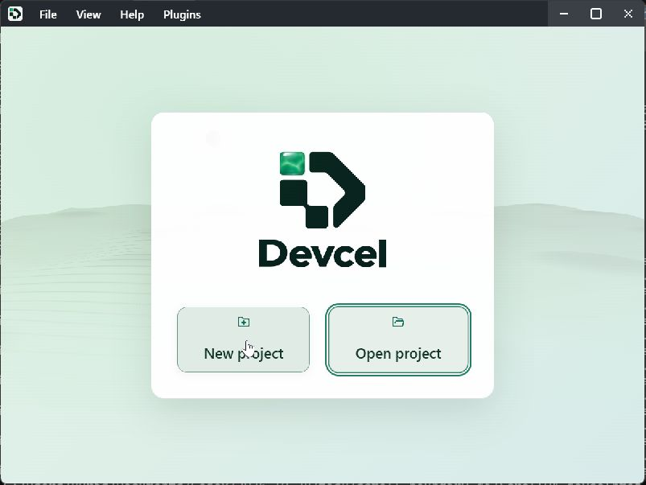

# Install and open Studio

[Manual](README.md) / Next: [Your first project](getting-started.md)

## Get the application

Use a Devcel Studio build for your operating system and CPU. To run it from source, see [Studio development and builds](../development/build-studio.md).

## Requirements

- Windows 10 or later, with Microsoft Edge WebView2 Runtime 111 or later
- macOS 13.3 or later, using the system WKWebView
- Ubuntu 24.04 x64 or Debian 13 x64 for the Linux deb package, with GTK 3 and WebKitGTK from `webkit2gtk-4.1`. Install current distribution security updates.

Check installed library versions on Linux. The WebKitGTK 2.40 minimum is based on upstream feature support; rendering on that exact oldest version has not been verified. Windows and macOS native validation is also a separate requirement.

See [Build instructions](../development/build-studio.md) and [Linux development](../development/linux.md) for build dependencies and verification conditions.

## Open on Windows

1. Download `devcel-studio-<version>-windows-x64.zip` from the release.
2. Right-click the ZIP and choose **Extract All**.
3. Open the extracted folder, then double-click **devcel-studio.exe**. Keep the `legal` folder and license files with it.

If Studio reports that WebView2 is missing, install the **Evergreen Runtime** from [Microsoft's WebView2 download page](https://developer.microsoft.com/en-us/microsoft-edge/webview2/), then open Studio again. Windows 11 includes WebView2; most Windows 10 devices already have it. To update Studio, extract the new release into a new folder and open its EXE. Settings remain in your Windows user profile.

<a id="install-on-ubuntu"></a>

## Install on Ubuntu or Debian

Download `devcel-studio-<version>-linux-x64.deb` from the release. Open a terminal in its download folder and install it:

```sh
sudo apt install ./devcel-studio-0.0.2-linux-x64.deb
```

Replace `0.0.2` with the version you downloaded. The package manager resolves the required system libraries from the distribution repositories. On Debian 13, GTK 3 is supplied by the `libgtk-3-0t64` package, which provides the GTK 3 ABI requested by the deb. Do not mix Ubuntu packages into Debian or manually relocate WebKit libraries/helper executables.

Open **Devcel Studio** from the application menu. A managed desktop that does not permit normal package installation is not made compatible by extracting selected libraries into a workspace.

## Open on macOS

The published v0.0.1 release has no macOS assets. These steps apply to a newer release that lists the matching DMG, or to a locally built DMG.

1. In **About This Mac**, check whether your Mac uses an Intel processor or Apple Silicon.
2. Download `devcel-studio-<version>-macos-x64.dmg` for Intel or `devcel-studio-<version>-macos-arm64.dmg` for Apple Silicon.
3. Open the DMG, drag **devcel-studio.app** to **Applications**, eject the disk image, then open the app from Applications.

The current macOS packaging uses ad-hoc signing and is not notarized by Apple.
A downloaded build may be blocked by Gatekeeper. Use only a source you trust;
consult your administrator or build locally if installation is blocked. These
packages still require native acceptance testing before general distribution.
To update, quit Studio and replace the application with the new matching build.
User projects and settings are stored separately from the application bundle.

## Open Studio

1. Open Devcel Studio from your applications or extracted application folder.
2. The welcome screen offers **New project** and **Open project**.



3. Choose a [display language](settings-and-plugins.md#change-the-display-language) if needed.
4. Continue to [Your first project](getting-started.md).

To open an existing project, choose its `.devcelproj.toml` file. Keep its `Tables/` folder with it.

## If Studio will not start

Check the requirements and the displayed error, then consult [Troubleshooting](troubleshooting.md). Locate and preserve your project folders before reinstalling the application. See [App updates](settings-and-plugins.md#update-the-app) for updating a working installation.
