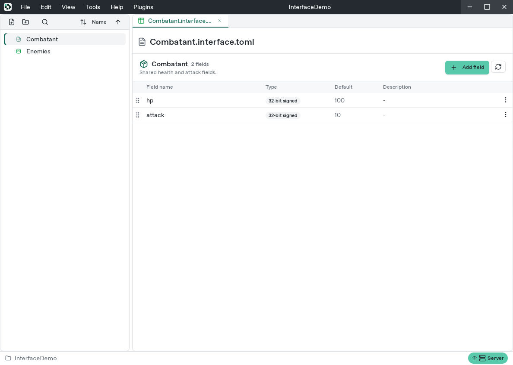
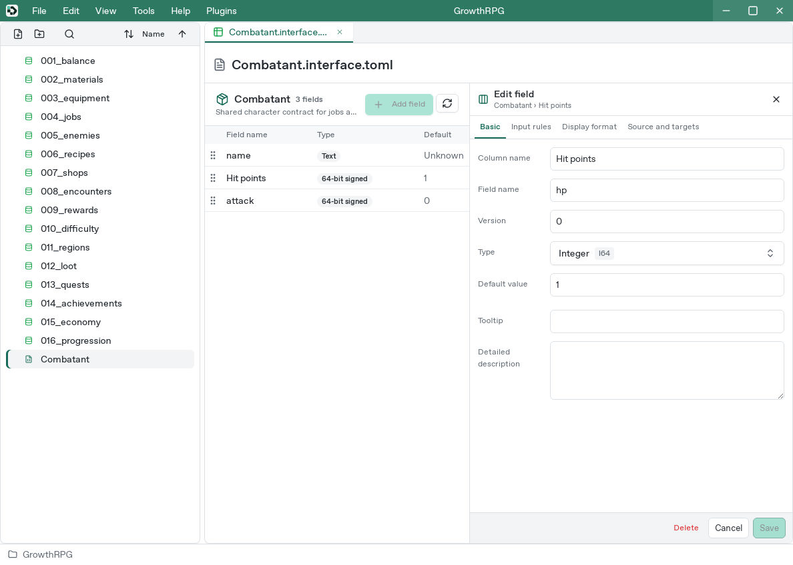
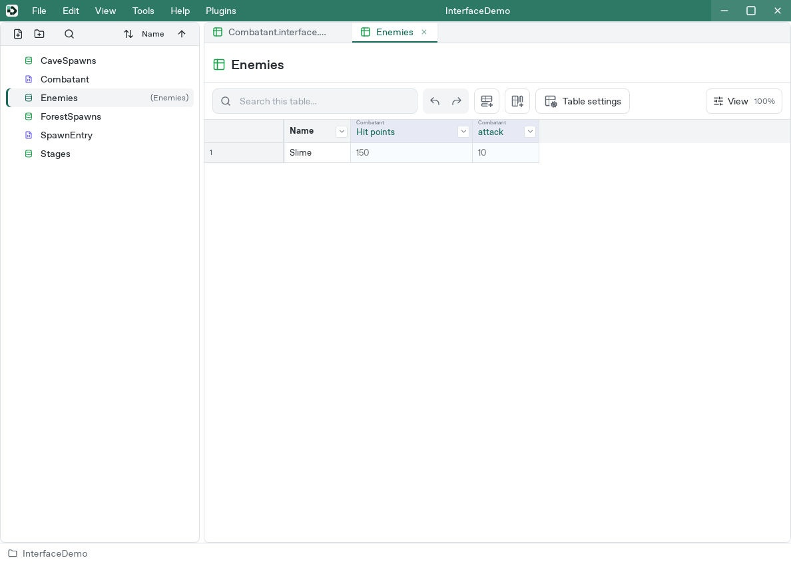
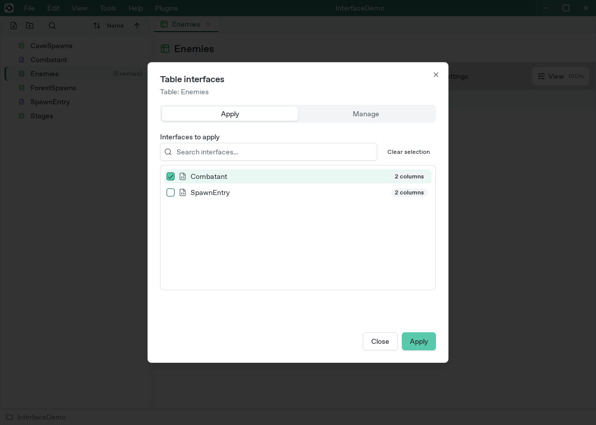
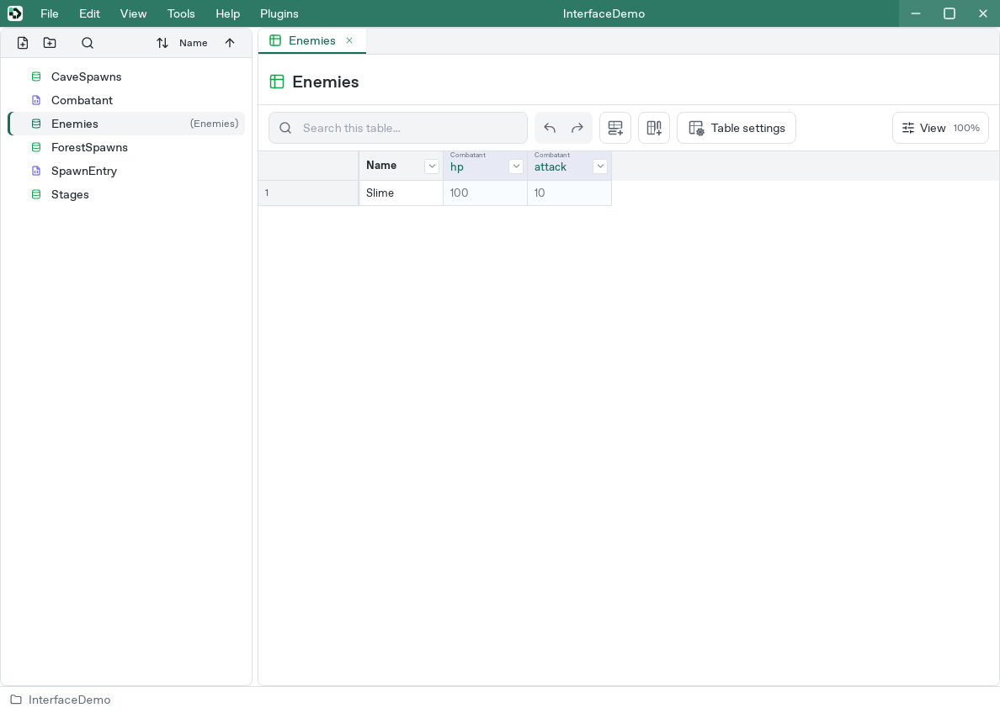
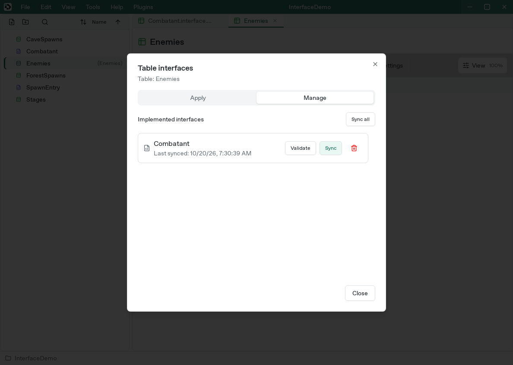
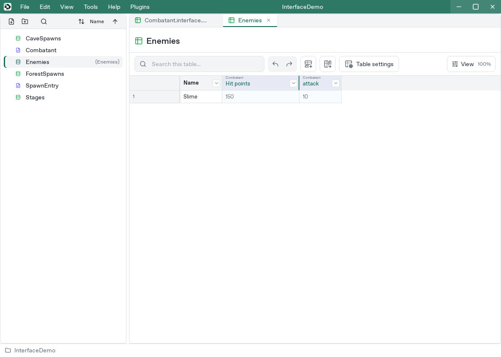

# Share columns with interfaces

[Manual](README.md) / [Studio](studio.md) / [Types and references](data-types.md) / [Versions](versions.md)

An **interface** defines fields shared by several tables. For example, `Combatant` can define `hp` and `attack` for both `Players` and `Enemies`. Each table still holds its own row values.

## Create a definition

1. Choose **Add file** in the file browser.
2. Select **Interface** and name it `Combatant`.
3. In its tab, choose **Add field**.
4. Set `hp`, I32, and default `100`, then **Add**.
5. Add another field, `attack`, with type I32 and default `10`.

Each field can have a separate display name, such as `Hit points`, while its internal field name remains `hp`. Leave the display name empty to use the internal name. The internal name keeps the ordinary identifier validation; display labels can contain spaces and localized text.

Double-click an existing field or use its edit button. Type, default, input rules, formatting, and version use the same settings as table columns.

## Apply an interface to a table

1. Open the target table, such as `Enemies`. The example uses a new Enemies table with `Slime` in Name.
2. Open **Table settings → Interfaces** above the grid.
3. Under **Apply**, select `Combatant` and choose **Apply**.

Valid table-settings changes apply before opening Interfaces. Closing Interfaces returns to refreshed Table settings. Interface operations apply separately; close Table settings to apply its valid draft.

4. Check the added columns and enter row values.

Interface columns show a small, muted defining-interface label above the field display name, in both ordinary and transposed views. Hover the field label to see its internal identifier. The interface field list also shows the display name and exposes the internal name on hover. Row values remain editable within the table's permissions. Shared name, type, default, rules, and version are controlled by the interface. Open the definition from the column's **Source and targets** section to change them. A table-local **Read-only** setting survives synchronization.

A same-named local column may trigger a warning. Matching names do not make two columns the same owner or storage area; inspect existing data before applying a shared definition.

## Review definition changes in tables

Studio checks applied interfaces for updates when opening a table. After changing a definition, inspect affected columns and values:

1. Change the interface's `hp` default to `150` and save.
2. In the table, open **Table settings → Interfaces → Manage**.
3. If an update is pending, choose **Sync** for that interface.

4. Review columns and versions. **Validate** checks missing fields, type mismatches, and constraint violations.

Cells without individual input inherit the new hp default of 150.

5. Repeat for other affected tables when needed.

**Sync all** synchronizes the interfaces applied to the currently open table.

A table can inherit, disable, or override interface conditional formatting. Edit the interface to change the shared rule itself. Deleting or unapplying an interface can affect columns and values; review the scope shown in confirmation before proceeding.

## Interface history

With the interface tab selected and focus outside an input, Ctrl/Cmd+Z undoes the latest definition edit; Ctrl/Cmd+Shift+Z redoes it. The **Edit** menu offers the same controls. This history is separate from table-value editing and resets when reopening the project.

Saved definition history remains in its file. Use the [CLI](cli.md) to inspect, restore, and merge it:

- `interface get`: definition and saved history
- `interface branches`: branched history
- `interface revert`: restore an older definition as a new history entry
- `interface preview-merge` / `interface merge`: inspect and combine divergent history

History version IDs differ from numeric row/column content versions. Reverting or merging changes the definition; synchronize required tables afterward. Back up the project before changes that may affect columns and values.

### Display names and variable names

**Display name** is the label shown in Studio. **Variable name** is the internal identifier used by generated code. They are separate inputs, in that order; changing the display name does not rename the variable. Choose **Save** to commit an existing field edit, or close with **X** to discard it.
