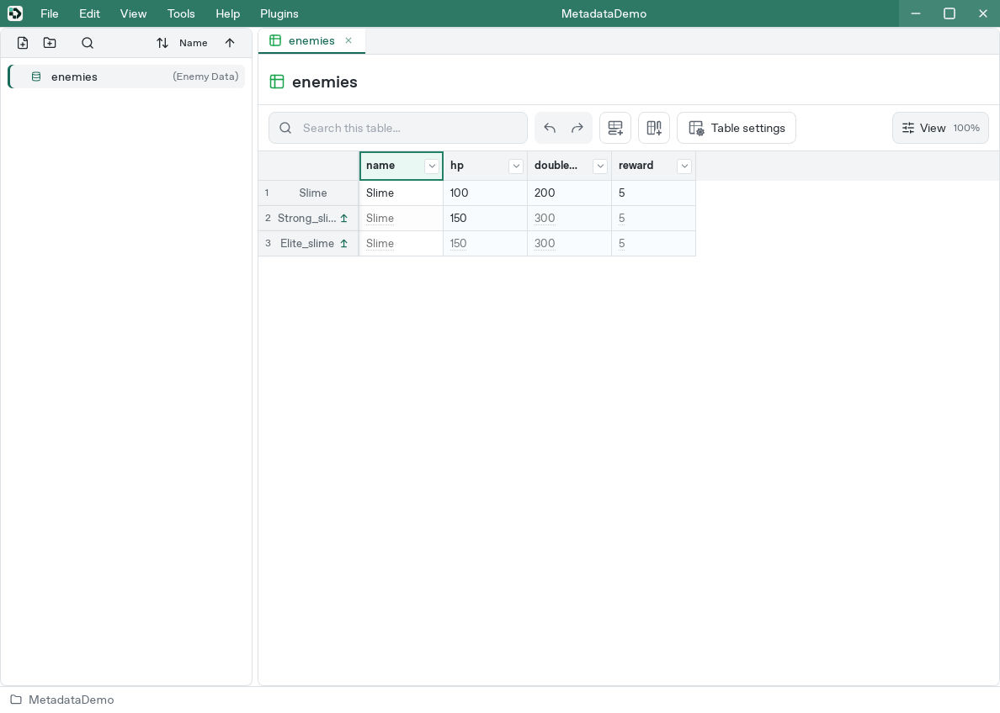
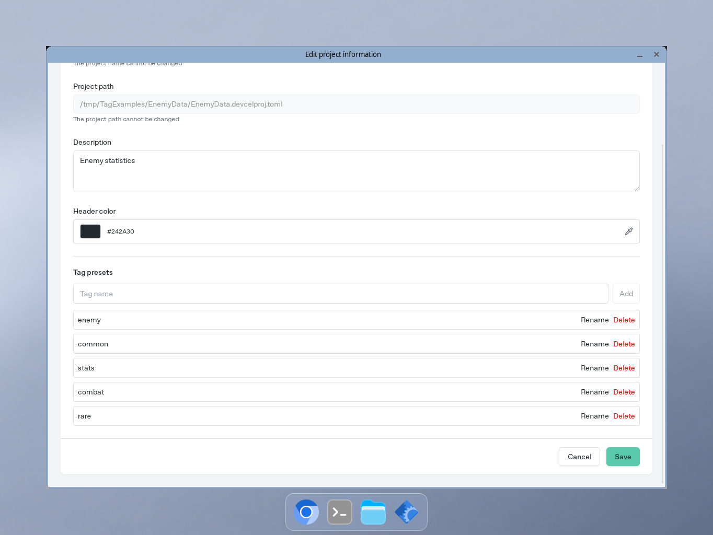
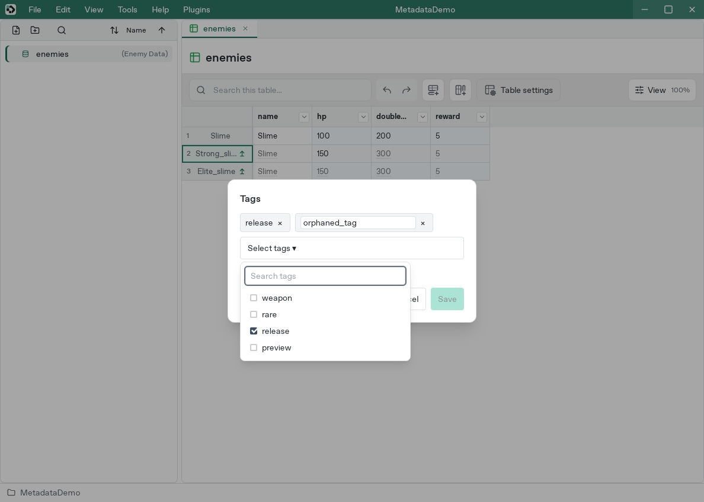
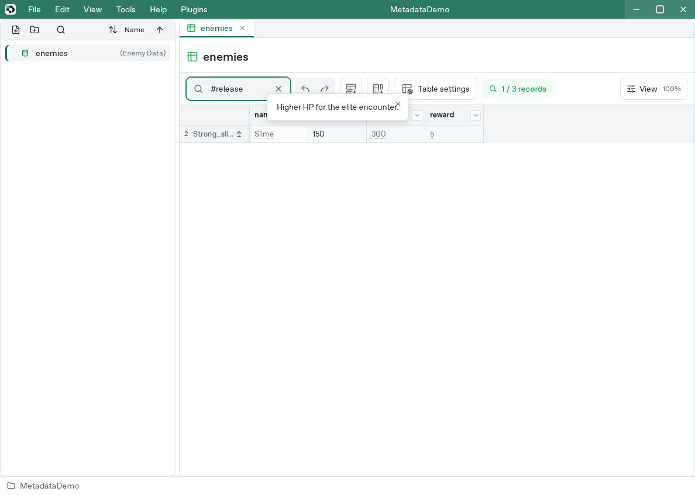
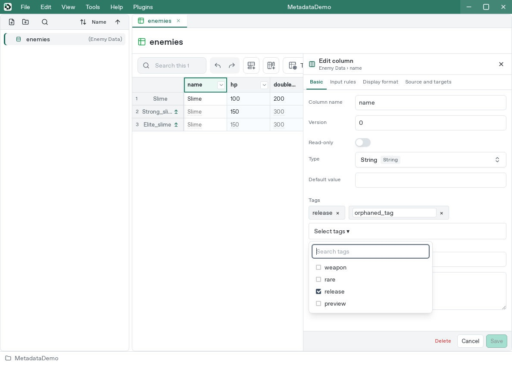
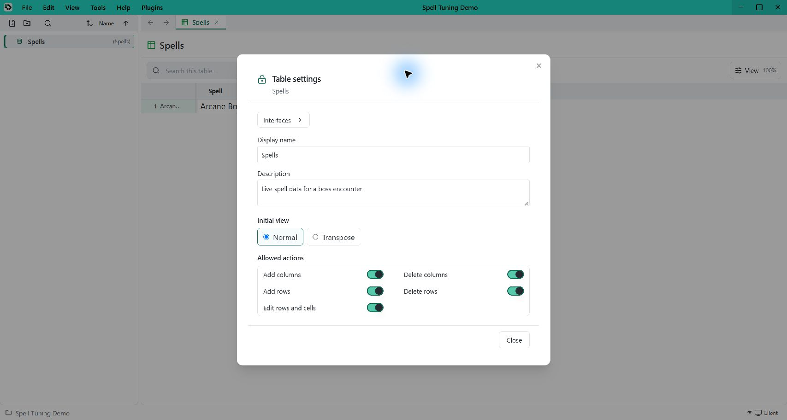

# Notes, tags, and parent records

[Manual](README.md) / [Studio controls](studio.md) / [Formulas](formulas.md)

Use tags to find related rows, notes to explain values, and parent records to keep related items consistent. A **record** is one row of data. A **parent** supplies values or formulas to a **child** row; you can change individual cells in the child.

## Build a variation of an item

For example, a standard sword and a heavy sword can share an attack calculation while having different prices.

### Prepare two rows

In a practice table, [add columns and rows](studio.md#add-and-configure-columns):

- `price`: an integer column with a default of `50`.
- `attack`: an integer column.
- `effect`: a String column with a default of `None`.

Double-click each row heading to give the rows the labels **Standard_sword** and **Heavy_sword**. These labels make the rows easy to recognize in the parent picker. New or changed row labels use ASCII letters, digits, and underscores, start with a letter or underscore, and contain at most 255 characters. Clear the label to return to the automatic row number.

In **Standard_sword**, enter `100` for `price`, `=price/10` for `attack`, and `Slash` for `effect`. The attack cell displays **10**. Here, the formula means “divide this row's price by ten.”

### Choose the parent

1. Right-click the **Heavy_sword** row heading and choose **Parent record**.
2. Select **Standard_sword** from the list and click **Save**.
3. Clear the input in Heavy_sword's `price`, `attack`, and `effect` cells. Empty input follows the parent; clearing an existing override restores that relationship.

Heavy_sword now shows **100**, **10**, and **Slash**. Its inherited cells have a dotted underline, and an arrow beside the row label marks the parent relationship.

Enter `150` in Heavy_sword's `price` cell. Its attack becomes **15**: the inherited formula uses Heavy_sword's price. Standard_sword still has price **100** and attack **10**.

Typing into an inherited cell creates an **override**, a value or formula belonging to that child. Other inherited cells continue to follow their parent. For example, changing Standard_sword's `effect` to `Cleave` also changes Heavy_sword's effect.

The enemy-data example below shows the same relationship indicators: arrows beside child rows and dotted underlines on inherited cells.

## Choose where a cell gets its value

A cell uses its own nonempty input first. When its input is empty, it follows the parent record, then the column default, then the type's empty fallback. There are no separate **Column default** or **Explicit empty** cell modes.

| Input | Result in the sword example |
| --- | --- |
| Clear the input | Heavy_sword follows Standard_sword's price **100**; its inherited attack becomes **10** |
| `150` | Heavy_sword overrides its price; its attack becomes **15** |
| `=""` in a String cell | The formula returns an intentional empty string even when a parent or column default supplies text |
| `0` in a numeric cell | The cell keeps an explicit zero instead of inheriting |

To use the column default without inheriting a parent value, change or detach the parent relationship, or enter the desired value explicitly. Empty input does not skip a parent that supplies a value.

### Find or change a parent

In the normal grid, click the arrow beside a child row to select its parent. If a filter hides the parent, clicking the arrow opens **Parent record**, where you can see the selected parent.

To choose a different parent, right-click the child's row heading, open **Parent record**, select another row, and **Save**. Cells with empty input follow the newly selected row; child overrides stay in place. The list contains eligible rows from the same table.

### Make a child independent

1. Right-click the child's row heading and choose **Parent record**.
2. Select **Detach parent** in the list, then click **Save**.

The child keeps the values and formulas it was using. Later edits to its former parent leave it unchanged. Formulas still calculate: if Heavy_sword has price **150** and the inherited formula `=price/10` when detached, its attack stays **15**; changing its own price to **200** then produces **20**.

### Copy a formula or its result

Normal copying preserves the cell's current input, including an inherited formula. Copying Heavy_sword's attack this way copies `=price/10`, so it calculates from the destination row's price when pasted.

To copy the displayed number instead, right-click the attack cell and choose **Copy values**. If it displays **15**, pasting inserts `15` as a fixed value.

## Manage project tag presets

Open **Edit → Edit project information** and find **Tag presets**. You can also choose **Manage tags** from a row or column tag selector; your current edits stay in place.

- **Add:** enter a tag name and click **Add**. For example, add `weapon` and `rare`.
- **Rename:** click **Rename** beside a preset, enter its new name, and click **Rename** again. Check the old and new names in the confirmation. Confirming updates the tag across the project's rows and columns, with progress shown while tables are scanned and changes are saved.
- **Delete:** click **Delete** beside a preset and confirm. If the tag is still used, the message identifies a table using it. Remove those row and column assignments before deleting the preset.

New or renamed tags follow the same naming rules as row labels. Existing names remain unchanged until you edit them.

## Find rows with tags

Tags let you group rows without adding another data column. For example, give several items the tag `weapon` to find them together.

1. Right-click a row heading and choose **Tags**.
2. Open **Select tags**, check `weapon` and `rare`, and click **Save**. Use **Search tags** to narrow the list.
3. In the table search box, enter `#weapon` to show rows whose tags contain `weapon`.

Tag searches ignore capitalization and match part of a tag too: `#weap` also finds `weapon`. A search beginning with `#` looks only at row tags. Ordinary search also checks tags alongside row labels and displayed cell values. Clear the search to show all rows again.

Reopen **Tags** to change the selection. Uncheck a tag in the list or use its **×** button to remove it, then **Save**.

An existing tag that is absent from the project's presets appears as an editable name. Correct it and press **Enter** or click outside the field. When its name matches a preset, it becomes a regular selected tag. Click **Save** to keep the change.

## Explain a particular cell

A cell memo is useful for a short explanation such as “Price includes the rare handle.”

1. Right-click the cell and choose **Cell memo**.
2. Enter the note, then click **Save**.
3. Hover over the cell to read the memo. A small corner mark helps you find cells with notes.

To change a memo, reopen **Cell memo**. To remove it, clear its text and **Save**. Renaming the column keeps its cell memos attached.

This example filters rows using `#release` and shows a memo when hovering over a cell.

## Describe a column and adjust its text size

Double-click a column heading to open its settings.

In **Basic**, use:

- **Tags:** open **Select tags** and check the project presets to assign to this column.
- **Tooltip** for a short hint about the column, such as “Purchase price in gold.”
- **Detailed description** for longer guidance, such as the units and how to choose a value.

Column tags describe the column; the `#weapon` row search above uses tags added through row headings. Column tags belong to the current table, including for columns supplied by an interface. Add or rename choices under [project tag presets](#manage-project-tag-presets).

Open **Display format** and change **Font size** to make the column's cell text easier to read. The range is **6–72 pixels**; **Reset** restores **12 pixels**. Click **Save** to apply the column settings. If larger text needs more room, increase the row height by dragging its boundary.

## Describe a table

Open **Table settings** above the grid:

- **Description** can explain what the table contains, such as “Equipment prices and attack values.”
- **Tooltip** holds a short hint for the table.
- **Initial view** and **Allowed actions** control how the table opens and which edits are available. See [Table settings](studio.md#set-the-initial-view-and-allowed-edits).

Close Table settings to apply its valid draft together.

## Undo changes and use either grid layout

Use **Undo** or **Redo** to step back or forward through saved changes to tags, memos, parent relationships, and cell inputs.

These actions also work in the transposed grid. Right-click a record heading for its tags or parent, and right-click a cell for its memo or editing actions.

If an editing action is disabled, check **Allowed actions** in **Table settings** and the column's **Read-only** setting. Tags and parent changes need row/cell editing permission; cell memos and input changes also respect the column's protection.
