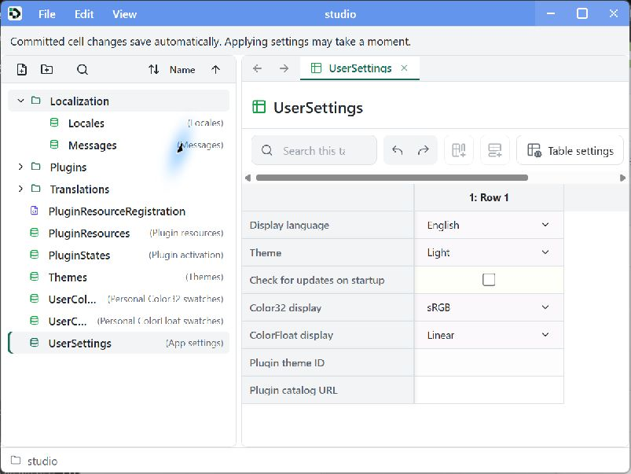
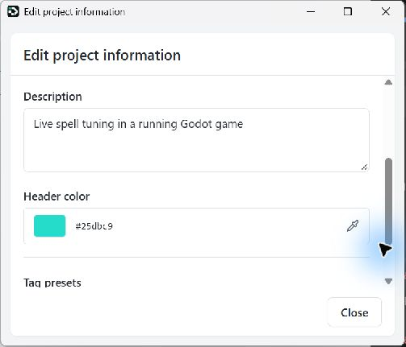
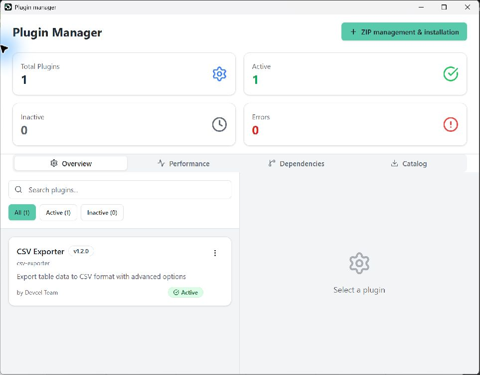
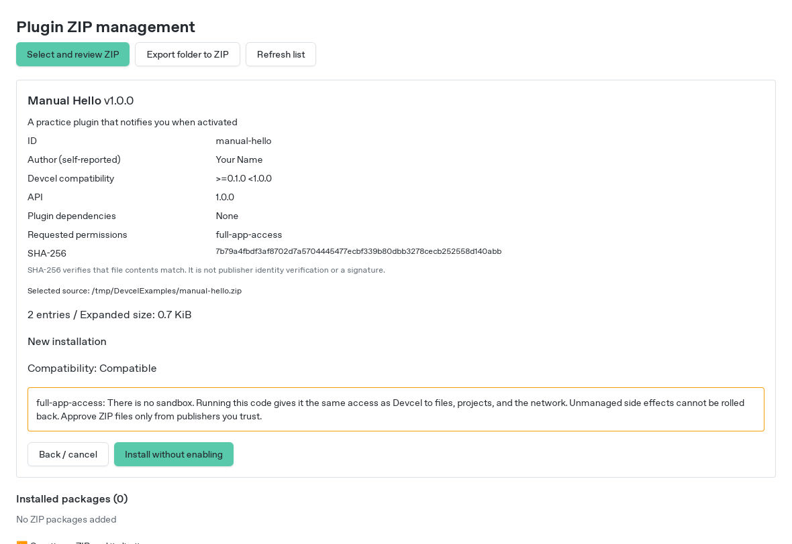
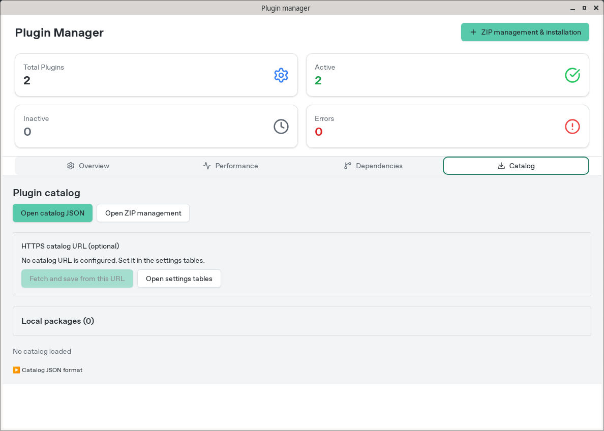
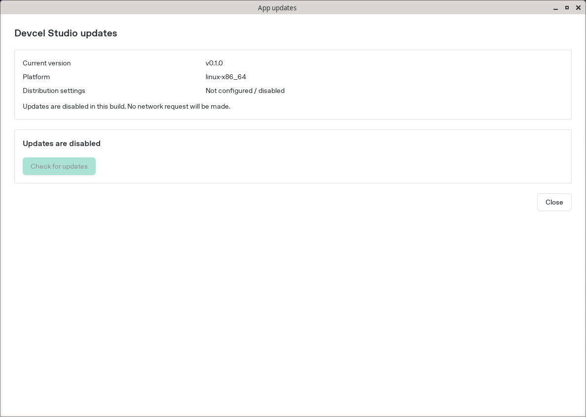

# Settings and plugins

[Manual](README.md)

## Change the display language

1. Open **View → Options**, available even before opening a project.
2. Click the selection arrow at the right edge of the **Display language** value in `UserSettings`. The first click opens the choices.
3. Select a language, or `system` to follow the operating system.
4. Wait for the save, validation, and application status to finish before checking the new interface language. Close the settings window to return.

New settings projects include Japanese (`ja`), English (`en`), French (`fr`), Spanish (`es`), German (`de`), Italian (`it`), Simplified Chinese (`zh-Hans`), Traditional Chinese (`zh-Hant`), Swedish (`sv`), Finnish (`fi`), Norwegian Bokmål (`nb`), Arabic (`ar`), Bengali (`bn`), and Hindi (`hi`). System Chinese selection prioritizes a specified script; Taiwan, Hong Kong, and Macao map to Traditional Chinese and other regions to Simplified Chinese. Arabic uses right-to-left app controls. Table data and formulas retain their original content.

On an app-version upgrade, new standard settings and translations are merged automatically with your previous customizations. You can also add your own languages using the [CLI localization procedure](cli.md#studio-localization).

Settings are local to this application environment. If saving fails, check the displayed selection before retrying.

Edit a project's description and header color with **Edit → Edit project information**.

## Edit settings and recover

View → Options edits a machine-local Devcel project using the same tables and Undo/Redo as ordinary data. `UserSettings` holds application choices; `Themes` stores one record per theme, with a stable key, a localized label reference, a light/dark appearance flag, and typed Color32 columns for its colors; `PluginStates` holds enabled choices. The two user-swatch tables store Color32 and ColorFloat palettes separately.

A valid save applies to open windows. If an intermediate edit is invalid, the settings remain editable and Studio keeps using the last valid appearance and values. Correct the marked values or use Undo. Your work project's table selection, drafts and history remain separate from the settings window.

Close the settings window before resetting settings. Reset preserves a backup and starts from the bundled settings project, replacing custom settings, themes and translations. Preserve any customizations you want to reuse first. Editing `PluginStates` does not approve a package or grant execution permission.

## Settings for each app version

Each exact app version owns its settings project, plugin package copies and local editor layout preferences. On first launch, Studio automatically copies from the latest older completed stable version and applies that release's setting changes. No migration confirmation is required. Later edits in either version are independent; returning to an older version uses its existing settings.

The settings project is under the application's configuration directory at `settings-versions/<version>/settings/studio.devcelproj.toml`. Its saved standard baseline and compiled state are adjacent. Plugin packages and their index are under the application's data directory at `plugin-versions/<version>/`. These roots use the application identifier `org.devcel`.

If migration fails, Studio uses this version's bundled defaults and shows a nonblocking notice. Previous settings remain untouched. Correcting the old source allows a later refresh to retry; an explicit reset starts this version from defaults and retains a backup. Reset never changes another version's settings. Incompatible copied plugins remain unable to execute. Plugin catalogs are disposable caches and start empty for a new version.

This settings isolation does not change operating-system installer behavior or create a separate installation automatically.

## Install a plugin

Open a project, then choose **Tools → Plugin Manager → ZIP management & installation**.

Hello World is not bundled. The plugin system remains available for packages you explicitly install and approve.

Plugins run with the app's privileges and can access files, projects, and the network. They are not sandboxed. The author field is self-declared; SHA-256 verifies package contents, not the author's identity. Review the source of a package before granting execution access.

1. Choose a trusted package with **Select and review ZIP**.
2. Review its name, version, author, compatible Devcel versions, dependencies, permissions, and SHA-256. Reviewing a ZIP does not run its code.

3. Choose **Install without enabling**. Replacing the same ID or moving to an older version requires the corresponding confirmation.
4. To permit execution, acknowledge `full-app-access` and choose **Approve access and allow execution**. This package permission is separate from the enabled setting.
5. Choose **Open settings tables** and open `PluginStates`. Add a row if needed and enter the ZIP's ID under **Plugin ID**. The temporary blank-ID error clears when a valid ID is entered.
6. Check **Enabled**. The main window runs the plugin when both execution permission and the enabled setting are present.

Approval applies to the reviewed contents. Updated or changed packages need fresh approval. Installation rejects a ZIP changed after review.

## Disable, update, and restore

- Unchecking **Enabled** stops the plugin and keeps it disabled after restart. **Revoke execution permission** also stops it. Both approval and Enabled are needed to run it again.
- An approved version that activated successfully can activate again at the next launch.
- Install, approve, and enable dependencies first. Revoke execution permission for dependent plugins before updating a dependency.
- A failed update attempts to restore the previous version. Automatic restart is limited to an approved version that was active in the same app session.
- Restoring an older version or deleted entry leaves it disabled. Enable it explicitly when ready. History retains the latest five entries per ID.
- After a timeout, inspect the list and main-window state before retrying. A timeout does not establish that processing was cancelled.

Disabling or restoring a plugin does not undo changes it already made to external files.

## Browse a catalog

The catalog shows local packages and optional additional catalogs.

- **Local file:** use **Open catalog JSON**.
- **HTTPS:** save a catalog URL through **Open settings tables**, return to Catalog, and choose **Fetch and save from this URL**.
- **ZIP:** use **Open distribution URL in external browser**, then review the downloaded ZIP through the installation steps above.

Catalogs are cached for offline browsing. Browsing a catalog leaves download, installation, approval, and execution as separate actions. Credential-bearing URLs and redirects are rejected.

## Develop a plugin

The [plugin development guide](plugin-development.md) covers a minimal plugin, a working TypeScript example, APIs, cleanup, testing, and ZIP creation.

## Update the app

Open **Help → App updates** to inspect the installed version and available update state.

The repository's standard build has no update endpoint or signing public key configured, so in-app updates and update-check requests are disabled. For configured builds, see [App updates](../development/app-updates.md) for the flow and cancellation limits.
