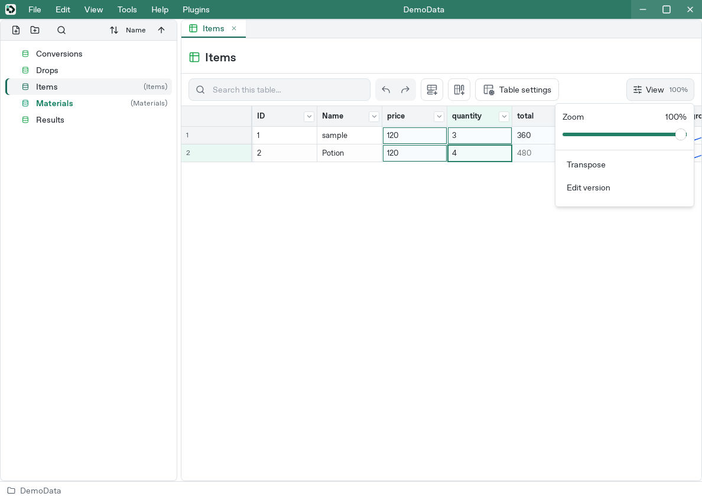
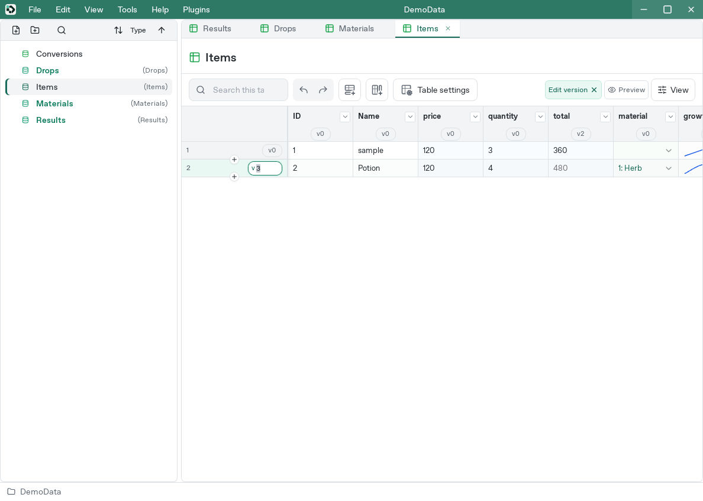
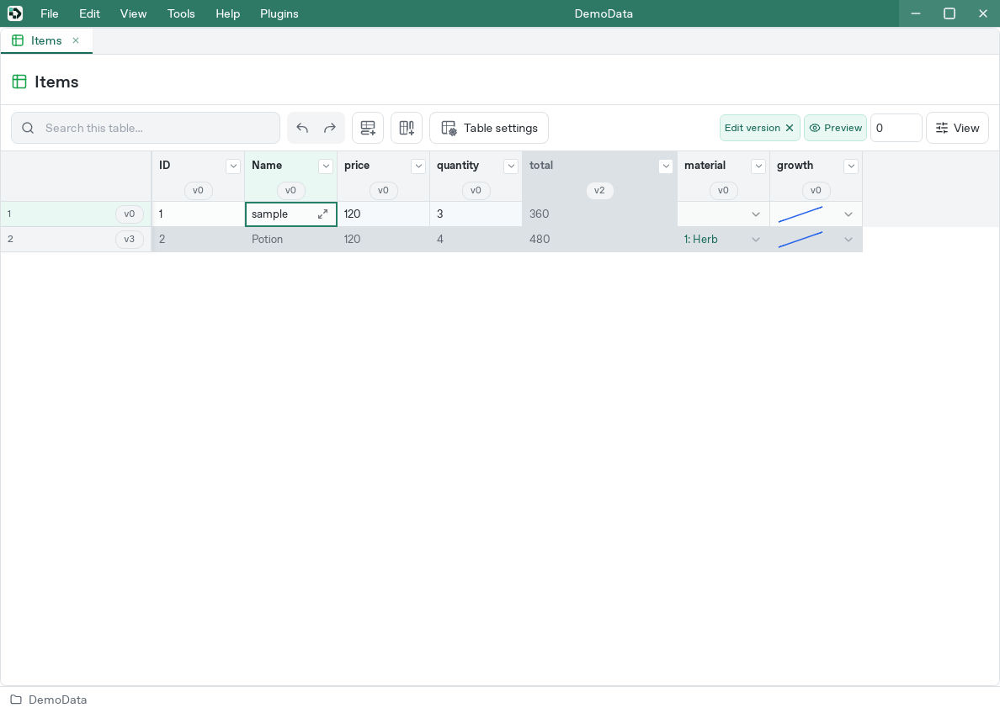
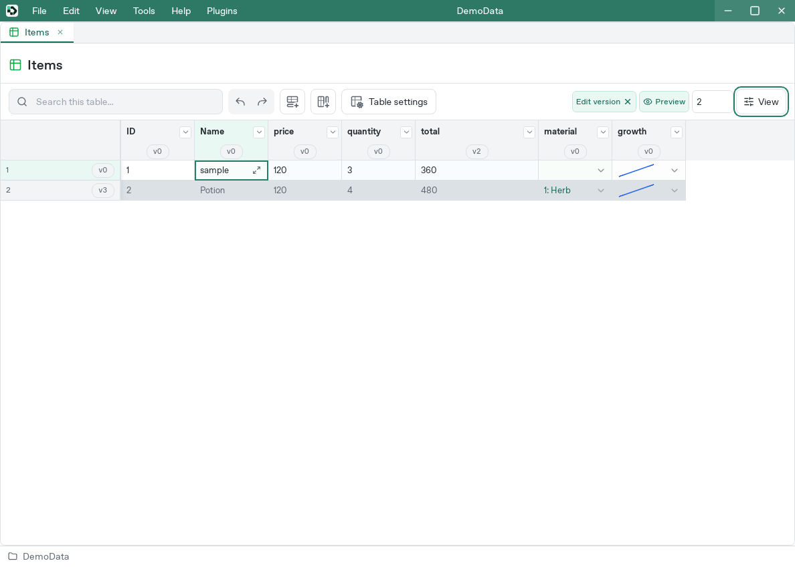
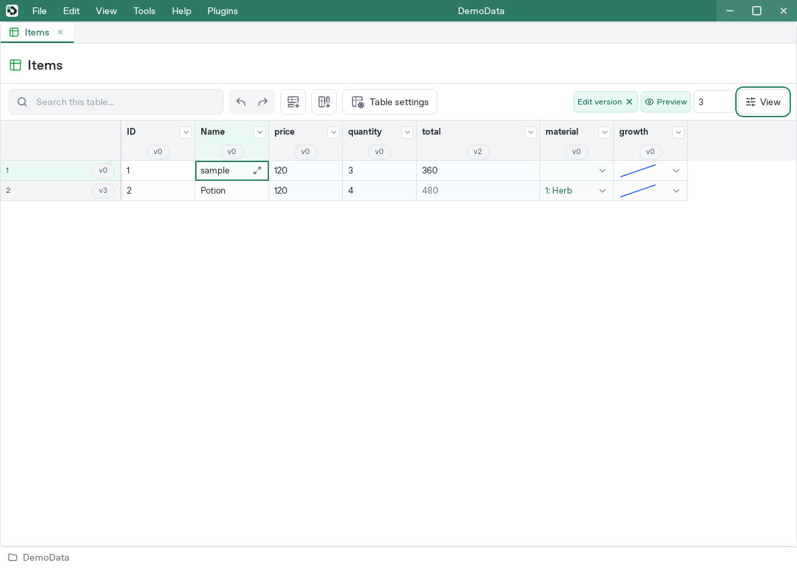

# Export rows and columns by content version

[Manual](README.md) / [Studio](studio.md) / [Godot](godot.md) / [Unity](unity.md) / [CLI](cli.md)

Assign numeric versions to rows and columns to control which releases include them. For example, existing data can use `0` while a planned character or field uses `3`.

## Which rows and columns are included?

A version is an integer from 0 to 4,294,967,295, defaulting to zero. Exporting version `N` includes rows and columns whose version is at most `N`. Excluding a row removes the whole row; excluding a column removes the whole column.

Using Items from [Getting started](getting-started.md) and [Formulas](formulas.md), set sample's row version to 0, Potion's to 3, and total's column version to 2. Other columns stay at zero.

| Setting | Release 0 | Release 2 | Release 3 |
| --- | --- | --- | --- |
| sample row: 0 | Included | Included | Included |
| Potion row: 3 | Excluded | Excluded | Included |
| price column: 0 | Included | Included | Included |
| total column: 2 | Excluded | Included | Included |

Omitting the export version includes all rows and columns. Explicit version zero includes only version-zero entries.

## Edit row and column versions in Studio

1. Open a table.
2. Choose **View** at the top right inside the table.
3. Enable **Edit version**.



4. Click a badge such as `v0` on a row or column header.
5. Enter an integer and press Enter. Moving focus also saves a valid value.



Set Potion's row version to `3` and total's column version to `2`. Column versions can also be edited under **Basic → Version** in column settings.

Esc cancels input before submission. Empty, negative, fractional, and out-of-range values cannot be saved. Failed saves retain the input and error for retry. Saved changes support grid undo/redo.

## Preview a release

1. With version editing enabled, choose **Preview**.
2. Enter a version such as `2` in **Release version** beside it.
3. Excluded rows and columns turn gray.

### Compare versions 0, 2, and 3







Invalid input keeps the last valid preview version. An empty field does not select zero or all versions.

The preview retains every row and column. Gray cells remain editable and confirmed edits save normally. Turning off Preview keeps version badges; ending version editing also ends preview.

This changes the table's view. Configure the actual export version separately in the importer or CLI.

## Change interface-owned column versions

Interface versions are controlled by their definition:

1. Click the column's badge and inspect **Source and targets**.
2. Open the defining interface, change **Basic → Version**, and save.
3. Review its target table. If an update remains pending, use **Table settings → Interfaces → Manage → Sync**.
4. Check the badge and preview.

Check every required target table. See [Interface synchronization](interfaces.md#review-definition-changes-in-tables).

## Apply versions to game data and code

Select a version in [Godot](godot.md), [Unity](unity.md), or [CLI](cli.md) settings. Use the same version for runtime data and generated code:

```sh
# Runtime rows and columns whose version is at most 2
devcel --project ./SampleGame export runtime --version 2 --out master.json

# C# code with the same eligible columns
devcel --project ./SampleGame export code csharp --version 2 --out DevcelDatabase.cs
```

Full and Minimal apply the same version filtering. In an export settings file, set matching `version` values on corresponding `[[runtime]]` and `[[code]]` entries.

Studio's CSV exporter writes the full table's current inputs after resolving parent inheritance and column defaults. Formulas remain formula strings. Version preview does not filter CSV output.

### Formulas and references

- Formulas can use excluded columns. An exported price can depend on a rate column that is not itself exported.
- A failed exported formula blocks output. An error in an excluded column matters when a retained formula depends on it.
- Referenced rows must be available in the intended release. Check both source and target versions.
- Same-named rows are separate UUIDs. Two rows named alike at versions 0 and 3 are both included in release 3.

## What content versions preserve

A version means “include this entry from this release onward.” Editing a version-zero row today changes its value in the next version-zero export too. Reproducing older values requires the project files from that time.

Interface history IDs and JSON `schema_version` describe separate concepts.

## Before exporting

1. Preview the release and inspect included rows and columns.
2. Synchronize changed interfaces into the required tables.
3. Check reference targets in the same release.
4. Align runtime and code versions.
5. Load the result in the game and check counts, fields, and references.
