# Types and references

[Manual](README.md) / [Studio](studio.md) / [Interfaces](interfaces.md) / [Formulas](formulas.md) / [Godot](godot.md) / [Unity](../../../../INSTALL.md)

A column's **type** determines the values it accepts and how the game reads them.

## Choose a basic type

[Add a column](studio.md#add-and-configure-columns) and open its type selector. You can search by type name, such as `U16`.

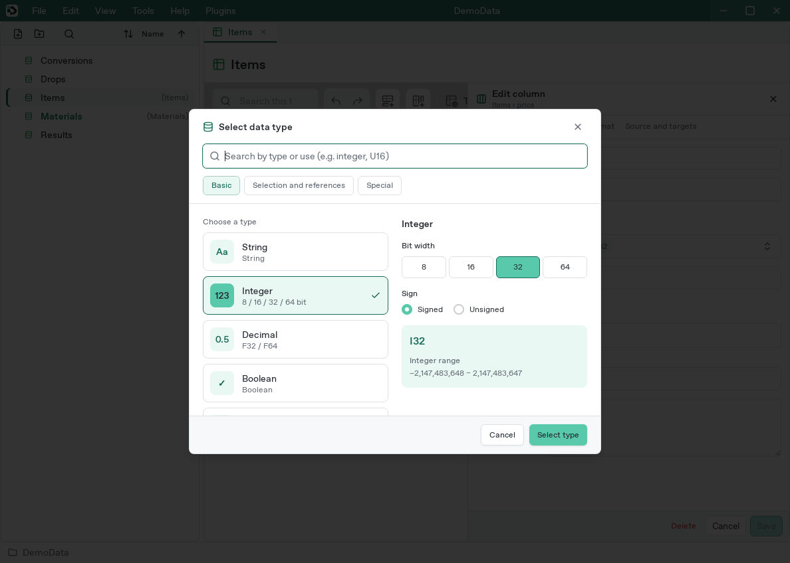

Choose **Integer → 32 → Signed** for I32. Review the type and range on the right, then choose **Select type**.

| Type | Use and examples |
| --- | --- |
| String | Names, descriptions, keys: `Potion`, `Healing herb` |
| I8 / I16 / I32 / I64 | Signed integers, such as a modifier `-10` or price `100` |
| U8 / U16 / U32 / U64 | Nonnegative integers, such as quantity `3` |
| F32 / F64 | Decimals, such as multiplier `1.5`; F64 has greater precision |
| Boolean | On/off values, edited with a true/false checkbox |
| Reference | One row in another table |
| TableRef | A whole table implementing a required interface |
| Color32 / ColorFloat | RGBA colors and opacity, including [HDR colors](colors.md) |
| Curve | Growth and interpolation curves |

Integer types differ in bit width and whether negative values are allowed. U8 spans 0–255; I32 spans −2,147,483,648–2,147,483,647. Decimal input such as `1.5` is invalid in an integer cell.

### Defaults

Defaults apply when a cell has no input. If a column defaults to `10`, entering `25` overrides it for that row. Clearing the input restores `10`. Defaults can also be [formulas](formulas.md).

## Change an existing column's type

1. Double-click its header and change the type under **Basic**.
2. Choose **Save** to validate saved inputs and the default, then review conversion examples and error counts.
3. Choose **Save** again to apply a valid conversion.

Errors prevent the change. String `00012` can become integer `12`; `1.2` is not silently rounded and `300` cannot fit U8. Floating-point conversions reject nonfinite values and detected precision loss.

A column with saved formulas cannot change type. Decide whether fixed results are appropriate and preserve formulas elsewhere if you need to replace them before converting.

## Reference: select another row

For example, let the `material` column in `Items` select a material from `Materials`:

1. Create `Materials` with `Herb` and `Ore` in its `Name` column.
2. Add a `material` column to `Items` with type **Reference**.
3. Set **Target table** to `Materials`.
4. Select the material-name column as **Display column**, then **Add** or **Save**. Without a display column, the picker uses row labels or numbers.

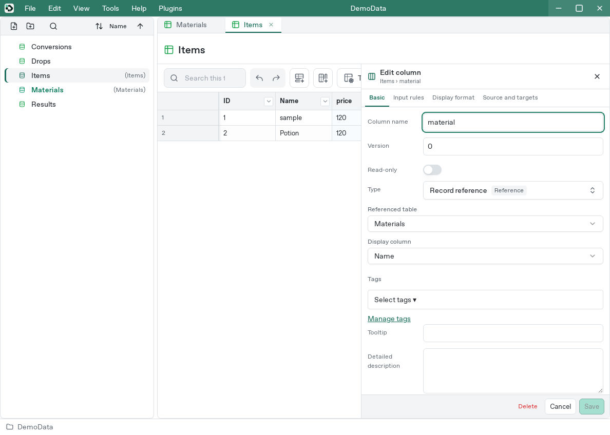

5. Open the arrow on a material cell and select **1: Herb**. Search narrows the candidates.

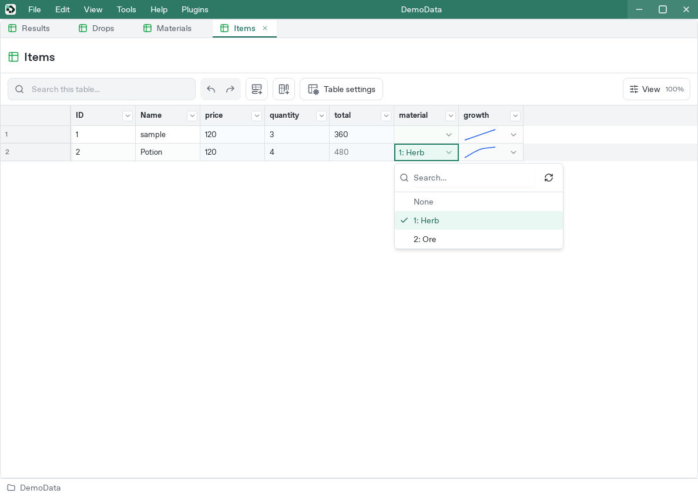

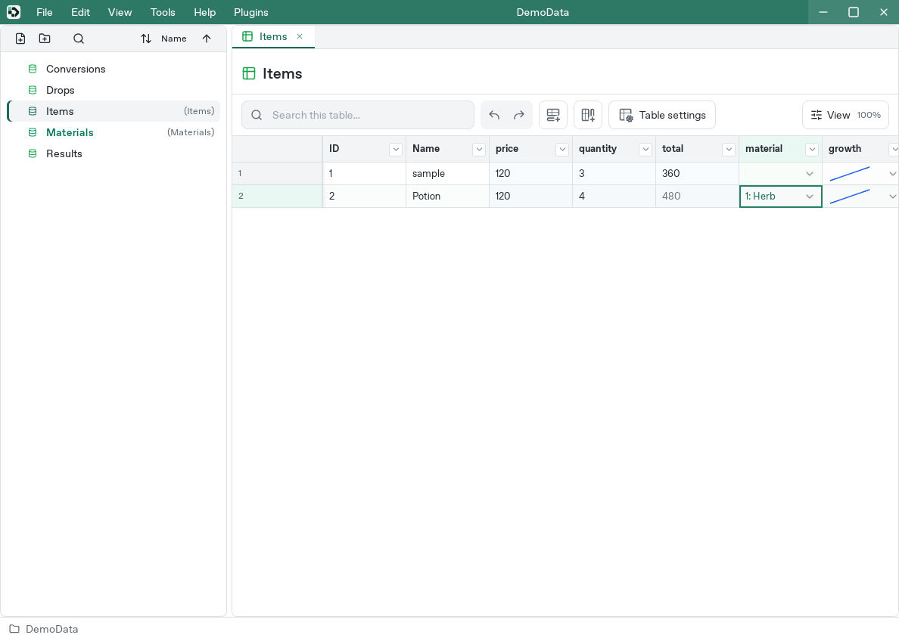

The cell displays the material name but stores the target row's UUID. Select **None** to clear the reference.

Click the blue reference label to open the target table and highlight that row. Any search hiding the target is cleared.

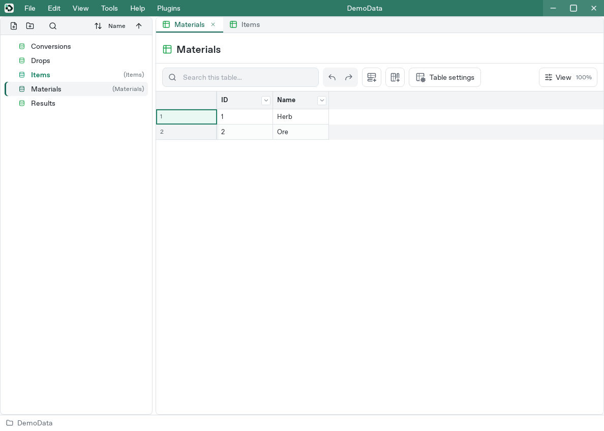

A referenced row cannot be deleted while another row still points to it. Clear or change the surviving references first, or delete all referencing rows together in one operation. This includes inherited values, defaults, and formulas.

For missing targets, check externally edited data and export filters. A [versioned export](versions.md) can exclude a referenced row.

## TableRef: select a whole table

Use TableRef when, for example, each stage selects a different enemy-spawn table and every candidate must have the same fields.

1. [Create an interface](interfaces.md#create-a-definition) named `SpawnEntry`.
2. [Apply it](interfaces.md#apply-an-interface-to-a-table) to `ForestSpawns` and `CaveSpawns`.
3. Add a TableRef column named `spawn_table` to the stage table.
4. Set its required interface to `SpawnEntry` and save.

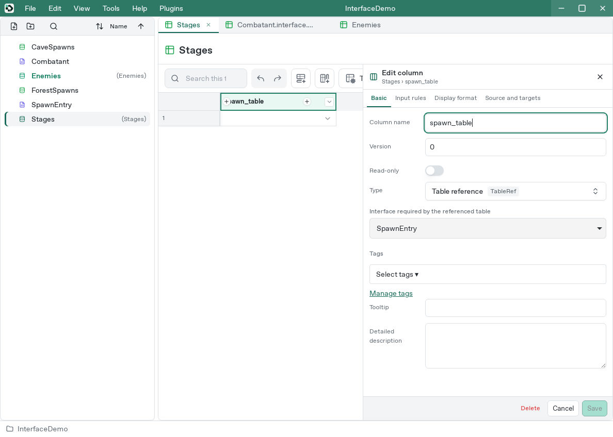

5. Open the cell's arrow and select a candidate table.

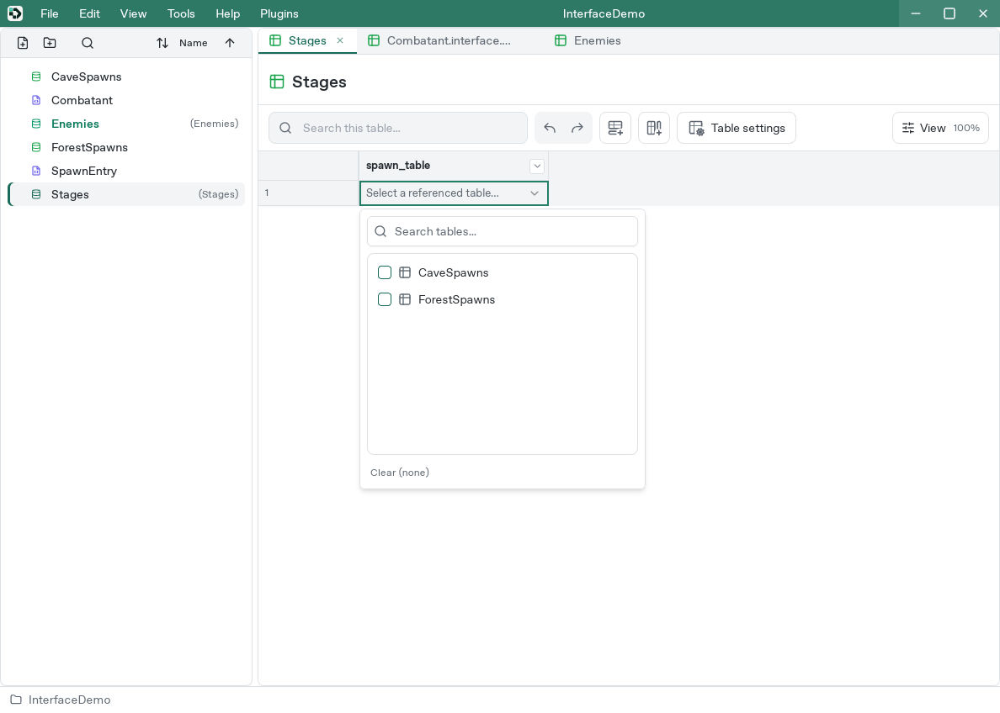

Candidates implement the required interface. The displayed table name corresponds to a stored table UUID. Click its name to open the table.

## Select: choices and enums

Select defines saved values and display labels, such as `fire`/Fire and `water`/Water. Existing Select columns can be edited in Studio. The new-column type picker currently omits Select, so create new ones through the [CLI](cli.md):

```sh
devcel --project ./SampleGame column add Items element Select
devcel --project ./SampleGame column select-config Items element '{"options":[{"value":"fire","label":"Fire"},{"value":"water","label":"Water"}]}'
```

In Studio's choices JSON field, enter the array inside `options`:

```json
[{"value":"fire","label":"Fire"},{"value":"water","label":"Water"}]
```

Each saved `value` must be nonempty and unique. Studio cells show a dropdown of option labels and store the selected value, such as `fire`. Enable an option input rule if you want validation against the choices. Generated code includes enum helper accessors for defined options.

DateTime and None exist in the data format but are also omitted from Studio's new-column picker.

## Model repeated or nested data

Represent repeated entries as rows in another table. For recipe ingredients:

- `Recipes`: one row per recipe
- `RecipeMaterials`: a recipe Reference, a material Reference, and an integer quantity

A recipe with three ingredients has three `RecipeMaterials` rows. The game gathers the matching rows. For designs that select an entire child table, use TableRef with an interface.

## Curve: edit a growth curve

Curves describe a Y value over X=0–1. A game can map a level or elapsed time to this range.

1. Add a Curve column named `growth`.
2. Set the column's endpoint values at X=0 and X=1, such as `0` and `100`, then choose **Add**.

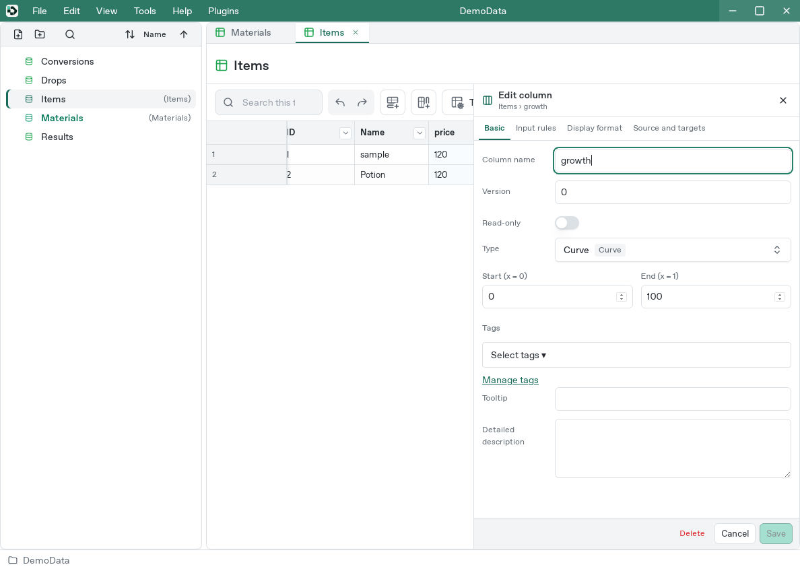

3. Open **Edit curve** from the cell's arrow.

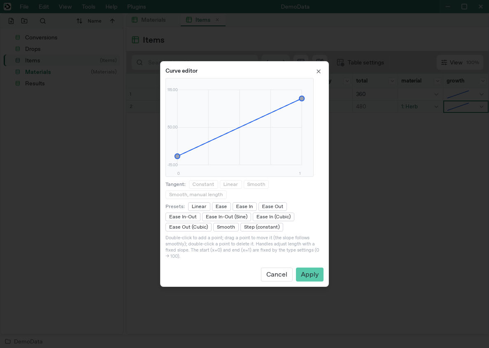

4. Select a preset or double-click empty graph space to add an intermediate point.
5. Drag the point and adjust its tangent mode or handle length as needed.

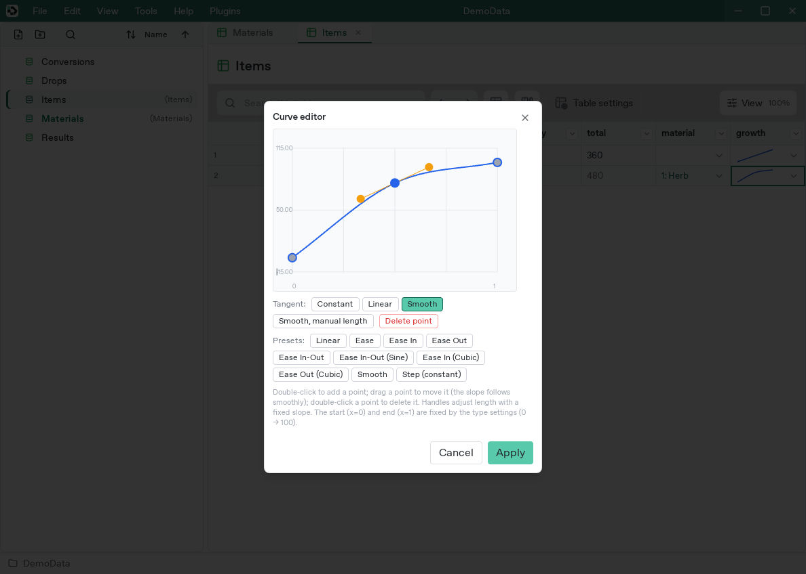

6. Choose **Apply** to save the cell.

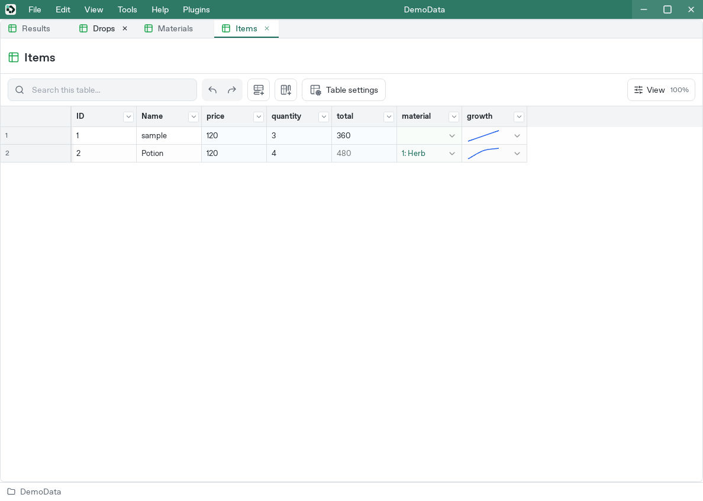

Endpoints are fixed by column settings. Delete intermediate points by double-clicking them or using **Delete point**.

If the editor reports an invalid curve, inspect the displayed curve before applying: **Apply** replaces the original input with the curve shown. **Cancel** preserves the original input.
