# Edit data in Studio

[Manual](README.md) / [Getting started](getting-started.md) / [Types and references](data-types.md) / [Versions](versions.md)

Hover over an icon-only button to see its name.

## Create, open, and save projects

### Create a project

Choose **File → Create new project**. [Your first project](getting-started.md#create-a-project) explains the location and name fields.

### Open a project

Choose **File → Open project** and select its `.devcelproj.toml` file. Select a table in the left file browser to open it in a tab.

### Save changes

Confirmed cell, row, and column operations are saved automatically. New columns use **Add**. Existing column settings require **Save**; **Cancel**, ×, and closing the editor discard their draft. Valid table and project settings apply when you close their settings, including × or clicking outside a dialog. To save manually, choose **File → Save project**. A **Saved** notification appears at the bottom right for a few seconds.

If saving fails, read the error and retry. A **Saving** indicator or remaining error means completion is still pending. Keep the input until a retry succeeds. Rejected or invalid settings remain open with their draft and error. New-column creation keeps its separate Add/Cancel flow.

## Grid keyboard shortcuts

With a data cell selected, Ctrl+A selects all displayed data cells in the finite table, including cells outside the viewport. Filtered-out records are excluded. Ctrl+Space selects a displayed column; Shift+Space selects a displayed row. Selection follows the transposed view.

Ctrl+Arrow moves to the edge of a contiguous data region, or across a blank region to the next populated cell. Ctrl+Shift+Arrow extends selection. Home moves to the first data cell in the row; Ctrl+Home moves to the first data cell in the table, excluding row labels and headers.

Enter and Shift+Enter move down and up. F2 starts editing. In a simple cell editor, Enter or Shift+Enter commits and moves down or up; Escape discards the draft. Alt+Enter inserts a newline in text cells. Tab and Shift+Tab retain navigation. Search, text inputs, dialogs, and composition input retain their own text-selection keys. Compound editors retain their specific controls.

Copy, cut, paste, undo, and redo retain their existing commands. Devcel does not emulate an infinite Excel worksheet or Excel's End-key navigation mode.

## Find your way around

- **Left: file browser.** Tables, interfaces, documents, and folders.
- **Center: tabs and grid.** Switch files and use search, undo, row/column controls, table settings, and view settings.
- **Right: properties and column settings.** Inspect the selected file or edit a column.

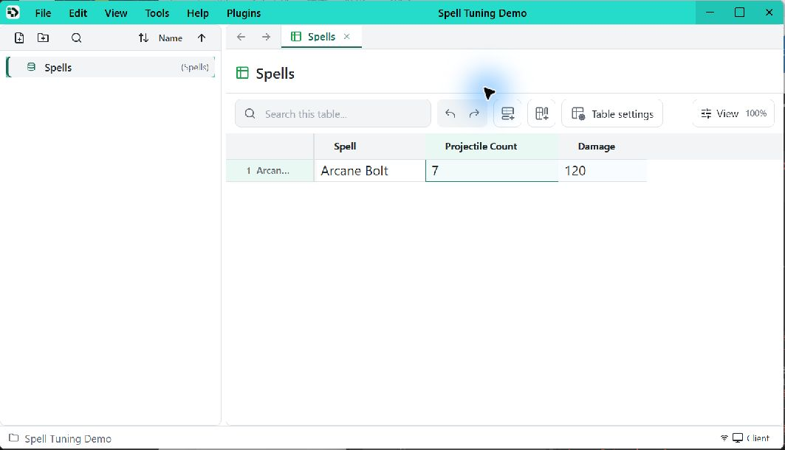

**Add row** and **Add column** sit beside Undo and Redo. **Table settings** opens table options and **Interfaces**.

The top **View** menu shows the file browser and properties panel. The table's **View** control changes zoom, version editing, and transposed display. Zoom ranges from 10% to 200%. Use the properties panel’s × button to hide it without changing the selected file.

Use **Back** and **Forward** beside the tabs, or Alt+Left and Alt+Right outside an editor, to revisit files that successfully opened. A new navigation after Back replaces the forward path. Canceled or failed navigation keeps the current file and history position.

Column headers include an edit pencil and **+** insertion controls at their boundaries. Select cells open a dropdown of the column’s configured choices; the displayed label does not change the stored choice value.

Transposing places field names vertically and each record horizontally. The focused cell keeps its record and field identity; a multi-cell rectangle becomes a single focused cell. The addition icons follow the displayed row and column directions:

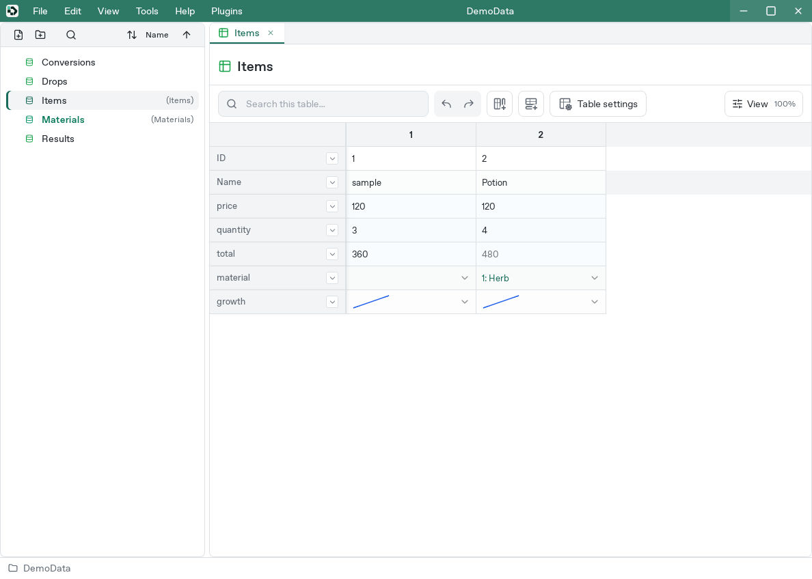

## Create a table

1. Select a destination folder in the file browser. Click empty space to use the root data folder, `Tables`.
2. Choose **Add file**.
3. Select **Table**, enter a name such as `Items` using ASCII letters, digits, and underscores, then create it. Omit the extension.

A new Studio table contains String columns `ID` and `Name`, with a sample row containing `1` and `sample`. `ID` is a regular data column. References use the row's separate internal UUID.

## Organize files, folders, and tabs

**Add file** also creates interfaces and Markdown documents. Open each type's **?** help for an explanation. Documents can hold usage instructions or production notes. **Add folder** creates a folder in the selected location. Use names such as `notes` or `Characters` with ASCII letters, digits, and underscores.

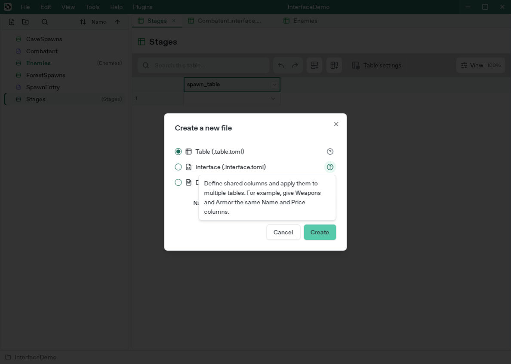

| Action | How it works |
| --- | --- |
| Move | Drag an item onto a folder, or onto empty list space to return it to Tables root |
| Duplicate | Right-click → Duplicate; copies receive another name at the same level, including folder contents |
| Rename | Right-click → Rename; folder/document names use ASCII letters, digits, and underscores |
| Delete | Right-click → Delete; deleting a folder also deletes its contents |
| Close tab | Click the tab's ×; the file remains |

Renaming an existing table file can use Unicode and spaces. File renaming preserves its display name, data name, and UUID. Use **Rename display name** to change the name shown for the table.

Confirm and save edits before duplicating. Copied tables and rows receive new UUIDs; references within the copied group are remapped to the copies, while references outside it keep their original targets.

File and folder deletion is permanent within Studio: grid undo cannot restore it, and files are not moved to the operating system's Trash. Back up important data and check the selected scope.

### Saving before closing a tab

Documents save automatically while editing and with Ctrl/Cmd+S. Switching or closing a tab flushes pending saves; a failure keeps you in place and displays a retry option.

A recovered interrupted column edit remains unsaved. Use **Add** for a new column or **Save** for an existing column to keep wanted changes. Explicitly closing or cancelling existing-column settings discards the draft.

## Add and configure columns

1. Choose **Add column** above the table.
2. Enter a name such as `price` in the right panel.
3. Open the type selector and choose a type, such as Integer I32 for prices or String for names.
4. Set an optional default and description, then choose **Add**.

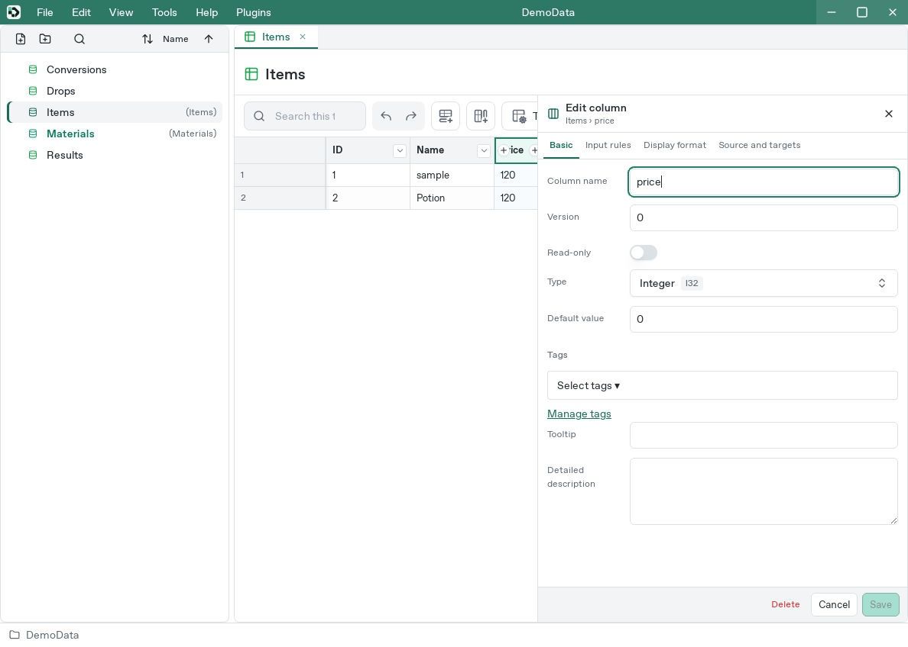

A default supplies the value when a cell has no nonempty local or inherited input. Set it to `100` to give those cells the value 100. Changing the default later updates cells that use it. A cell can also inherit from a parent row or keep its own value; see [Parent records and cell modes](metadata-and-inheritance.md).

Double-click an existing column header to edit it.

| Settings tab | Controls |
| --- | --- |
| Basic | Name, version, type, default, tooltip, description, read-only |
| Input rules | Required, unique, ranges, and other checks |
| Display format | Conditional formatting and column colors |
| Source and targets | Interface ownership and its definition |

Right-clicking a header opens display-format settings. Delete a column with **Delete** at the bottom of its settings. Change the structure of an interface-owned column at its definition.

For an existing column's type change, the first **Save** previews conversion results. Review errors and changed-value examples, then choose **Save** again. See [Type conversion](data-types.md#change-an-existing-columns-type).

Right-click the **Add row** button and choose **Add rows** to add several rows at once. With the button focused, use the Menu key or Shift+F10 to open the same menu. Left-click still adds one row.

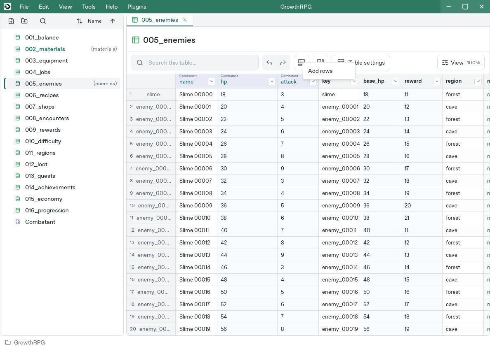

## Set the initial view and allowed edits

Open **Table settings** and close it to apply valid changes. Orientation changes apply immediately. Open **Interfaces** within this dialog to apply or manage shared definitions; settings changes apply before opening Interfaces; closing Interfaces returns to refreshed settings:

- **Initial view:** normal or transposed when reopening the table. A temporary view toggle leaves this default unchanged.
- **Allowed actions:** independently permit adding/deleting columns, adding/deleting rows, and editing rows/cells.

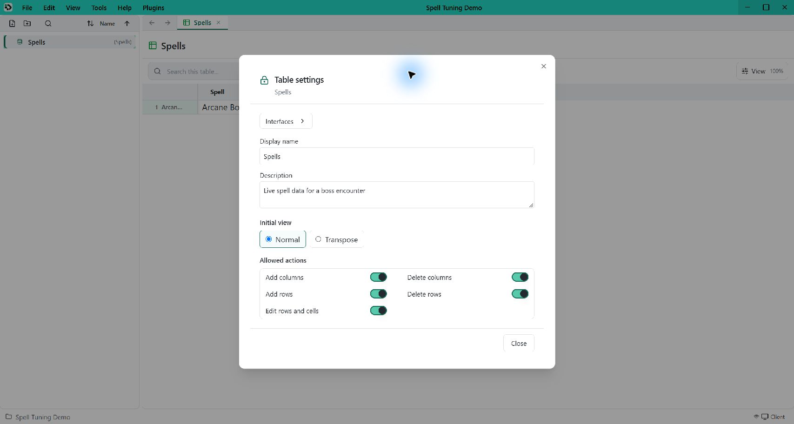

Turning off row/cell editing blocks cell input, paste, cut, clearing, row labels, versions, tags, and notes. Reading and copying remain available, as do column-default/formula settings and recalculation. Existing inputs remain intact. Row/column creation and deletion use their separate permissions. Deleting a table or folder requires both row-deletion and column-deletion permission for its contained tables.

### Make one column read-only

1. Double-click the column header and open **Basic**.
2. Turn on **Read-only**, then choose **Save**.

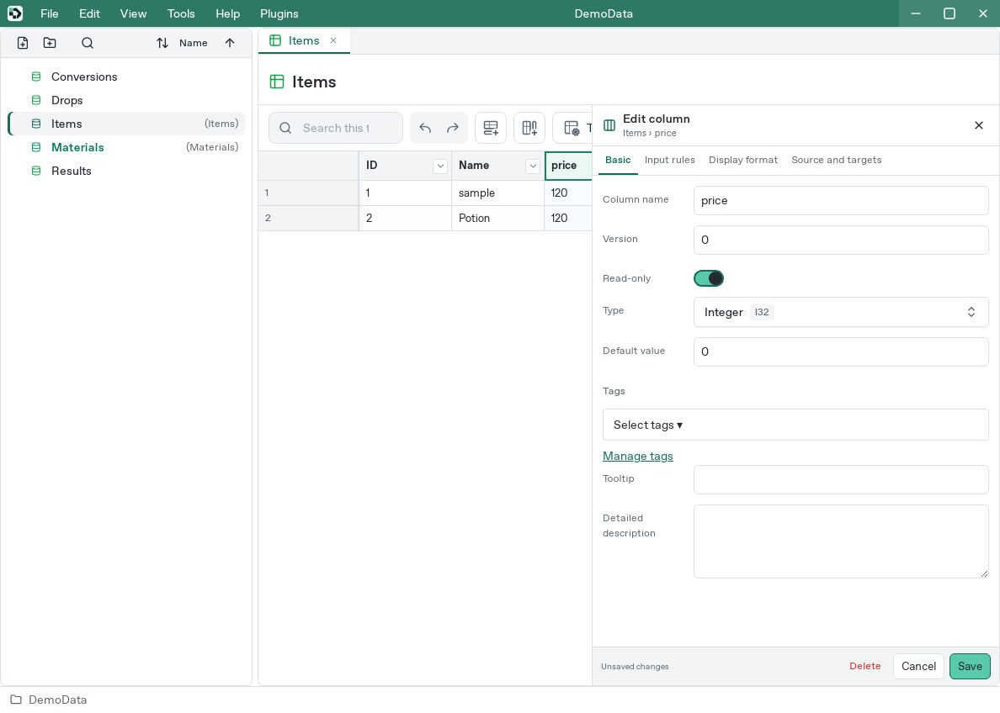

This blocks direct values, individual cell formulas, paste, cut, and clearing in that column, even when the table otherwise allows editing. Turn it off and choose **Save** to restore editing. Interface-owned columns can have table-local read-only settings, which survive interface synchronization.

Editing restrictions persist and apply in Studio, the CLI, and plugins. Undo respects current value-editing restrictions, while changes to the protection settings themselves can be undone.

## Add and edit rows

- **Add row** appends one row.
- **Add rows**, in the Add row button’s context menu, accepts an integer from 1 to 10,000. One undo reverses the entire batch.
- Right-click a row header and choose **Insert row above/below**, or use the small + between rows.
- Double-click a row header to edit its label. The UUID remains the same.
- Right-click → **Delete row** removes the row when no surviving row references it or inherits from it. Select all related rows to delete them together. The Delete key on a cell clears only its input.

New rows use column defaults. A row can be added even when its initial values violate required or unique rules; marked cells show what needs correction.

## Enter and select cells

1. Click a cell or move with arrow keys.
2. Double-click or press F2 to edit.
3. Enter the value, press Enter to confirm, or Esc to cancel.

Alt+Enter inserts a line break in a text cell editor. Enter and Shift+Enter commit and move down or up. Boolean cells use checkboxes. References and curves open dedicated editors from the arrow on the cell's right. Formulas begin with `=`; see [Formulas](formulas.md).

Drag to select a rectangular range, or extend a selection with Shift+click or Shift+arrow. When an input is open, text selection and copying operate within that input.

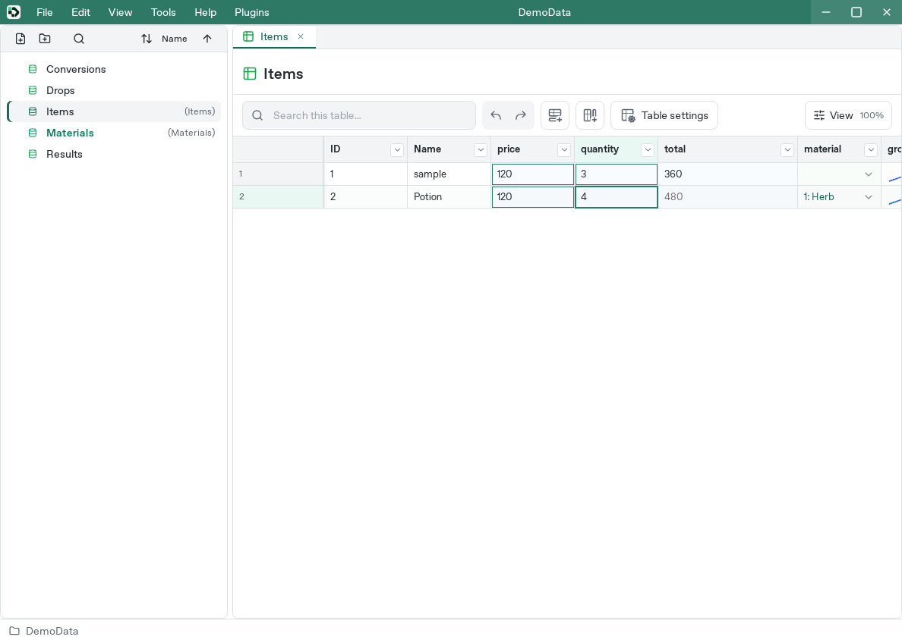

### Edit long or multiline text

The grid displays the first line and a `↵` marker for additional lines, keeping row height stable.

1. Select a String cell and choose **Expand** at its right edge, or press Ctrl/Cmd+Shift+Enter.
2. Edit in the larger text area. Enter creates a line break; Ctrl/Cmd+Enter saves and closes.
3. Toggle line wrapping with the control at the top.

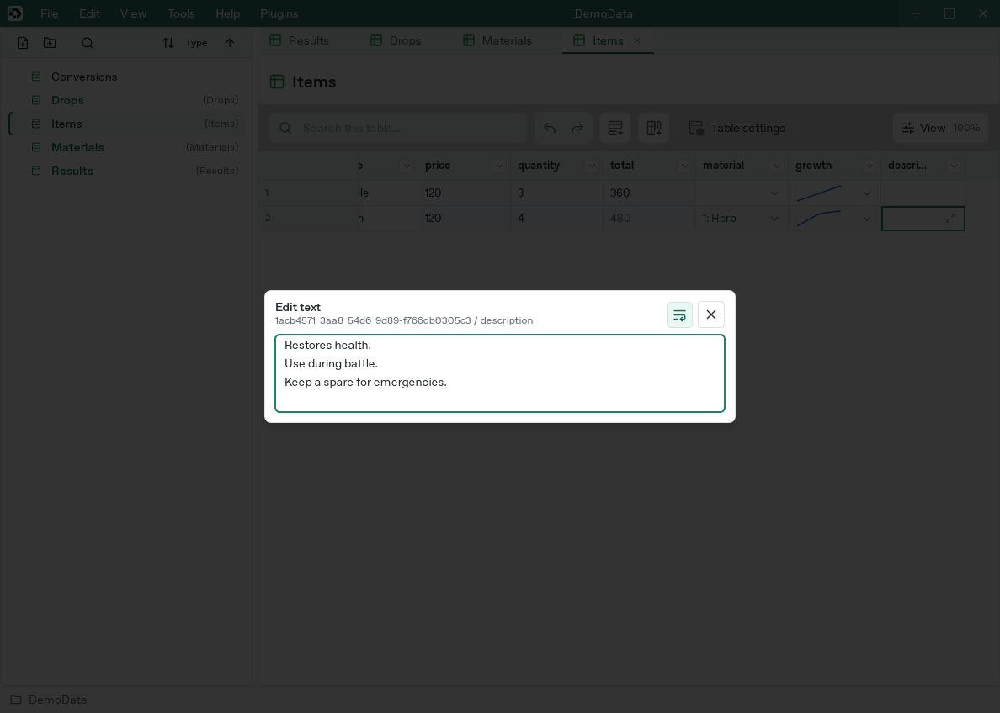

Esc or × with unsaved changes offers **Save**, **Discard and close**, or **Cancel**. Ctrl/Cmd+Z inside the editor undoes text edits; after saving, table undo reverses the whole cell change.

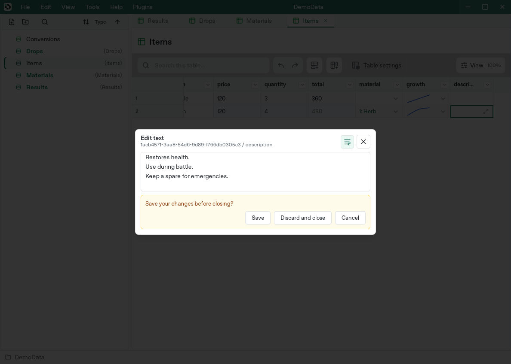

If another operation updates the table during editing, Studio prevents the older text from overwriting newer data. Copy any text you need, close, and reopen the cell. A leading `=` still marks a formula.

### Copy, cut, and paste

Use Cmd instead of Ctrl on macOS.

| Shortcut | Result |
| --- | --- |
| Ctrl+C | Copy the input currently used by each cell, including parent/default formulas |
| Ctrl+X | Copy the current inputs, preserving formulas, then clear the source cells |
| Ctrl+V | Paste tab/newline-separated values starting at the selection's top-left cell |
| Delete / Backspace | Clear selected inputs; keep rows and columns |
| F2 → Ctrl+C → Esc | Copy the input shown in the cell editor without cutting it |

Clearing restores inheritance from the parent row, or the column default if there is no parent. Empty input uses that fallback; it does not establish a separate explicit-empty mode. For a String cell that must evaluate to empty text, use the formula `=""`. To copy a displayed calculation result as a fixed value, right-click the cell and choose **Copy values**. Pasting one copied empty cell does not clear the destination.

Create enough rows and columns before pasting. An out-of-bounds paste fails rather than expanding the table. Invalid values reject the whole operation; warning rules let you confirm whether to continue.

Grid copy/cut uses quoted TSV, preserving tabs and line breaks within a single cell. To paste a paragraph directly into one cell, open its text editor first. Grid paste treats tabs and row separators as cell boundaries.

Text starting with a quote is interpreted as TSV quoting. Paste into the cell editor when literal leading quotes are intended. Malformed quoting or inconsistent field counts rejects the whole paste.

### Undo and redo

With the grid focused, use Ctrl+Z for undo and Ctrl+Shift+Z or Ctrl+Y for redo. The toolbar and **Edit** menu provide the same actions. An active input handles text undo first. Editing histories are per table. File/folder deletion is outside grid undo.

## Search, filter, and arrange the view

Type in the table search field to show matching rows; × clears it. Editing, copying, and pasting during search operate on visible rows.

- Drag column names to reorder columns, including interface and local columns together.
- Drag a header boundary to resize a column or row.
- In the file browser, choose name/type/updated sorting and use the adjacent direction arrow.

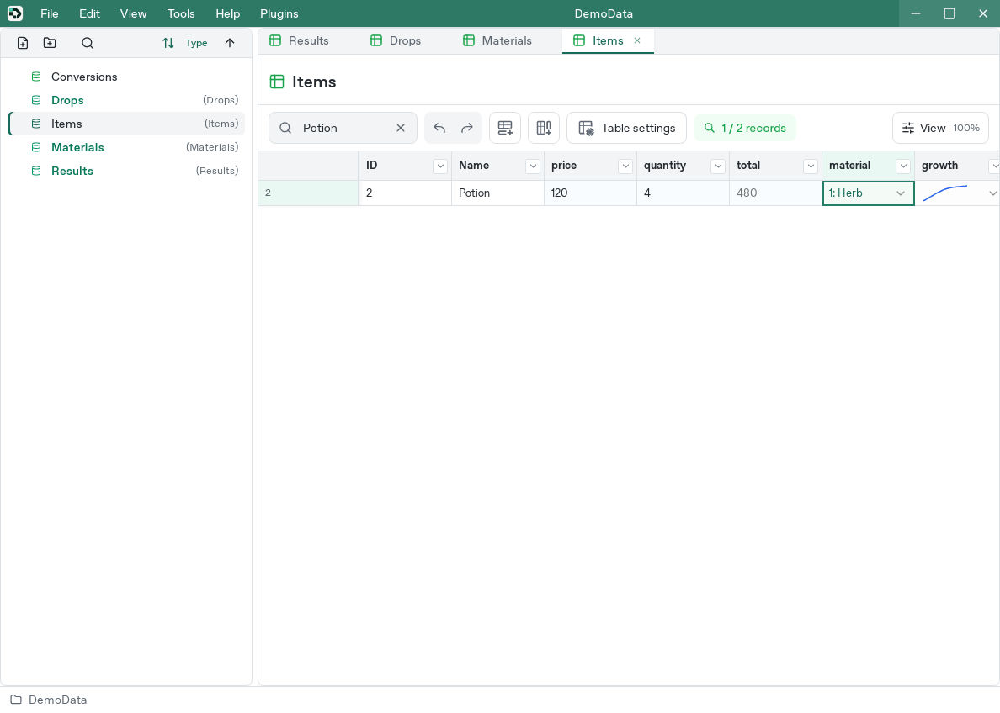

### Filter by column values

Open a column header's arrow, check the values to show, and choose **Apply**. Search within the candidate values when needed.

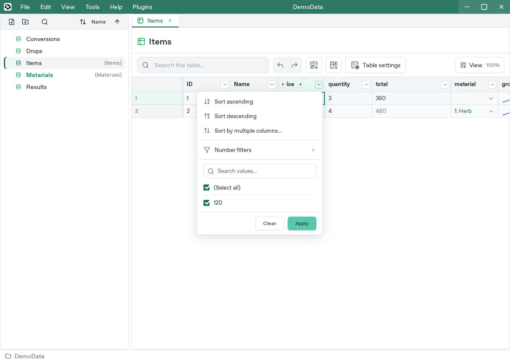

For a numeric range, open **Number filters**, choose a condition, enter its value, and apply. **Custom filter…** combines conditions.

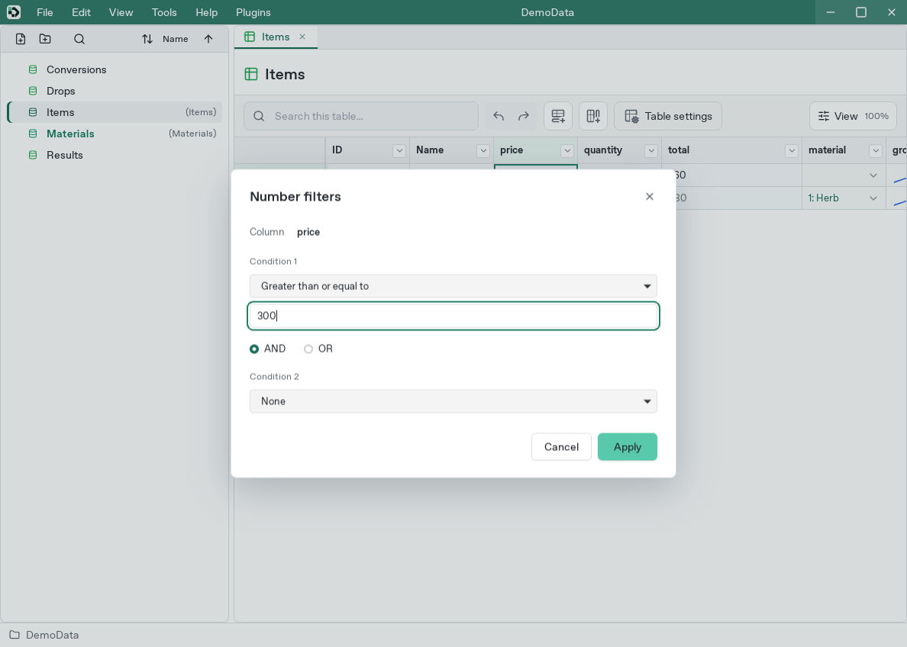

### Sort rows

Choose **Sort ascending** or **Sort descending** from a column header's arrow. For several sort keys, open **Sort by multiple columns…**, choose the first key, add further levels with **Add level**, reorder priorities with the arrows, and apply.

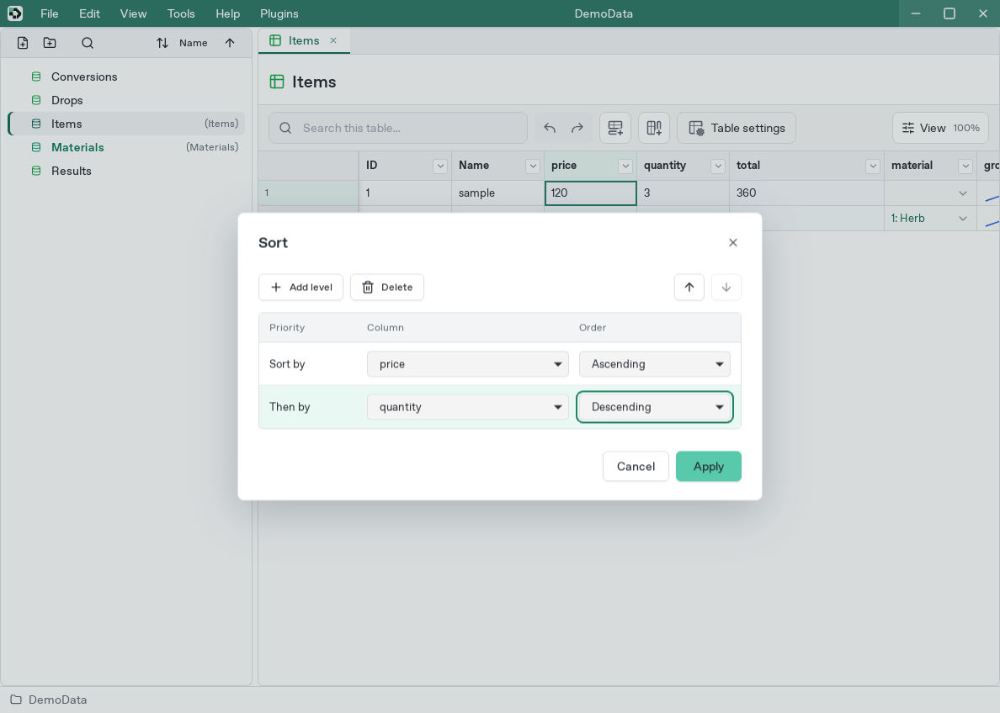

**Clear all sorting and filters** resets the view. Sorting and filtering preserve cell values and stored row order.

## Find input mistakes

To restrict `price` to 0–1000:

1. Double-click `price` and open **Input rules**.
2. Enable rules and add a number-range rule.
3. Set inclusive minimum `0` and maximum `1000`, then **Apply**.
4. Open **Input behavior** and choose **Reject input** or **Warn and allow**. This is also where input hints and error/warning messages are configured.
5. Choose **Save** in column settings to apply them.
6. Try `-1` or `1001`; the configured rejection or warning appears.

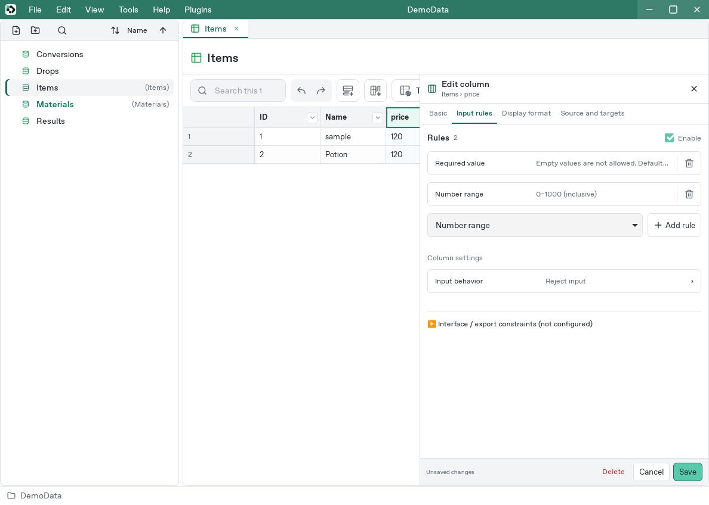

Rule cards summarize current settings. Open an existing card to edit its range or pattern, then close it to apply the draft to column settings. New-rule dialogs retain Apply/Cancel. Finally choose **Save** in the existing column settings; invalid values keep the draft open.

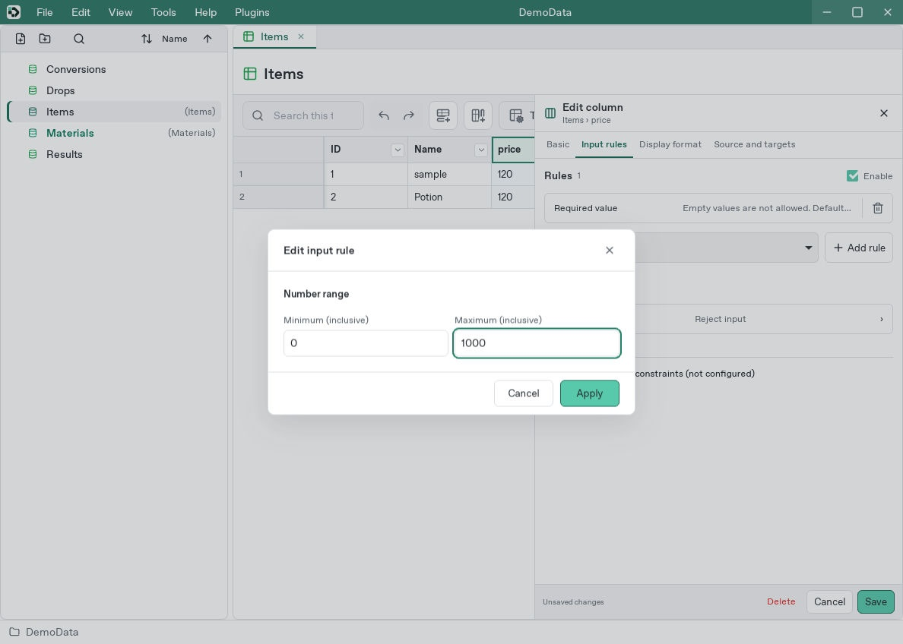

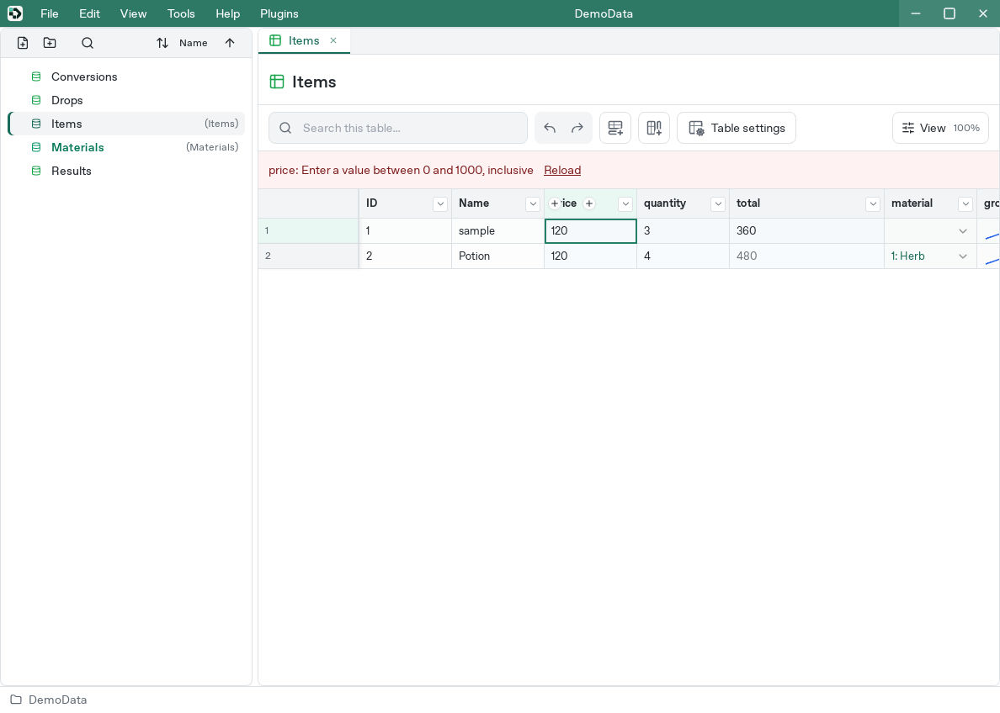

Required, unique, regular-expression, and existing Select-option rules are also available. Regular expressions match substrings; use anchors such as `^[A-Z]+$` to validate an entire string. Defaults and formula results participate in validation.

Existing invalid values remain available for correction. Look for underlines and hover explanations. Cancelling or closing a warning prompt leaves the attempted change unsaved.

Conditional formatting under **Display format** changes appearance based on equality, numeric ranges, top/bottom ranks, or two-color scales. Rules have top-to-bottom priority. Rankings and color scales use the whole table, including rows hidden by search.

Open a rule card to edit conditions, background, and text colors; close the existing rule editor, then choose **Save** in column settings. New-rule dialogs retain Apply/Cancel. Card controls enable/disable, reorder, or delete rules. **Formatting settings** controls column-wide formatting and inheritance/overrides.

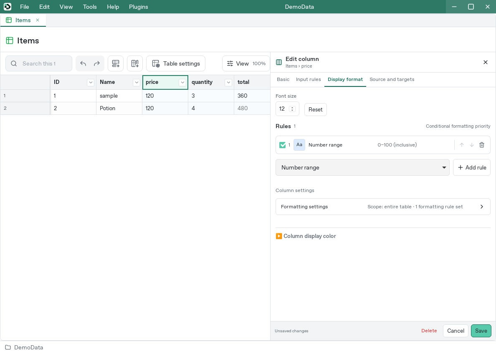

See [input-rule and formatting details](../reference/input-rules.md) for whitespace, uniqueness, ties, defaults, and interface overrides.

## Export CSV and bring in spreadsheet values

### Export CSV

1. Select the table's tab.
2. Choose **Plugins → CSV Exporter → Export CSV (Basic)**.
3. Choose a destination and filename.

Use **Export CSV (Advanced)** for delimiters and headers. If the menu is missing, enable CSV Exporter in **Tools → Plugin Manager**.

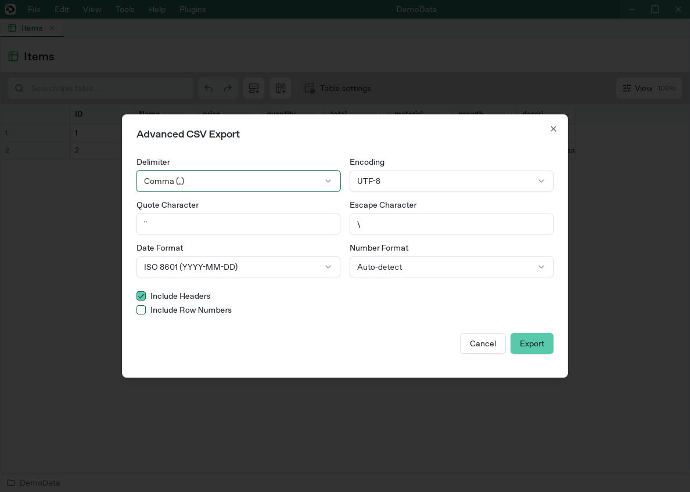

CSV uses UTF-8 and includes the full open table. Screen search and version preview do not filter it. It exports the inputs the cells are using, resolving parent inheritance and column defaults. Formulas remain formula strings, including inherited formulas. To copy a displayed calculation result as a fixed value, right-click that cell and choose **Copy values**.

For game-ready JSON or generated code, use [Godot](godot.md), [Unity](../../../../INSTALL.md), or the [CLI](cli.md).

### Paste from a spreadsheet

Open the CSV in a spreadsheet application, copy the desired cells, and paste into existing Devcel rows and columns. Prepare column names, types, and reference settings in Devcel first.

## Continue reading

- [Types and references](data-types.md)
- [Shared interface columns](interfaces.md)
- [Versioned output](versions.md)
- [Troubleshooting](troubleshooting.md)

### Display names and variable names

**Display name** is the label shown in Studio. **Variable name** is the internal identifier used by generated code. They are separate inputs, in that order; changing the display name does not rename the variable. Choose **Save** to commit an existing field edit, or close with **X** to discard it.

### Number range display

In column **Display format**, **Number range** draws a horizontal bar using the specified minimum and maximum. Choose the minimum color, maximum color, and a separate out-of-range color (red by default). The bar grows from the left in left-to-right languages and from the right in right-to-left languages. Its fill is softened behind the text; an unsafe text color is replaced by a readable foreground.

The endpoints are included. Values below or above them fill the entire cell with the out-of-range color, so a below-minimum value remains visible. If minimum and maximum are equal, that exact value receives a full bar in the maximum color; other numeric values use the out-of-range color. Empty, invalid, non-finite, and formula-error values have no range bar. A minimum greater than the maximum is rejected.

The first matching background treatment has priority, and **Stop if true** still stops later rules. This is presentation only: stored numbers and exported values do not change. **Color scale** remains a separate feature based on the column population; input-validation ranges remain validation rules.
