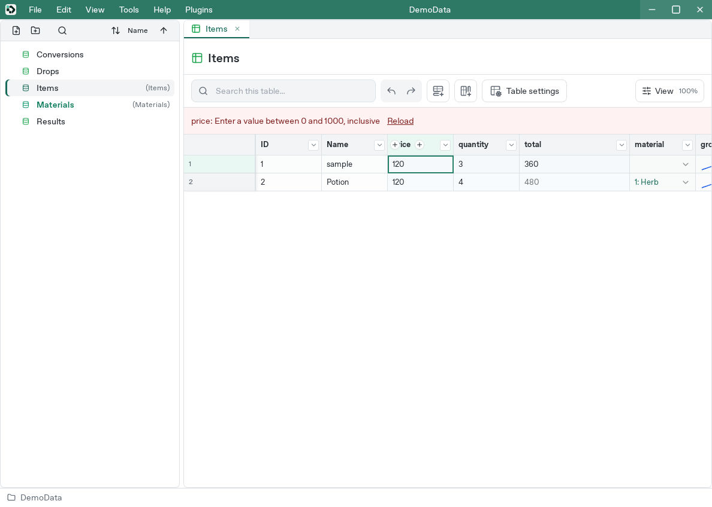

# Troubleshooting

[Manual](README.md)

## Cannot create a project

- Names begin with an ASCII letter or underscore and contain letters, digits, and underscores. A description is required to continue.
- Choose a parent folder; Studio creates a project-named folder beneath it.
- If a manifest already exists there, use Open project or choose another location.
- Resolve write-permission or disk-space errors, then retry and check the success notification.

## Cannot open a project or find tables

Keep the manifest and Tables folder in the same project. Read errors for missing fields, type problems, UUID inconsistencies, or invalid history. Copy the whole project before manual repairs.

### Inspect the format and CLI result

For externally edited TOML, validate syntax and required types against the [authoring API and stored types](../reference/authoring-api.md).

If a directory does not identify one project, specify the manifest directly:

```sh
devcel --project "/path/to/DemoData/DemoData.devcelproj.toml" info
devcel --project "/path/to/DemoData/DemoData.devcelproj.toml" table list
```

If the CLI loads the project but an OS file dialog remains open, investigate the dialog separately. See [Linux development constraints](../development/linux.md) for managed GTK environments.

## Cannot save column settings

- In Review changes, inspect failed conversions or rule violations by table, row, and column.
- Change interface-owned structure in its definition, then synchronize affected tables.
- If the definition changed elsewhere, preserve your intended edits and reload the latest definition before retrying.
- After switching projects, reopen column settings in the intended project.

See [Column editing](studio.md#add-and-configure-columns) and [Interfaces](interfaces.md).

## A value reverts or shows a red error



Read the message above the table for the column and cause. Enter a valid value or revise the column's input rule if the rule itself needs changing. Warn-and-allow rules offer a confirmation before proceeding. See [Input rules](studio.md#find-input-mistakes).

## A formula gives an unexpected result

- Use a unique data name such as price for a clear column reference.
- A cell's own input overrides a changed column default.
- Check table/column identifiers, duplicate keys, and eligible rows in the selected export version.
- Break complex expressions into smaller parts to find cycles or type mismatches.

See [Formulas](formulas.md) and the [Function reference](formula-reference.md).

## CSV differs from the displayed values

Grid copy and CSV export use the inputs the cells are using, including inherited parent inputs and column defaults. Formulas remain formula strings. Right-click a cell and choose **Copy values** to copy its displayed result, or use [runtime export](cli.md#export) for evaluated table data. CSV includes the full table regardless of search or version preview.

Open CSV as UTF-8 in a spreadsheet application if text appears garbled. See [CSV export](studio.md#export-csv).

## Rows or columns are missing from output

Compare the Studio preview with saved importer settings and CLI --version. Rows and columns are eligible when their minimum version is at most the target. Generated code for that target omits excluded column properties.

For interface changes, inspect the table's synchronization status and sync pending definitions. See [Versions](versions.md).

## Validation stops export

Export validates every output table, including tables outside the current tab. Correct required-field, duplicate, range, pattern, interface, and formula errors at the identified rows.

Also check referenced rows for deletion or exclusion by the selected version. Successful generation alone does not establish that every game lookup will find a target.

Use --allow-invalid only when you have reviewed and intentionally accept the reported constraint violations. It does not suppress arbitrary load/export failures or make unevaluable formulas valid. After an error, distinguish retained old output from a newly successful export.

See [CLI export](cli.md#export).

## Changes do not reach the game

Confirm the cell and wait for Studio saving to finish, then inspect the engine's import settings and result:

- [Godot troubleshooting](godot.md#10-troubleshoot-import)
- [Unity troubleshooting](../../../../INSTALL.md#10-troubleshoot-import)

Imported means that import succeeded; Up to date means source/configuration/output hashes match. Check game logs or a sample to confirm the game loaded the intended output.

## CLI failures

Use the command's --help to check argument placement. Client mode requires a live server; decide whether you need saved-file access or connected editing state. Use UUIDs when names are ambiguous. Stop connected editors before intentional local writes.

## A plugin will not activate

Check compatible app/API versions, dependencies, approval, and Enabled state. Installing alone leaves the package inactive. Changed package contents need new approval. After a timeout, refresh the list and inspect the main window before retrying.

See [Plugin setup and recovery](settings-and-plugins.md).

## Report an issue

Preserve a copy of the project. Record the version from **Help → About Devcel Studio**, OS/CPU, steps, exact error, column type, content version, and synchronization mode. Share a minimal reproduction with confidential data removed.
